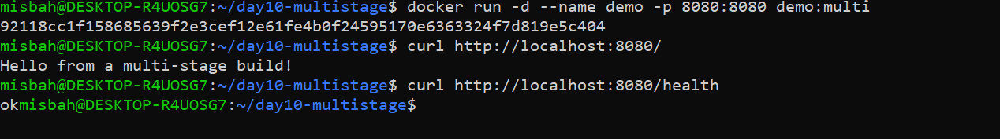
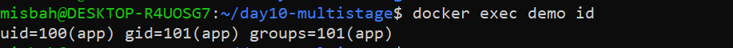
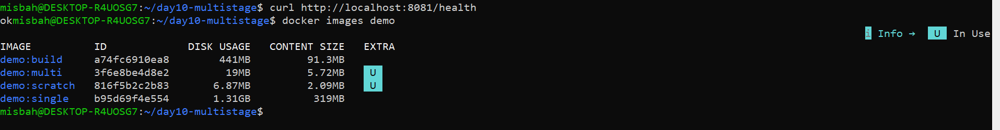

# Day 10: Multi-Stage Docker Builds & Non-Root Execution

## 📌 Executive Summary
In this project, we refactored a production Go HTTP microservice from a bloated single-stage container into an ultra-lean, secure multi-stage Docker image. We implemented non-root least-privilege security and evaluated an ultra-minimal `scratch` runtime.

---

## 🛠️ What We Did Today (Detailed Task Breakdown)
1. **Single-Stage Build (`Dockerfile.single`):**
   - Packaged the entire Go toolchain, compilers, and source code into the final container.
   - Resulted in an oversized image (**1.31 GB**).
2. **Multi-Stage Build (`Dockerfile`):**
   - **Stage 1 (Builder):** Compiled the static binary using `golang:1.22-alpine` with `CGO_ENABLED=0` and stripped debug symbols (`-ldflags="-s -w"`).
   - **Stage 2 (Runtime):** Copied only the compiled binary into a lightweight `alpine:3.20` image.
3. **Least Privilege Security:**
   - Created a dedicated system user/group (`app`).
   - Switched execution using `USER app` to prevent running as `root` (`uid=0`).
4. **Endpoint Validation:**
   - Deployed the container on port `8080` and verified `/` and `/health` endpoints.
5. **Builder Target Verification:**
   - Verified that the intermediate builder stage builds independently using `docker build --target builder`.
6. **Scratch Image Experiment (Bonus):**
   - Created a standalone static binary image on `scratch` without any OS or shell overhead (**6.87 MB**).

---

## 📊 Measured Image Sizes & Reduction Analysis

| Image Variant | Base Image | Disk Usage | Content Size | Purpose |
| :--- | :--- | :--- | :--- | :--- |
| **`demo:single`** | `golang:1.22` | **1.31 GB** | 319 MB | Single stage (Build tools & cache included) |
| **`demo:build`** | `golang:1.22-alpine` | **441 MB** | 91.3 MB | Builder stage artifact |
| **`demo:multi`** | `alpine:3.20` | **19 MB** | 5.72 MB | Production runtime (Non-root `app` user) |
| **`demo:scratch`** | `scratch` | **6.87 MB** | 2.09 MB | Ultra-minimal static Go runtime |

### 📐 Size Reduction Formula
$$\text{Reduction (\%)} = \frac{\text{Single-stage size} - \text{Multi-stage size}}{\text{Single-stage size}} \times 100$$

$$\text{Reduction (\%)} = \frac{1310\,\text{MB} - 19\,\text{MB}}{1310\,\text{MB}} \times 100 \approx \mathbf{98.5\%}$$

The multi-stage Alpine build achieved a **98.5% reduction** in image footprint compared to the single-stage build.

---

## 🔒 Security & Least Privilege Verification

1. **Root vs. Non-Root Execution:**
   - Single-stage images default to `root` (`uid=0`), which creates major security vulnerabilities if the application is compromised.
   - In `demo:multi`, we defined `USER app`.
   - Running `docker exec demo id` confirmed:
     ```text
     uid=100(app) gid=101(app) groups=101(app)
     ```
   - This strictly limits what an attacker can access inside the container or mounted host volumes.

2. **Attack Surface Reduction:**
   - Compilers (`go`), package managers (`apk`, `apt`), and build caches were eliminated from the runtime image, drastically reducing potential CVE vulnerabilities.

---

## ⚖️ Alpine vs. Scratch Trade-offs

- **Alpine (`alpine:3.20` - 19 MB):**
  - **Pros:** Includes a shell (`/bin/sh`) and package manager (`apk`) for easy debugging and maintenance.
  - **Best for:** Standard microservices where occasional container inspection is needed.
- **Scratch (`scratch` - 6.87 MB):**
  - **Pros:** Zero overhead, smallest possible size, absolute minimal attack surface.
  - **Cons:** No shell or standard utilities; standard `docker exec` commands do not work.
  - **Best for:** High-security, standalone static binaries in production environments.

---

## 📸 Verification & Screenshots

### 1. Image Sizes Comparison (Single vs. Multi vs. Scratch)


### 2. Application & Health Endpoints


### 3. Non-Root User Verification (`uid=100`)


### 4. Builder Stage Target Build


### 5. Scratch Image Bonus Check


---

## 🎯 Conclusion
All Day 10 requirements have been successfully completed:
- Functional HTTP service with verified health checks.
- Reproducible multi-stage Dockerfiles.
- 98.5% image size reduction benchmarked.
- Non-root user execution enforced.
