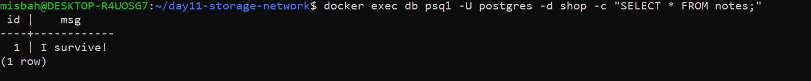
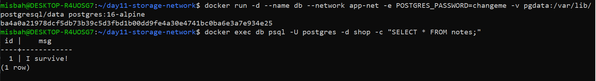
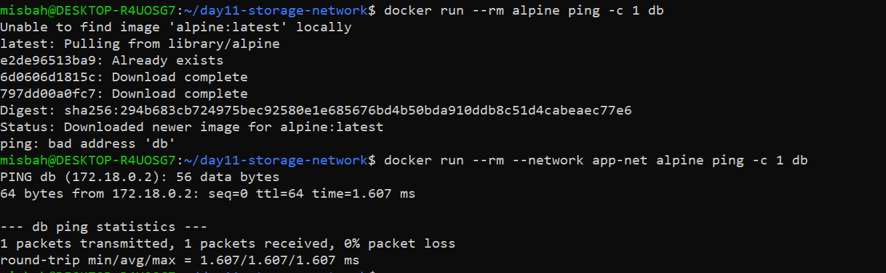
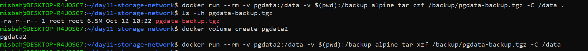
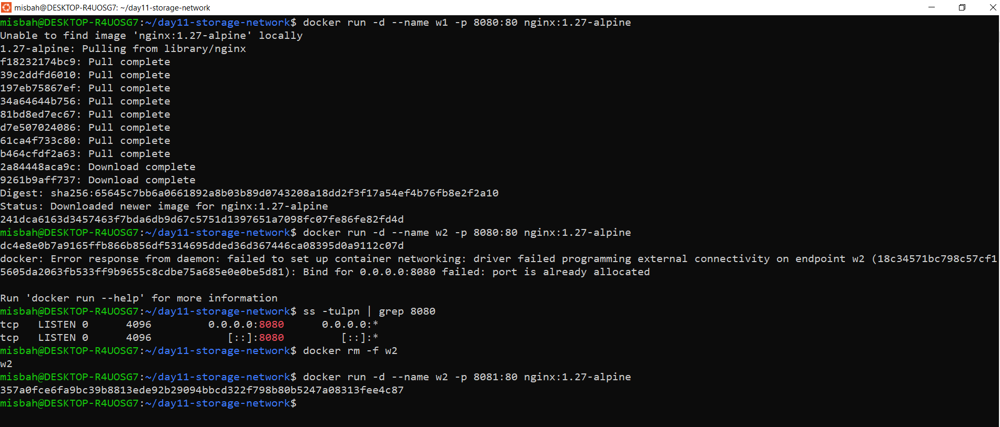

 # 🐳 Day 11 — Docker Storage & Networking

> **DevOps Winter Arc — 90 Days DevOps Challenge**  
> Course Practical: Day 4 — Docker Storage & Networking

## 🎯 Objective

The objective of this practical was to understand Docker storage, data persistence, container networking, DNS resolution, volume backup and restore, and port conflict resolution.

## 🛠️ Technologies Used

- Docker
- Docker Volumes
- Docker Networking
- PostgreSQL 16 Alpine
- Linux Commands
- GitHub

## 📚 Tasks Completed

### 1. Docker Volume and Data Persistence

- Created a named Docker volume called `pgdata`.
- Started a PostgreSQL 16 Alpine container.
- Stored database files in the named volume.
- Verified that database data persisted after removing and recreating the container.

**Volume:** `pgdata`  
**Container:** `db`

📸 Screenshot:



### 2. Data Persistence Verification

Docker volumes allow data to remain available even when a container is removed.

The database was recreated using the same named volume to verify data persistence.

📸 Screenshot:



### 3. Docker Networking and DNS Resolution

- Created a custom Docker bridge network named `app-net`.
- Connected containers to the custom network.
- Tested container-to-container communication.
- Used the hostname `db` to connect to the PostgreSQL container.
- Compared hostname resolution on the default bridge network and the custom bridge network.

**Network:** `app-net`  
**Database hostname:** `db`

📸 Screenshot:



### 4. Docker Volume Backup and Restore

Practiced backing up and restoring Docker volume data.

- Created a backup archive named `pgdata-backup.tgz`.
- Used a temporary container to access the volume data.
- Restored the backed-up data into another named volume called `pgdata2`.

**Original volume:** `pgdata`  
**Backup file:** `pgdata-backup.tgz`  
**Restore volume:** `pgdata2`

📸 Screenshot:



### 5. Docker Port Conflict Resolution

Practiced identifying and resolving a port conflict.

- Identified a conflict involving host port `8080`.
- Used an alternative host port, `8081`, to avoid the conflict.
- Verified the corrected port mapping.

📸 Screenshot:



## 🌐 Docker Network Diagram

```text
                 Custom Docker Network
                       app-net
                          |
             +------------+------------+
             |                         |
       +-----------+             +-----------+
       |    db     |             |  Client   |
       | PostgreSQL|<----------->| Container |
       |    :5432  |             |           |
       +-----------+             +-----------+
             |
        Named Volume
          pgdata
             |
      Persistent Database
             |
      Backup: pgdata-backup.tgz
             |
        Restore Volume
           pgdata2

📂 Project Structure
Day-11/
├── README.md
└── screenshots/
    ├── 01-db-data-before-delete.png
    ├── 02-db-data-persisted.png
    ├── 03-network-dns-proof.png
    ├── 04-volume-backup-restore.png
    └── 05-port-conflict-fix.png

✅ Conclusion

This practical strengthened my understanding of Docker storage and networking.

I gained hands-on experience with persistent storage, custom networks, DNS resolution, volume backup and restore, and port conflict troubleshooting.

Every day, I am improving my Linux and DevOps skills through practical implementation as part of my 90 Days DevOps Challenge.

Challenge: DevOps Winter Arc — 90 Days DevOps Challenge
Author: Misba Banu Jakati

#90DaysDevOpsChallenge #DevOps #Docker #Linux #CloudComputing #LearningByDoing
