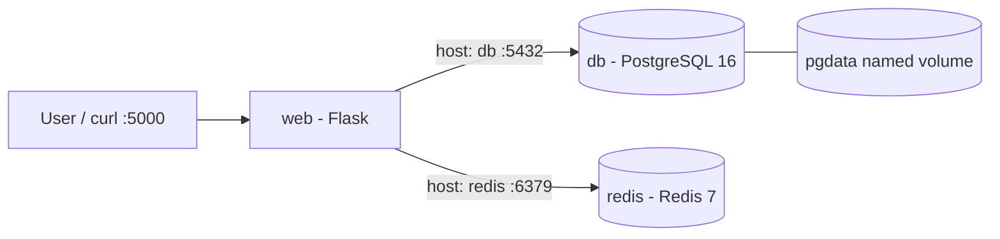
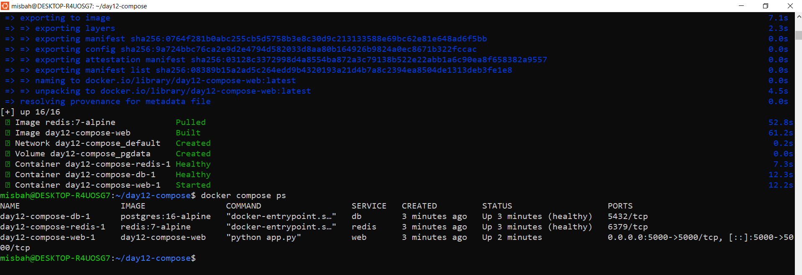
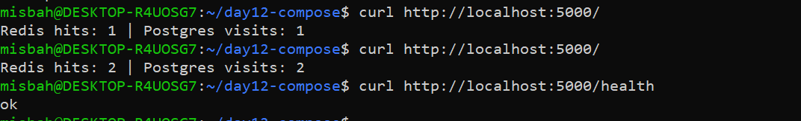
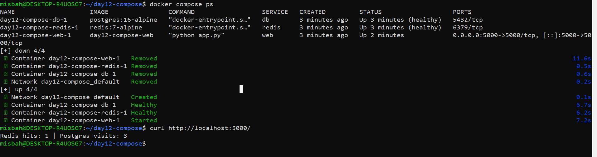
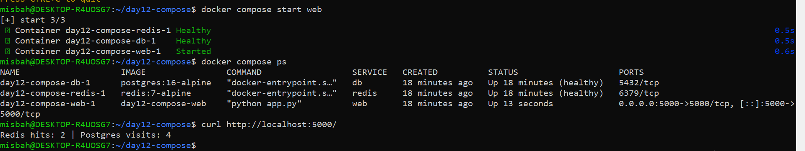

# Day 12 - Docker Compose: Flask + PostgreSQL + Redis

A multi-container application defined in a single `compose.yaml`. A Flask web service talks to PostgreSQL (persistent visits) and Redis (hit counter), with health checks, dependency readiness, a named volume, and an automatic restart policy.

## Architecture



| Service | Role |
|---------|------|
| `web` | Flask app. `/` increments the Redis counter and inserts a visit row in PostgreSQL. `/health` returns `ok`. |
| `db` | PostgreSQL 16. Data stored in the `pgdata` named volume. |
| `redis` | Redis 7. Used as a hit counter (no volume, so it can reset). |

## Project structure

```
Day-12/
├── compose.yaml
├── .env.example
├── .gitignore
├── README.md
├── app/
│   ├── app.py
│   ├── requirements.txt
│   └── Dockerfile
└── evidence/
    ├── 01-compose-status.png
    ├── 02-app-response.png
    ├── 03-persistence-test.png
    └── 04-restart-test.png
```

## Setup

```bash
git clone https://github.com/misbabanu64/90-Days-DevOps-Challenge.git
cd 90-Days-DevOps-Challenge/Day-12
cp .env.example .env
```

`.env` is git-ignored. Only `.env.example` is committed. Never commit real credentials.

## Run

```bash
docker compose config
docker compose up -d --build
docker compose ps
```

`db` and `redis` should become healthy and `web` should be running.

## Test

```bash
curl http://localhost:5000/
curl http://localhost:5000/
curl http://localhost:5000/health
docker compose logs --tail=50 web
```

Expected: both counters increase on every call and `/health` returns `ok`.





## Persistence test

```bash
docker compose down
docker compose up -d
curl http://localhost:5000/
```

The PostgreSQL visit count continues because data lives in the `pgdata` named volume. The Redis counter resets because Redis has no volume.



## Restart policy test

```bash
docker kill $(docker compose ps -q web)
docker compose ps
curl http://localhost:5000/
```

Compose restarts `web` automatically because of `restart: unless-stopped`.



## Observations

- `db` and `redis` became healthy before `web` started (`condition: service_healthy`).
- Redis hits and PostgreSQL visits both increased with repeated requests.
- After `down` and `up`, the PostgreSQL visit count continued, but the Redis counter reset.
- After `docker kill`, the `web` service restarted and `/` responded again.

## Troubleshooting

| Symptom | What to check |
|---------|---------------|
| YAML/config error | Run `docker compose config`; check indentation (spaces only) and service names |
| Connection refused | Check db/redis health, logs, and `service_healthy` dependencies |
| DB connection fails | Confirm `DB_HOST=db` and credentials in `.env`; never use `localhost` for another container |
| Postgres data disappears | Check `pgdata` is declared under top-level `volumes`; make sure `down -v` was not used |
| Redis counter resets | Expected without a Redis volume |
| Port 5000 already allocated | Use `docker ps` or `ss -lntp`; stop the conflicting service or change the host port |
| Code changes not visible | Run `docker compose up -d --build` |
| `.env` shows in `git status` | Check `.gitignore`; rotate any exposed credential |

## Stop / cleanup

```bash
docker compose down
docker compose down -v
```

`down` keeps the named volume. `down -v` also deletes the data, so use it carefully.

## Reflection

**What does each service do?** `web` serves the app, `db` stores visits permanently, `redis` stores a fast hit counter.

**How does web discover PostgreSQL and Redis?** Compose creates a project network with built-in DNS, so the app uses the service names `db` and `redis`.

**What proves the DB was ready before the app started?** `docker compose ps` showed `db` as healthy, and `web` uses `depends_on` with `condition: service_healthy`.

**Why did PostgreSQL data persist but Redis reset?** Postgres writes to the `pgdata` named volume, which survives `down`. Redis has no volume, so its data was lost with the container.

**What would I change for production?** Use a secrets manager instead of `.env`, add a Redis volume if needed, use gunicorn instead of the Flask dev server, add a dedicated network, resource limits, monitoring, and database backups.

## Interview Readiness

1. **What problem does Docker Compose solve?**
   It defines and runs multi-container applications declaratively (services, networks, volumes) and starts the stack with one command.
2. **Does `depends_on` guarantee database readiness?**
   No. By default it only controls start order. Use a health check with `condition: service_healthy`.
3. **Why use `db` instead of `localhost`?**
   Inside a container, `localhost` is that container itself. Docker's internal DNS resolves `db` to the database container.
4. **Named volume vs container writable layer?**
   A named volume is managed separately and survives container replacement. The writable layer is deleted with the container.
5. **What does a health check do?**
   It periodically tests a service and reports its health. `service_healthy` uses that for dependency readiness.
6. **What does `restart: unless-stopped` mean?**
   Docker restarts the service after failures and daemon restarts, unless it was explicitly stopped.
7. **Why not commit `.env`?**
   It can contain secrets. Commit `.env.example` and keep real values local.
8. **`down` vs `down -v`?**
   `down` removes containers and networks but keeps named volumes. `down -v` also deletes volumes and their data.
