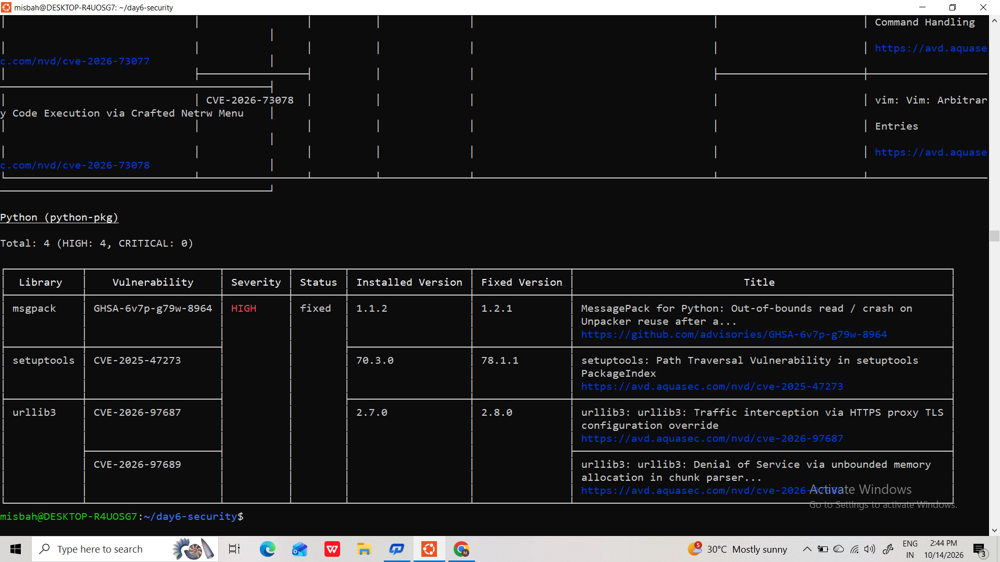
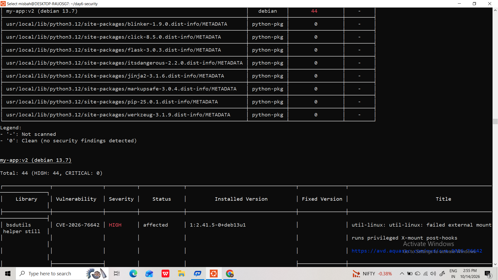
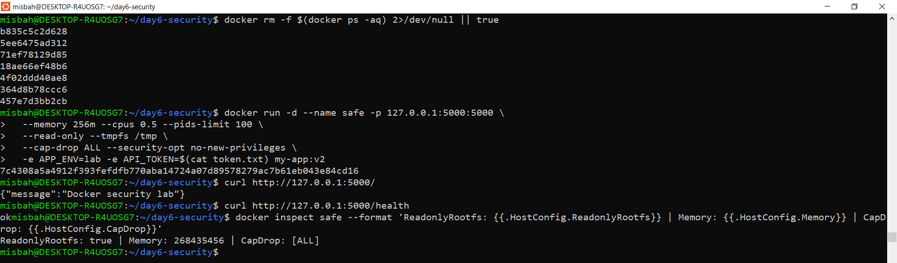

# Day 13 - Docker Security & Optimization

Turned an intentionally unsafe Docker image (`my-app:bad`) into a smaller, safer `my-app:v2`. Scanned before and after with Trivy, removed unsafe patterns, kept the API token out of the image, ran as non-root, and applied runtime restrictions.

> `Dockerfile.bad` is deliberately unsafe for training. Its token is fake. `token.txt` is a local fake file and is never committed.

## Results (from my own machine)

| Measure | my-app:bad | my-app:v2 |
|---------|-----------|-----------|
| Image size (disk usage) | 1.77 GB | 185 MB |
| Image size (content size) | 459 MB | 44.9 MB |
| HIGH findings | 401 | 44 |
| CRITICAL findings | 16 | 0 |
| Runtime user | root | app (UID 10001) |
| Hard-coded secret | Present (`ENV API_TOKEN`) | Not present |
| Base image | `python:latest` | `python:3.12-slim` |

- HIGH findings dropped by 357 (about 89%), CRITICAL went from 16 to 0.
- Image size dropped by about 90%.
- Tool: Trivy 0.75.0, severity filter HIGH,CRITICAL. Exact scan timestamps are inside `reports/before.json` and `reports/after.json`.

## Project structure

```
Day-13/
├── app.py
├── requirements.txt
├── Dockerfile.bad
├── Dockerfile.good
├── .dockerignore
├── .gitignore
├── README.md
├── reports/
│   ├── before.json
│   └── after.json
└── evidence/
    ├── scan-before.png
    ├── scan-after.png
    └── hardened-container.png
```

## Risks found in Dockerfile.bad and fixes

| Risk | In Dockerfile.bad | Fix in Dockerfile.good |
|------|-------------------|------------------------|
| Floating base | `python:latest` | `python:3.12-slim` (specific tag) |
| Root user | No `USER`, runs as root | `useradd -r -u 10001 app` and `USER app` |
| Secret in image | `ENV API_TOKEN=...` | Removed. Token is passed at runtime with `-e` |
| Build tools left in image | `build-essential git curl vim` installed | Not installed. Multi-stage build keeps only runtime files |
| Shell-form CMD | `CMD python app.py` | Exec form `CMD ["python", "app.py"]` |
| Unneeded files copied | `COPY . .` | Only `app.py` copied, with `.dockerignore` |

## Commands used

Build and baseline:

```bash
docker build -f Dockerfile.bad -t my-app:bad .
docker images my-app
docker history --no-trunc my-app:bad
```

Scan before:

```bash
mkdir -p reports
trivy image --severity HIGH,CRITICAL -f json -o reports/before.json my-app:bad
trivy image --severity HIGH,CRITICAL my-app:bad
trivy config .
```

Build the fixed image and scan after:

```bash
docker build --pull --no-cache -f Dockerfile.good -t my-app:v2 .
docker history --no-trunc my-app:v2
trivy image --severity HIGH,CRITICAL -f json -o reports/after.json my-app:v2
trivy image --exit-code 1 --severity HIGH,CRITICAL --ignore-unfixed my-app:v2
```

Confirm non-root:

```bash
docker run --rm --entrypoint id my-app:v2
docker image inspect my-app:v2 --format '{{.Config.User}}'
```

Run hardened container:

```bash
printf '%s' 'training-token-only' > token.txt && chmod 600 token.txt
docker run -d --name safe -p 127.0.0.1:5000:5000 \
  --memory 256m --cpus 0.5 --pids-limit 100 \
  --read-only --tmpfs /tmp \
  --cap-drop ALL --security-opt no-new-privileges \
  -e APP_ENV=lab -e API_TOKEN="$(cat token.txt)" my-app:v2
```

Validate and clean up:

```bash
curl http://127.0.0.1:5000/
curl http://127.0.0.1:5000/health
docker inspect safe --format '{{.HostConfig.ReadonlyRootfs}}'
docker inspect safe --format '{{.HostConfig.CapDrop}}'
docker rm -f safe
rm -f token.txt
```

## Runtime restrictions applied

| Flag | Purpose |
|------|---------|
| `--memory 256m`, `--cpus 0.5`, `--pids-limit 100` | Limit memory, CPU and process count |
| `--read-only` and `--tmpfs /tmp` | Read-only root filesystem, writable temp space only |
| `--cap-drop ALL` | Remove all Linux capabilities |
| `--security-opt no-new-privileges` | Block privilege escalation |
| `127.0.0.1:5000:5000` | Port reachable only from localhost |
| `-e API_TOKEN=...` | Secret injected at runtime, not baked into the image |

## Evidence







## Remaining findings

`my-app:v2` still has 44 HIGH findings and 0 CRITICAL in `reports/after.json`. I did not hide them. A clean scan is not a guarantee of security. Next remediation steps:

- Check which of the 44 have a fix available (`trivy image --ignore-unfixed --severity HIGH,CRITICAL my-app:v2`).
- Rebuild on a newer patched base tag and rescan.
- Document findings that have no upstream fix as accepted exceptions.
- Bonus idea: run Trivy with `--exit-code 1` as a CI gate.

## Troubleshooting

| Problem | What to check |
|---------|---------------|
| Trivy command not found | Install Trivy and verify with `trivy --version` |
| Many findings | Filter HIGH,CRITICAL and check fix availability |
| Image still large | `docker images` and `docker history`; remove unneeded packages |
| Read-only filesystem breaks app | Find the write path and mount tmpfs only there |
| Port cannot bind | Check if port 5000 is in use or change the host port |
| Container exits immediately | `docker logs safe`; check command, dependencies, port |
| Secret in history | Rebuild cleanly, remove old images, rotate real secrets |
| Trivy exits 1 | Review remaining findings and document exceptions |

## Interview Readiness

1. **How do you secure a Docker image?** Small maintained base, pinned tags, multi-stage builds, non-root user, regular scans and rebuilds, no secrets in layers, and runtime restrictions.
2. **How should secrets be handled?** Not in Dockerfile, ENV, ARG or the image. Inject at runtime or use a secrets manager; use BuildKit secrets for build-time needs.
3. **What does Trivy scan?** Known vulnerabilities in images, and supported config files for misconfigurations.
4. **Why a slim base image?** Fewer packages means a smaller attack surface and less patching.
5. **What does `--read-only` do?** Makes the root filesystem read-only. Use tmpfs for paths that need writes.
6. **Why `--cap-drop ALL`?** Removes Linux capabilities the app does not need, limiting a compromised process.
7. **What do `--memory` and `--cpus` do?** Set resource limits so one container cannot use unlimited memory or CPU.
8. **Why is removing a secret from the current Dockerfile not enough?** It can remain in old layers, history, caches or registries. Rotate it and rebuild cleanly.
9. **Why `--exit-code 1`?** It returns a failing status when findings match the policy, so CI can stop the build.
