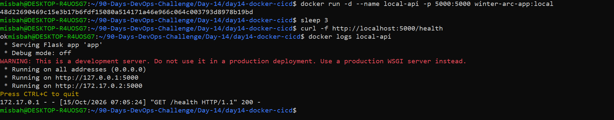
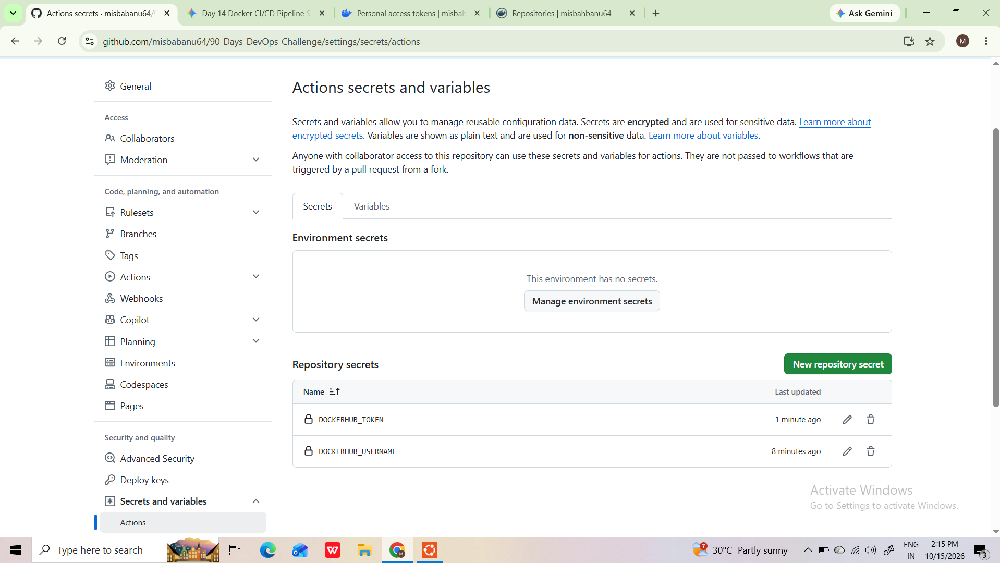
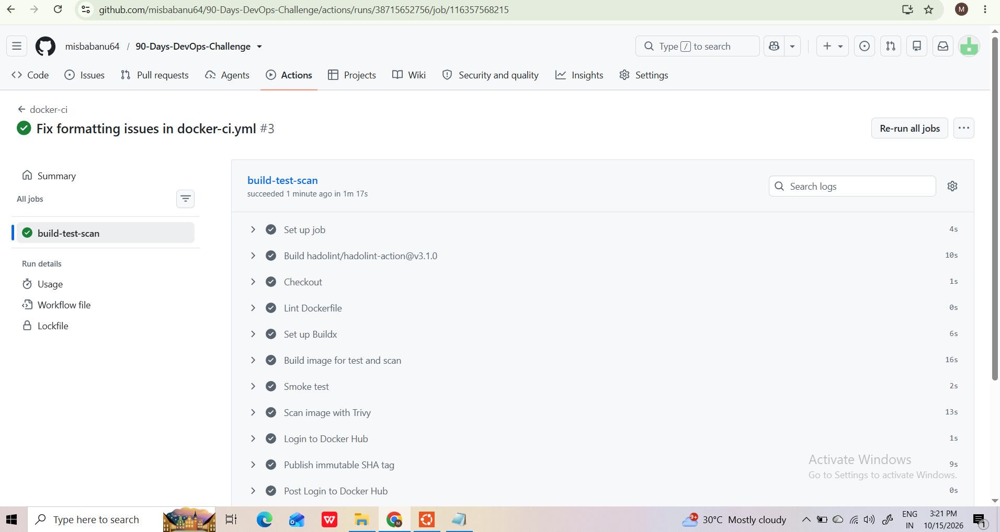
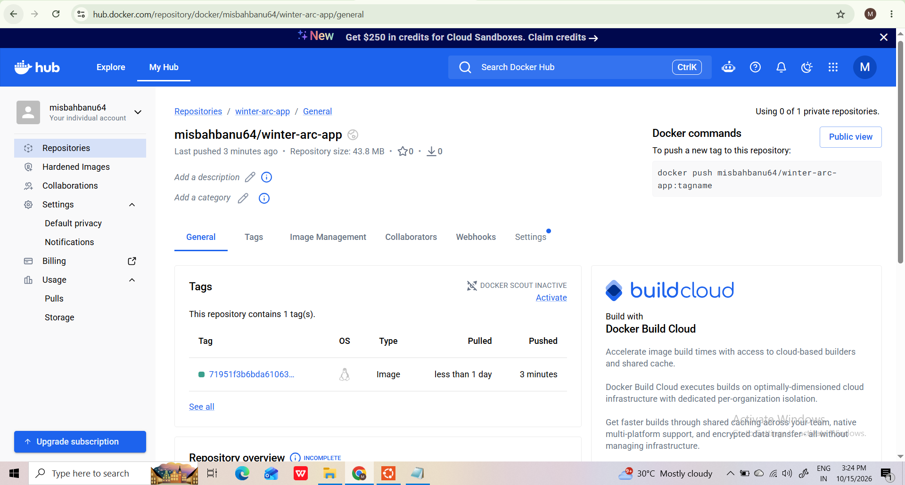

# Day 14: Docker in CI/CD

Is din maine ek GitHub Actions pipeline banayi jo Dockerfile lint karti hai, Docker image build karti hai, Trivy se security scan karti hai aur image Docker Hub pe push karti hai.

## Pipeline

```
push / PR (sirf Day-14/** ya workflow file badle to)
        |
        v
 Checkout -> Hadolint (Dockerfile lint) -> Buildx setup
        |
        v
 Docker build -> Trivy scan -> Docker Hub push (SHA tag)
```

- Workflow file: `.github/workflows/docker-ci.yml`
- Job name: `build-test-scan`
- Trigger: `main` branch pe push aur pull request, paths filter ke saath (`Day-14/**` aur workflow file)

## Project files

| File | Kaam |
|---|---|
| `app.py` | Application code |
| `Dockerfile` | Single-stage image build |
| `requirements.txt` | Python dependencies |
| `.dockerignore` | Build context se extra files hatata hai |

## Actions versions (pinned)

| Action | Version |
|---|---|
| `actions/checkout` | `v4` |
| `hadolint/hadolint-action` | `v3.1.0` |
| `docker/setup-buildx-action` | `v3` |
| `aquasecurity/trivy-action` | `0.35.0` |

Trivy action ko `@master` ki jagah exact version pe pin kiya, kyunki March 2026 me is action se juda supply-chain incident hua tha. Pinned version se unexpected code chalne ka risk kam hota hai.

## Setup

1. Docker Hub me access token banao (Account Settings > Security).
2. GitHub repo me Settings > Secrets and variables > Actions me ye secrets add karo:

| Secret name | Kaam |
|---|---|
| `DOCKERHUB_USERNAME` | Docker Hub username |
| `DOCKERHUB_TOKEN` | Docker Hub access token |

Secret ki values kabhi repo me commit nahi ki gayi. Workflow me sirf `${{ secrets.NAME }}` use hota hai.

3. `Day-14/**` me koi change push karo aur GitHub ke Actions tab me run dekho.

## Local test

```bash
cd Day-14/day14-docker-cicd
docker build -t winter-arc-app:local .
docker run --rm -p 5000:5000 winter-arc-app:local
```

(Port aur run command app.py / Dockerfile ke hisaab se check karna.)

## Docker Hub image

`misbahbanu64/winter-arc-app` (har run pe commit SHA wala tag).

## Rollback

**1. Pichla image chalana:**

```bash
docker pull misbahbanu64/winter-arc-app:<PICHLA_SHA_TAG>
docker run -d -p 5000:5000 misbahbanu64/winter-arc-app:<PICHLA_SHA_TAG>
```

`<PICHLA_SHA_TAG>` Docker Hub ke Tags page se lena.

**2. Code revert karna:**

```bash
git revert <BAD_COMMIT_SHA>
git pull --no-rebase
git push
```

Revert push hone pe pipeline dobara chalegi aur naya SHA tag banega.

## Evidence (screenshots)

**Local test OK**



**GitHub secrets configured (sirf names, values nahi)**



**GitHub Actions pipeline success**



**Docker Hub pe image published**



## Trivy scan result

`<Actions run ke Trivy step se asli result yahan likhna. Abhi tak scan screenshot nahi hai.>`

## Learnings

- Third-party actions ko exact version pe pin karna chahiye.
- Paths filter se unnecessary pipeline runs bachte hain.
- Secrets sirf GitHub Secrets me rakhne chahiye, code me kabhi nahi.
- Dockerfile abhi single-stage hai. Multi-stage build future improvement hai.
