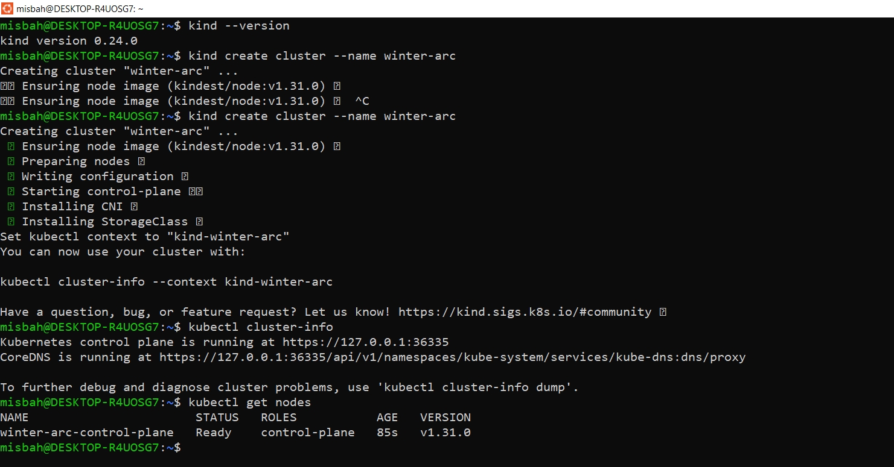
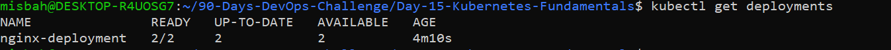
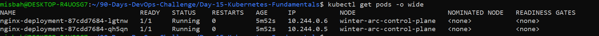
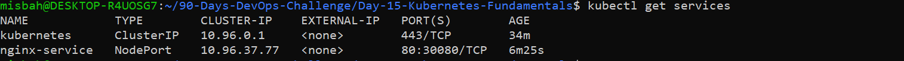
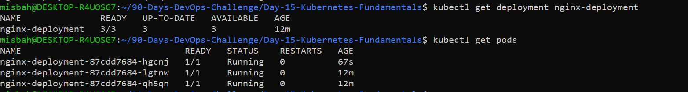
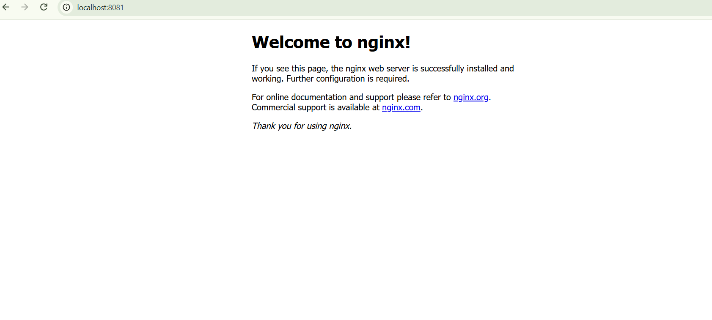
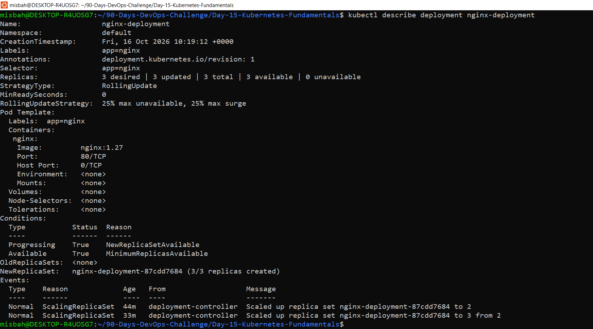
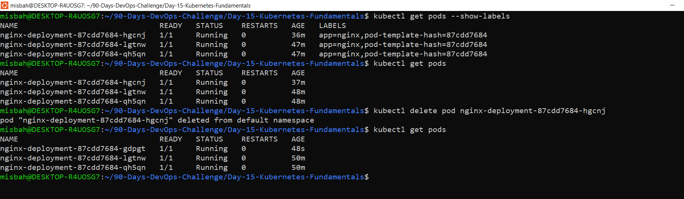

# Day 15 - Kubernetes Fundamentals

## Objective
Deploy an Nginx application on a local Kubernetes cluster (kind) using YAML manifests, scale it to 3 replicas, expose it with a NodePort Service, and verify it.

## Architecture and key concepts
- **Kubernetes:** a platform that runs and manages many containers across machines. It keeps the app in the state I declare.
- **Cluster:** the whole Kubernetes environment. Mine is a local kind cluster named `winter-arc`.
- **Control plane:** the "brain" that makes decisions and tracks the desired state.
- **Worker node:** the machine that runs Pods. In kind, one node does both jobs (`winter-arc-control-plane`).
- **Pod:** the smallest unit. It holds my Nginx container.
- **Deployment:** keeps the right number of Pod copies running and handles updates.
- **Service:** a stable address to reach the Pods. It finds Pods using the label `app=nginx`.
- **Docker vs Kubernetes:** Docker builds and runs containers. Kubernetes manages many containers (scheduling, scaling, self-healing, service discovery).

## Cluster setup
Environment: Windows 10 with Ubuntu (WSL) and Docker. Docker Desktop is not installed, so I used kind.

```
kubectl version --client
kind --version
kind create cluster --name winter-arc
kubectl cluster-info
kubectl get nodes
```

Result: node `winter-arc-control-plane` is `Ready`.

## Deploy and scale Nginx
Files: `deployment.yaml` (2 replicas, image nginx:1.27) and `service.yaml` (NodePort 30080).

```
kubectl apply -f deployment.yaml
kubectl apply -f service.yaml
kubectl get deployments
kubectl get pods -o wide
kubectl get services
kubectl scale deployment nginx-deployment --replicas=3
kubectl get deployment nginx-deployment
kubectl get pods
```

## Commands and evidence

| Step | Screenshot |
|------|------------|
| Node is Ready |  |
| Deployment 2/2 |  |
| Pods Running |  |
| Service NodePort 30080 |  |
| Scaled to 3 replicas |  |
| Nginx access in browser |  |
| Troubleshooting (describe) |  |
| Self-healing |  |

Access test: port 8080 was already used by Jenkins on my machine, so I used port-forward on 8081:

```
kubectl port-forward service/nginx-service 8081:80
```

Then I opened http://localhost:8081 in the browser and saw "Welcome to nginx!".

## Troubleshooting / lessons learned
- I used `kubectl describe deployment nginx-deployment` to inspect the Deployment. It showed 3 desired, 3 updated, 3 total, 3 available, and the scaling events.
- `kubectl get pods --show-labels` shows the Pods have the label `app=nginx`. The Service selector matches this label, which is how it finds the Pods.
- Self-healing: I deleted one Pod and the Deployment automatically created a replacement to keep 3 replicas.
- Port 8080 conflicted with Jenkins, so I used 8081.

## Cleanup
```
kubectl delete -f service.yaml
kubectl delete -f deployment.yaml
kind delete cluster --name winter-arc
```

No kubeconfig, tokens, or credentials are included in this repository.
