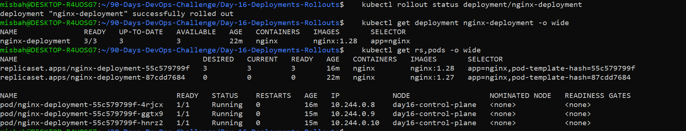
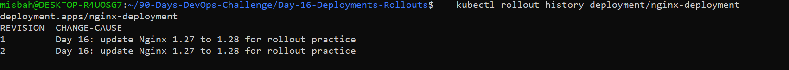
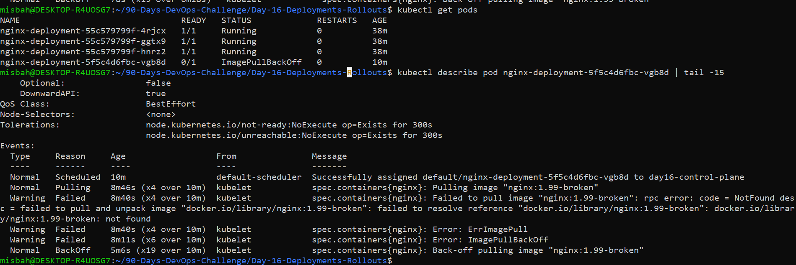
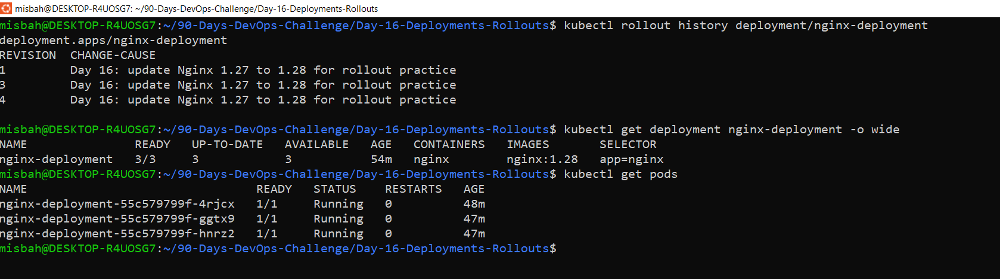
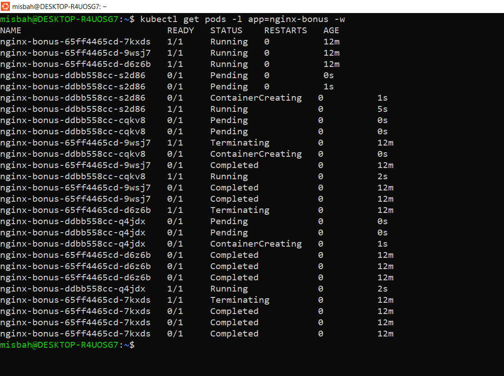
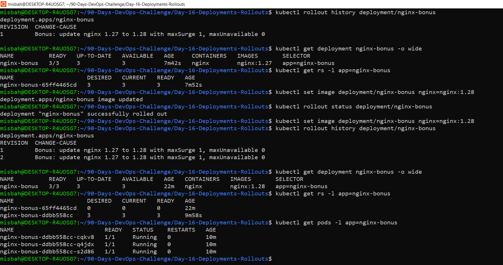

# Day 16: Deployments & Rollouts

## Goal
Practice a safe release on a local Kubernetes cluster: rolling update, revision history, a deliberately failed release, and rollback.

## Environment
- Cluster: kind (cluster name: day16, context: kind-day16)
- Deployment: nginx-deployment (3 replicas), container name: nginx
- Note: My Day 15 cluster was no longer available, so I created a new small kind cluster for this lab.

## What I did (summary)
1. Created nginx-deployment with image nginx:1.27 (revision 1).
2. Added a change-cause annotation and updated the image to nginx:1.28 (revision 2).
3. Updated to a deliberately invalid image nginx:1.99-broken (revision 3). The new Pod went into ImagePullBackOff.
4. Ran kubectl rollout undo to return to nginx:1.28 (became revision 4).
5. Verified the Deployment was healthy again (3/3 Pods Running).

## Evidence

### 1. Successful rolling update (nginx:1.27 to nginx:1.28)
Rollout status says "successfully rolled out", the Deployment image is nginx:1.28, and 3/3 Pods are Running.



### 2. Revision history after the update
Rollout history shows revision 1 and revision 2.



### 3. Failed rollout (nginx:1.99-broken)
The new Pod is stuck in ImagePullBackOff because the image tag does not exist. The 3 old Pods kept running.



### 4. Rollback verified
After kubectl rollout undo, the image is back to nginx:1.28 and 3/3 Pods are Running.



## Revision History Explained

| Revision | Image | What happened |
|----------|-------|---------------|
| 1 | nginx:1.27 | Initial deployment |
| 2 | nginx:1.28 | Rolling update (known-good version) |
| 3 | nginx:1.99-broken | Deliberately invalid image, rollout failed |
| 4 | nginx:1.28 | Rollback (same Pod template as old revision 2) |

- **Known-good image:** nginx:1.28 (revision 2 before the broken update).
- After `kubectl rollout undo`, Kubernetes reused the revision 2 template and gave it a new number, revision 4. That is why the final history shows 1, 3 and 4, and revision 2 no longer appears separately.
- The CHANGE-CAUSE text is the same on all revisions. I changed the annotation to "update Nginx 1.27 to 1.28" before the image update, so Kubernetes applied it to the existing revision 1 as well. I did not add a new annotation before the broken update, so revision 3 still shows the old note.
- Lesson: set a new change-cause annotation before every release so each revision has its own reason in history.


## Rolling Update, maxSurge and maxUnavailable

**Rolling update:** Kubernetes replaces old Pods with new Pods gradually, instead of stopping everything at once. The app stays available during the release.

**Strategy in my Deployment (default):** `maxSurge: 25%` and `maxUnavailable: 25%` with 3 replicas.

- **maxSurge** is how many extra Pods can exist above the desired replica count during an update. 25% of 3 = 0.75, rounded up to 1. So at most 4 Pods can exist at one time.
- **maxUnavailable** is how many desired Pods can be unavailable during an update. 25% of 3 = 0.75, rounded down to 0. So all 3 Pods must stay available.

**What I observed:** When I deployed the broken image nginx:1.99-broken, Kubernetes created 1 new Pod (the surge Pod). It went into ImagePullBackOff and never became Ready. Because maxUnavailable was effectively 0, Kubernetes did not remove any old Pod. The 3 old nginx:1.28 Pods kept running, so the app had no downtime.

**Rollback:** `kubectl rollout undo` restores the previous Pod template. The old Pods were never touched, so the rollback finished quickly.

## Interview Readiness

**What does a rolling update do?** It gradually replaces old Pods with Pods from the new Pod template, while respecting maxSurge and maxUnavailable so the app stays available.

**What are maxSurge and maxUnavailable?** maxSurge is the number of extra Pods allowed above the desired count. maxUnavailable is the number of desired Pods allowed to be unavailable during the update.

**Why inspect rollout history?** It lists saved revisions, which I can inspect and use for rollback.

**How do you diagnose a failed rollout?** Run kubectl get pods, then kubectl describe pod POD_NAME and read the Events section (and logs if the container started).

**How does rollout undo work?** It restores the Pod template of a previous revision. Kubernetes gives that template a new revision number.

**Why annotate a release?** The change-cause annotation records why a release was made, so history is easier to understand.

## Notes
- nginx-deployment.yaml is the initial manifest (image nginx:1.27). The cluster is now running nginx:1.28 after the rollback, so I will not re-apply that file.
- No kubeconfig, tokens or secrets are included in this folder.
- The kind cluster day16 was created only for this lab and can be deleted after submission.

## Bonus: maxSurge 1 and maxUnavailable 0

I created a separate Deployment `nginx-bonus` (manifest: `nginx-bonus-deployment.yaml`) with an explicit strategy, so the shared `nginx-deployment` was not touched:

```yaml
strategy:
  type: RollingUpdate
  rollingUpdate:
    maxSurge: 1
    maxUnavailable: 0
```

I updated the image from nginx:1.27 to nginx:1.28 (valid update). The rollout completed successfully and the Deployment shows 3/3 Pods with image nginx:1.28. The old ReplicaSet was scaled to 0 and the new one to 3.

**What I observed in the live watch:** Each time, one new Pod was created first and became Running 1/1. Only after that was one old Pod set to Terminating. This repeated 3 times. At most 4 Pods existed at once (3 + 1 surge), and the number of Ready Pods never dropped below 3. Old Pods show "Completed" after Terminating because their container exited.

**How these settings affect availability:**
- `maxSurge: 1` lets Kubernetes create 1 extra Pod above the 3 replicas.
- `maxUnavailable: 0` means an old Pod is removed only after a new Pod is Ready, so there is no capacity loss.
- Trade-off: the update needs room for 1 extra Pod and can be a bit slower than the default 25%/25%.

Note: the change-cause is the same on revisions 1 and 2 because I changed the annotation before updating the image, so it was applied to the existing revision 1 as well.

### Evidence


