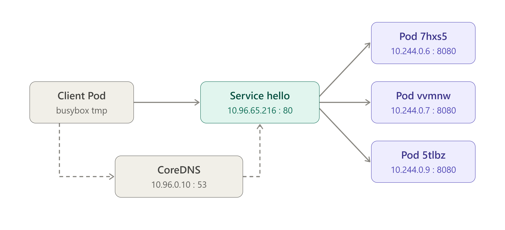
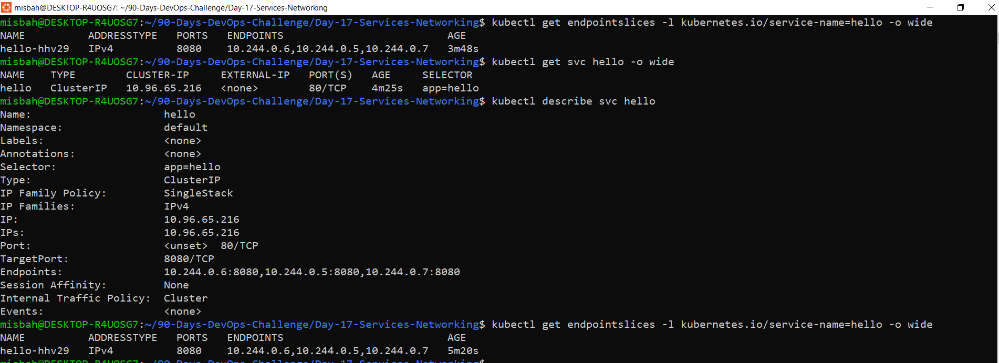
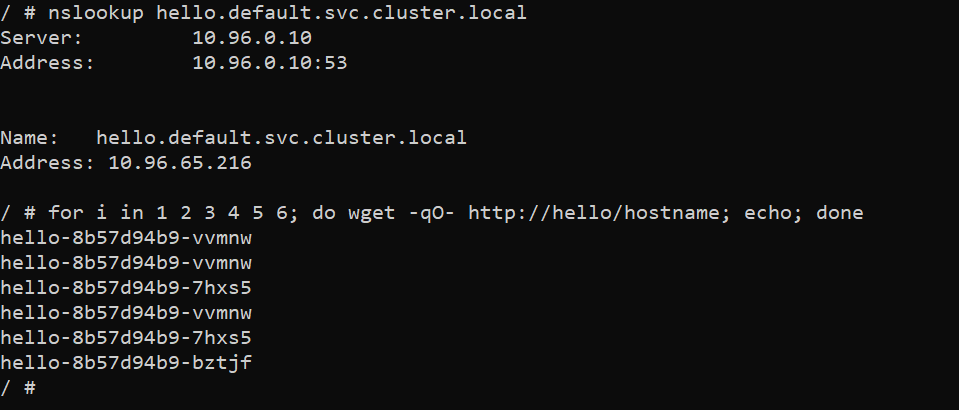
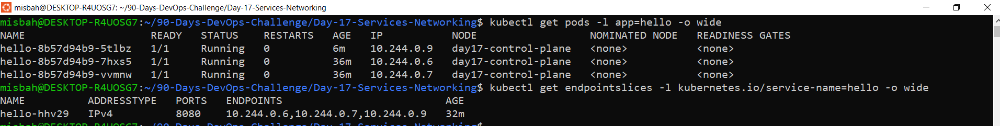
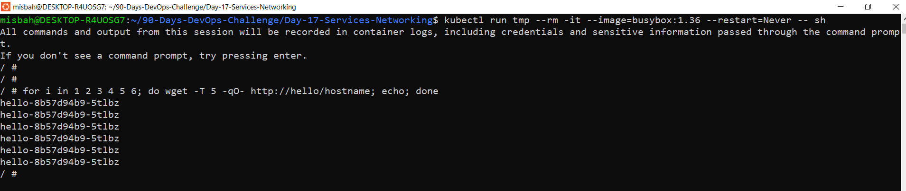

# Day 17 - Services & Networking

## 1. Goal

Give an application a stable in-cluster address, call it by DNS name from another Pod, observe requests reaching different replicas, and diagnose why a Service stops routing when its selector is wrong.

## 2. Environment

- OS: Windows laptop with WSL Ubuntu
- Cluster: kind, cluster name `day17`
- kubectl context: `kind-day17`
- Node: `day17-control-plane` (Ready, v1.31.0)
- Test workload: Deployment `hello` with 3 replicas
- Image: `registry.k8s.io/e2e-test-images/agnhost:2.39` (listens on port 8080)
- Service: `hello` (ClusterIP, port 80 -> targetPort 8080), defined in `svc-clusterip.yaml`

## 3. Service manifest and traffic flow

The Service is created from `svc-clusterip.yaml`:

    apiVersion: v1
    kind: Service
    metadata:
      name: hello
    spec:
      type: ClusterIP
      selector:
        app: hello
      ports:
      - port: 80
        targetPort: 8080

Applied with `kubectl apply -f svc-clusterip.yaml`. The Service got ClusterIP `10.96.65.216` and CoreDNS answered at `10.96.0.10`.

Traffic path: temporary client Pod -> CoreDNS resolves `hello` -> ClusterIP Service (port 80) -> one Ready backend Pod (port 8080).

## 4. Service and EndpointSlice

The `hello` Deployment created 3 Pods, all with the label `app=hello`:

    hello-8b57d94b9-7hxs5   1/1   Running   app=hello
    hello-8b57d94b9-bztjf   1/1   Running   app=hello
    hello-8b57d94b9-vvmnw   1/1   Running   app=hello

`kubectl get svc hello -o wide` showed TYPE `ClusterIP`, CLUSTER-IP `10.96.65.216`, PORT `80/TCP` and SELECTOR `app=hello`.

`kubectl describe svc hello` listed 3 endpoints, all on targetPort 8080:

    10.244.0.6:8080, 10.244.0.5:8080, 10.244.0.7:8080

The EndpointSlice `hello-hhv29` showed the same 3 addresses (`10.244.0.6`, `10.244.0.5`, `10.244.0.7`) on port `8080`. So the selector matched all 3 Pods.

## 5. DNS and load balancing

A temporary BusyBox Pod (`kubectl run tmp --rm -it --image=busybox:1.36 --restart=Never -- sh`) was used as the client.

`nslookup hello` was answered by CoreDNS at `10.96.0.10` and resolved to the Service ClusterIP:

    Name:   hello.default.svc.cluster.local
    Address: 10.96.65.216

The NXDOMAIN lines in that output are not errors. BusyBox tries the search suffixes one by one (`hello.svc.cluster.local`, `hello.cluster.local`) and the name was found under `default.svc.cluster.local`.

The full name `nslookup hello.default.svc.cluster.local` returned the same address `10.96.65.216`.

Then 6 requests were sent to the Service by name:

    for i in 1 2 3 4 5 6; do wget -qO- http://hello/hostname; echo; done

Output:

    hello-8b57d94b9-vvmnw
    hello-8b57d94b9-vvmnw
    hello-8b57d94b9-7hxs5
    hello-8b57d94b9-vvmnw
    hello-8b57d94b9-7hxs5
    hello-8b57d94b9-bztjf

All 3 backend Pods answered, so traffic was spread across replicas. The order is random. The client never used a Pod IP, only the name `hello`.

## 6. Deleting a backend Pod

Before deleting, the Pods and their IPs were:

    hello-8b57d94b9-7hxs5   10.244.0.6
    hello-8b57d94b9-bztjf   10.244.0.5
    hello-8b57d94b9-vvmnw   10.244.0.7

EndpointSlice `hello-hhv29` listed `10.244.0.6`, `10.244.0.5`, `10.244.0.7` on port `8080`.

The Pod `hello-8b57d94b9-bztjf` was deleted with `kubectl delete pod hello-8b57d94b9-bztjf`. The Deployment created a replacement, `hello-8b57d94b9-5tlbz`, which became `1/1 Running`.

After the replacement:

    hello-8b57d94b9-5tlbz   10.244.0.9
    hello-8b57d94b9-7hxs5   10.244.0.6
    hello-8b57d94b9-vvmnw   10.244.0.7

The same EndpointSlice `hello-hhv29` now listed `10.244.0.6`, `10.244.0.7`, `10.244.0.9`. The old address `10.244.0.5` was removed and the new Pod address was added, and the workload was back to 3 Ready replicas.

This is why clients should use the Service name and not Pod IPs: Pod names and IPs change when a Pod is replaced, but the Service name and ClusterIP stay the same.

The screenshot below shows the state after the replacement.

## 7. Breaking and fixing the selector

The selector was changed on purpose to a label that no Pod has:

    kubectl patch service hello -p '{"spec":{"selector":{"app":"hellow"}}}'

`kubectl describe service hello` then showed `Selector: app=hellow` and an empty `Endpoints:` line. The EndpointSlice `hello-hhv29` still existed, but both PORTS and ENDPOINTS showed `<unset>`.

From a temporary Pod, DNS still worked because the Service object still existed:

    Name:   hello.default.svc.cluster.local
    Address: 10.96.65.216

But the request failed:

    wget: can't connect to remote host (10.96.65.216): Connection refused

So the Service existed, but it had no usable backend. A Service object existing does not prove it can route traffic.

The selector was fixed with:

    kubectl patch service hello -p '{"spec":{"selector":{"app":"hello"}}}'

After the fix, the EndpointSlice listed `10.244.0.6`, `10.244.0.7`, `10.244.0.9` on port `8080` again, and `kubectl describe service hello` showed `Selector: app=hello` with 3 endpoints.

Requests worked again. In this run all 6 requests were answered by one Pod, `hello-8b57d94b9-5tlbz`. Load balancing order is not guaranteed and 6 requests is a small sample. All 3 Pods answering was already shown in section 5.

## 8. Bonus: second client Pod

A second temporary client Pod called `client2` called the same Service by name:

    kubectl run client2 --rm -it --image=busybox:1.36 --restart=Never -- wget -T 5 -qO- http://hello/hostname

It was answered by `hello-8b57d94b9-7hxs5`.

Both `tmp` and `client2` use the same name `http://hello`. Neither client knows any Pod IP. CoreDNS resolves `hello` to the Service ClusterIP (`10.96.65.216`) for every Pod in the namespace, and the Service forwards each request to one of the Ready backend Pods listed in the EndpointSlice. Pods behind the Service can be deleted and replaced, and the clients do not need to change anything.

## 9. Concepts explained

### port vs targetPort

`port` is the port the Service listens on. Clients call this one. `targetPort` is the port the application inside the Pod listens on. In this assignment `port: 80` and `targetPort: 8080`, so a request to `http://hello` (port 80) is forwarded to port 8080 of a backend Pod, where `agnhost` is listening. If `targetPort` is wrong, DNS still resolves but requests fail.

### Service DNS

Every Service gets a DNS name in the format `<service>.<namespace>.svc.cluster.local`. Here it is `hello.default.svc.cluster.local`. CoreDNS (`10.96.0.10` in this cluster) resolves it to the ClusterIP `10.96.65.216`. Inside the same namespace the short name `hello` also works.

### EndpointSlice

An EndpointSlice records the addresses and ports of the backend Pods that belong to a Service. Here `hello-hhv29` listed the 3 Pod IPs on port `8080`. It is updated automatically: it changed when a Pod was replaced, became empty when the selector was wrong, and was filled again after the fix.

### Why use the Service name and not Pod IPs

Pod IPs are not stable. When `hello-8b57d94b9-bztjf` (`10.244.0.5`) was deleted, its replacement got a new IP (`10.244.0.9`). The Service name and ClusterIP did not change, so clients keep working.

### Why DNS can work while HTTP fails

When the selector was `app=hellow`, the Service object still existed, so DNS returned `10.96.65.216`. But there were no endpoints behind it, so the request got `Connection refused`. Check the selector, Pod labels, EndpointSlices, readiness and targetPort when this happens.

## 10. Cleanup

Only the resources created for this assignment were deleted:

    kubectl delete service hello
    kubectl delete deployment hello

After that, `kubectl get deployments,services,pods` showed only the default `kubernetes` Service. No `hello` Deployment or Pods were left.
