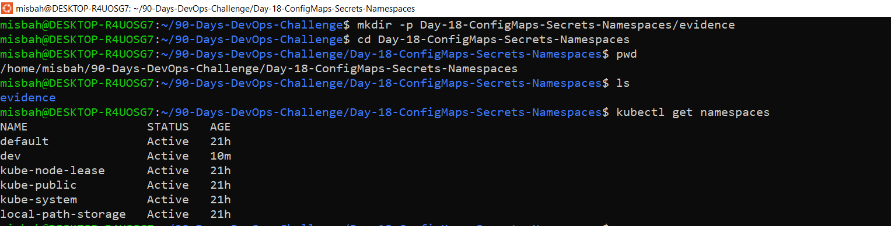
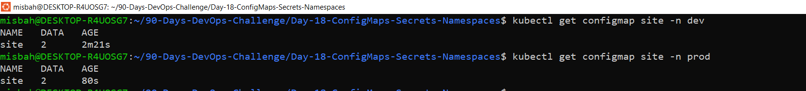
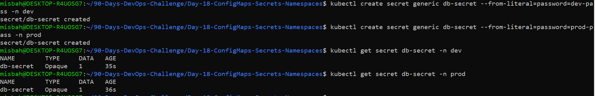
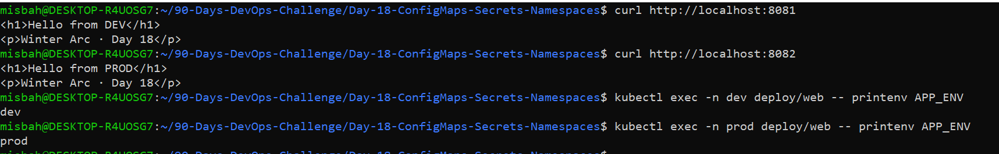
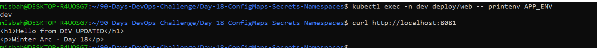
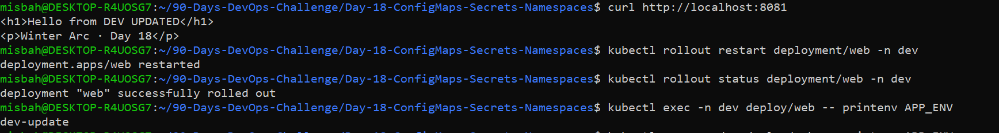
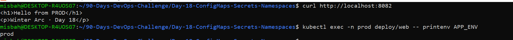

# Day 18: Kubernetes ConfigMaps, Secrets & Namespaces

## Overview

This project demonstrates environment-specific configuration in Kubernetes using ConfigMaps, Secrets, and Namespaces. The same Nginx application is deployed in separate `dev` and `prod` namespaces with different configurations and web page content.

## Objectives

- Create isolated Kubernetes namespaces for development and production.
- Manage application settings using ConfigMaps.
- Pass Secret values to containers through environment variables.
- Mount ConfigMap data as files inside an Nginx container.
- Observe configuration updates and environment variable behavior.

## Technologies Used

- Kubernetes
- Docker / Nginx
- YAML
- kubectl
- Git and GitHub
- WSL Ubuntu

## Project Structure

```text
Day-18-ConfigMaps-Secrets-Namespaces/
├── configmap-dev.yaml
├── configmap-prod.yaml
├── deployment.yaml
├── README.md
└── evidence/
    ├── 1-namespaces.png
    ├── 2-configmaps.png
    ├── 3-secrets.png
    ├── 4-pages-and-env.png
    ├── 5-config-update-before-restart.png
    ├── 6-config-update-after-restart.png
    └── 7-prod-unchanged.png
```

## Implementation Steps

### 1. Create Namespaces

```bash
kubectl create namespace dev
kubectl create namespace prod
kubectl get namespaces
```

### 2. Apply ConfigMaps

```bash
kubectl apply -f configmap-dev.yaml -n dev
kubectl apply -f configmap-prod.yaml -n prod
```

### 3. Create Secrets

Dummy credentials were used for this lab.

```bash
kubectl create secret generic db-secret \
  --from-literal=password=dev-pass -n dev

kubectl create secret generic db-secret \
  --from-literal=password=prod-pass -n prod
```

### 4. Deploy the Application

```bash
kubectl apply -f deployment.yaml -n dev
kubectl apply -f deployment.yaml -n prod

kubectl get pods -n dev
kubectl get pods -n prod
```

### 5. Verify Both Environments

Run these commands in separate terminals:

```bash
kubectl port-forward -n dev deploy/web 8081:80
```

```bash
kubectl port-forward -n prod deploy/web 8082:80
```

Open the following URLs in your browser:

- Development: http://localhost:8081
- Production: http://localhost:8082

Check the environment configuration:

```bash
kubectl exec -n dev deploy/web -- printenv APP_ENV
kubectl exec -n prod deploy/web -- printenv APP_ENV
```

### 6. Observe Configuration Updates

Edit the development ConfigMap and change the page content and `APP_ENV` value.

```bash
kubectl edit configmap site -n dev
kubectl rollout restart deployment/web -n dev
kubectl rollout status deployment/web -n dev
```

Mounted ConfigMap files can update after a delay. Environment variables do not automatically change in an already-running container; restarting the Deployment allows the container to load the updated values.

## Evidence Screenshots

### 1. Namespace Creation



### 2. ConfigMaps



### 3. Secrets



### 4. Pages and Environment Variables



### 5. Configuration Before Update



### 6. Configuration After Update



### 7. Production Verification



## Key Learnings

- ConfigMaps store non-sensitive configuration data.
- Secrets are used for sensitive configuration, but Base64 encoding alone is not encryption.
- Namespaces help isolate development and production resources.
- Environment variables and mounted configuration files behave differently during updates.
- Referenced ConfigMaps and Secrets must exist in the appropriate namespace.

## Conclusion

Successfully practiced Kubernetes environment isolation, configuration management, Secret references, mounted configuration files, and configuration updates using separate development and production namespaces.

**Repository:** [90-Days-DevOps-Challenge](https://github.com/misbabanu64/90-Days-DevOps-Challenge)

**Focus:** Hands-on DevOps and Kubernetes learning.
