# Day 19: Storage & StatefulSets

**Mission:** Keep a database record alive even after its Pod is deleted.

**Environment:** kind cluster (`day17-control-plane`), Kubernetes v1.31.0, WSL Ubuntu
**StorageClass:** `standard` (provisioner `rancher.io/local-path`, reclaim `Delete`, binding `WaitForFirstConsumer`)

## Files

- `pg-headless.yaml` : Headless Service (`clusterIP: None`)
- `postgres-statefulset.yaml` : PostgreSQL 16 StatefulSet with `volumeClaimTemplates`
- `evidence/` : screenshots

## Commands Used

### Task A: Inspect cluster
```bash
kubectl get storageclass
kubectl get pv
kubectl get pvc -A
kubectl describe storageclass standard
```
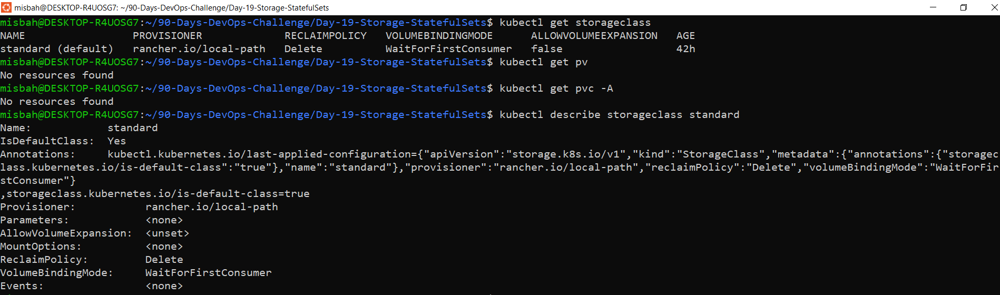

### Task B: Namespace and dummy Secret
```bash
kubectl create namespace day19-storage
kubectl create secret generic pg-secret \
  --from-literal='POSTGRES_PASSWORD=<dummy-lab-password>' \
  -n day19-storage
```
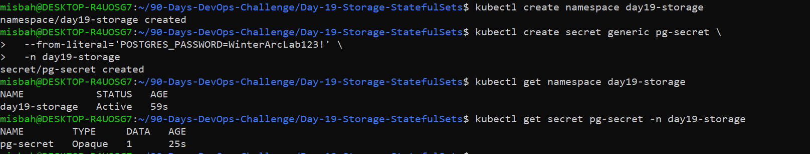

### Task C: Headless Service
```bash
kubectl apply -f pg-headless.yaml
kubectl get svc -n day19-storage
```
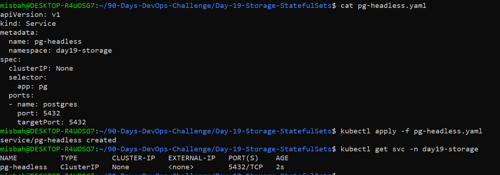

### Task D: StatefulSet
```bash
kubectl apply -f postgres-statefulset.yaml
kubectl get statefulset,pods,pvc -n day19-storage
```
PVC `data-pg-0` is **Bound**, Pod `pg-0` is `1/1 Running`.

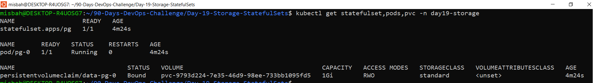

### Task E: Persistence test
```bash
kubectl exec -it -n day19-storage pg-0 -- psql -U appuser -d winterarc
# CREATE TABLE lab_notes (id INT PRIMARY KEY, note TEXT);
# INSERT INTO lab_notes VALUES (1, 'data-survives-pod-delete');
kubectl delete pod pg-0 -n day19-storage
kubectl exec -n day19-storage pg-0 -- psql -U appuser -d winterarc -c "SELECT * FROM lab_notes;"
```

Before delete:
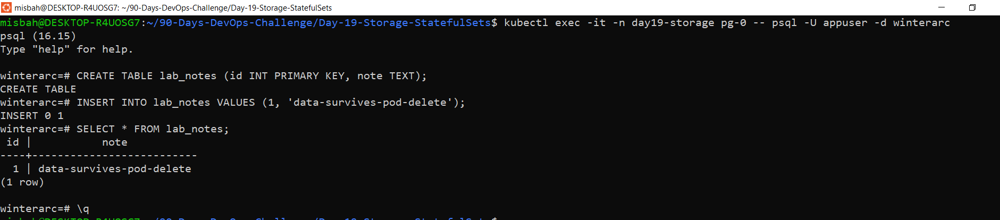
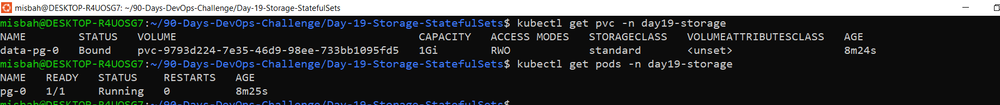

Pod recreated:
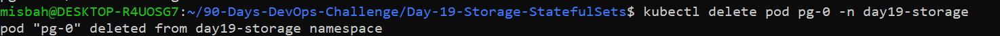

After delete (same row still exists):
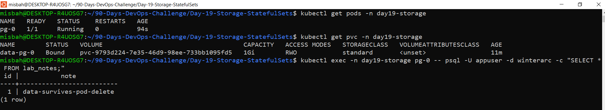

### Task F: Storage chain
```bash
kubectl get statefulset,pods,pvc,pv -n day19-storage
kubectl describe pvc data-pg-0 -n day19-storage
kubectl get events -n day19-storage --sort-by=.lastTimestamp
```
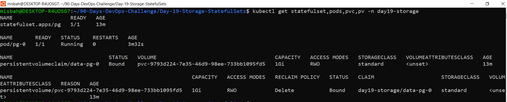
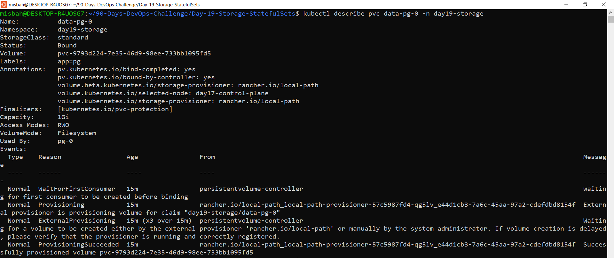
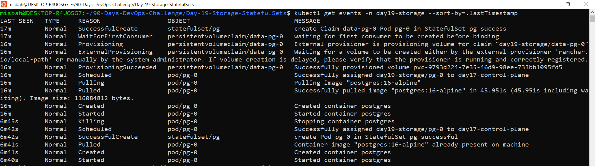
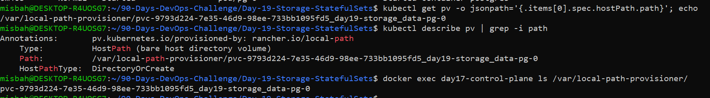

## Storage Chain Explained

When I deleted `pg-0`, only the Pod was removed. The StatefulSet recreated a Pod with the same name, and it mounted the same PVC, so the data was still there.

## Break & Diagnose: Why a PVC stays Pending

1. **Wrong/missing StorageClass:** I created a PVC with `storageClassName: does-not-exist`. Events showed the StorageClass was not found.
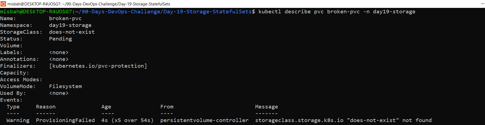
2. **WaitForFirstConsumer:** a valid PVC stays Pending until a Pod uses it.
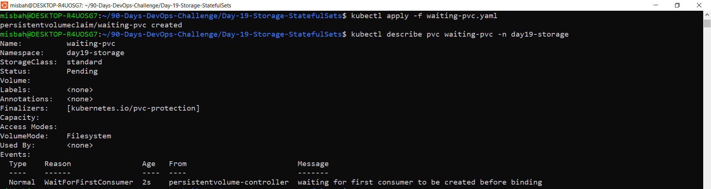
3. **Provisioner issue (theory):** if the provisioner is unhealthy, no volume gets created.
4. **Unsatisfiable request (theory):** requested size or access mode cannot be met.

## Interview Q&A

(Write each answer in your own words.)

1. **PV vs PVC?** A PV is the actual storage. A PVC is a Pod's request for storage, and Kubernetes binds the two.
2. **Why not store DB files in the container filesystem?** The writable layer dies with the container. Persistent storage outlives the Pod.
3. **What does a StorageClass do?** It describes a type of storage and triggers dynamic provisioning when a PVC asks for it.
4. **volumeClaimTemplates?** It creates a separate PVC for each StatefulSet Pod, so a replacement Pod reuses its own claim.
5. **Why did data survive?** The new `pg-0` had the same identity and reattached to the same PVC/PV.
6. **Deployment vs StatefulSet?** Deployment Pods are interchangeable. StatefulSet Pods have stable names, ordered management and per-Pod storage.
7. **ReadWriteOnce?** The volume can be mounted read-write by one node at a time.
8. **Why Headless Service?** It gives each StatefulSet Pod its own DNS name instead of one virtual IP.
9. **Why can a PVC stay Pending?** Wrong StorageClass, provisioner problems, unsatisfiable request, or WaitForFirstConsumer.
10. **Does deleting a Pod delete its PVC?** No, the PVC is retained.
11. **Risk of deleting a PVC?** With reclaim policy `Delete` (my cluster), the PV and data are deleted too.
12. **Is persistent storage a backup?** No. It does not replace backups, restore tests or disaster recovery.

## Cleanup
```bash
kubectl delete namespace day19-storage
kubectl get pv
```

## Security Note
Only a dummy lab password was used. No real credentials are committed.
