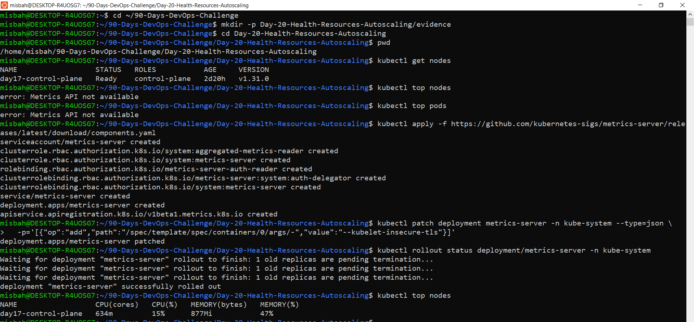
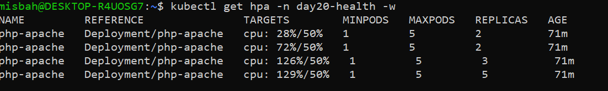
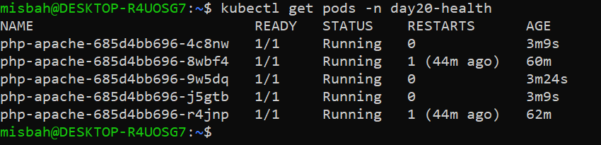
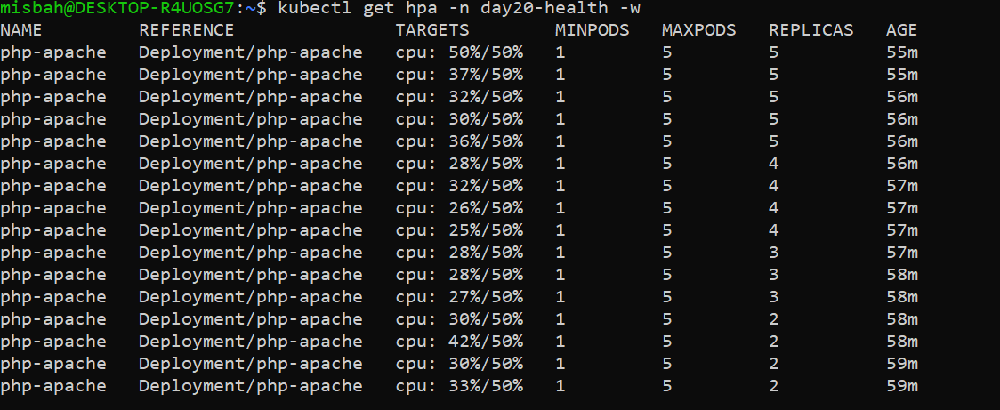

Day 20: Kubernetes Health Probes, Resource Management & Autoscaling (HPA)
📌 Mission

Build a self-healing, resource-aware Kubernetes application that monitors its health, manages CPU and memory resources, and automatically scales from 1 to 5 Pods based on CPU utilization.

🎯 Learning Objectives
Verify Metrics Server installation and resource metrics.
Configure CPU and memory requests and limits.
Implement Startup, Readiness, and Liveness probes.
Understand Kubernetes Quality of Service (QoS) classes.
Configure Horizontal Pod Autoscaler (HPA).
Perform load testing and observe automatic scaling.
Test readiness probe failures and application recovery.
Troubleshoot common Kubernetes monitoring and autoscaling issues.
🛠️ Task A: Metrics Server Verification

Metrics Server collects resource usage metrics from Kubernetes nodes and containers. These metrics are used by commands such as kubectl top and by the Horizontal Pod Autoscaler.

Configuration

Installed Metrics Server in the local Kind cluster with the --kubelet-insecure-tls argument for local development.

Note: Disabling kubelet TLS certificate verification is suitable only for this local lab setup. Use properly configured TLS verification in production.
Verification Commands
kubectl get pods -n kube-system
kubectl top nodes
kubectl top pods -A

Expected Outcome
Metrics Server is running.
Node CPU and memory usage are available.
Pod resource usage can be inspected.
Resource metrics are available for autoscaling.
🚀 Task B: Resource-Aware Deployment

Deployed the php-apache application in the day20-health namespace.

1. Create the Namespace
kubectl create namespace day20-health

2. Resource Requests and Limits
Resource	Request	Limit
CPU	200m	500m
Memory	64Mi	128Mi

Understanding the configuration:

CPU request: The amount of CPU used as the scheduling baseline and for HPA utilization calculations.
CPU limit: The maximum CPU capacity the container can consume; exceeding it can cause throttling.
Memory request: The amount of memory Kubernetes uses when scheduling the Pod.
Memory limit: The maximum permitted memory usage before the container may be terminated due to an out-of-memory condition.
3. Health Probe Configuration
Probe	Endpoint	Configuration	Purpose
Startup	HTTP GET /	periodSeconds: 2, failureThreshold: 30	Allows the application time to start
Readiness	HTTP GET /	initialDelaySeconds: 5, periodSeconds: 5	Controls whether the Pod receives traffic
Liveness	HTTP GET /	initialDelaySeconds: 15, periodSeconds: 10	Detects an unhealthy or stuck container
Probe Behavior
Startup Probe: Gives the application time to initialize before the other probes take effect.
Readiness Probe: Removes an unready Pod from normal Service traffic without restarting its container.
Liveness Probe: Repeated failures cause the kubelet to restart the container, subject to the Pod's restart policy.
Verification Commands
kubectl get deployments,pods,svc -n day20-health

kubectl describe deployment php-apache -n day20-health

kubectl describe pods -n day20-health

📊 Task C: Resource Inspection & QoS

Inspected the Pod's Quality of Service (QoS) class and monitored live resource consumption.

Commands
kubectl get pods -n day20-health

kubectl describe pod <pod-name> -n day20-health

kubectl top pods -n day20-health

kubectl top pods -n day20-health --containers

Observed QoS Class: Burstable

The application uses the Burstable QoS class because CPU and memory requests are configured, but the requests and limits are not equal for both resources.

Kubernetes QoS Classes
QoS Class	Description
Guaranteed	Every container has CPU and memory requests equal to their corresponding limits
Burstable	At least one container has resource requests or limits configured, but the Pod does not meet Guaranteed criteria
BestEffort	No containers in the Pod have CPU or memory requests or limits configured

Key takeaway: Resource requests help Kubernetes schedule Pods, while resource limits constrain container resource consumption.

📈 Task D: Horizontal Pod Autoscaler (HPA)

Configured an HPA to automatically adjust the number of php-apache replicas according to CPU utilization.

HPA Configuration
Setting	Value
Target Deployment	php-apache
Namespace	day20-health
Minimum replicas	1
Maximum replicas	5
Target CPU utilization	50%
Verification Commands
kubectl get hpa -n day20-health

kubectl describe hpa -n day20-health

kubectl get hpa -n day20-health -w

Monitor Pod replicas:

kubectl get pods -n day20-health -w

How HPA Works

The HPA compares the current average CPU utilization against the configured target and adjusts the desired replica count.

The approximate scaling formula is:

Desired Replicas =
Current Replicas × (Current CPU Utilization / Target CPU Utilization)

For example, if there are 2 replicas, current CPU utilization is 100%, and the target is 50%:

Desired Replicas = 2 × (100 / 50)
                 = 4 replicas

This is an approximation. Kubernetes also applies tolerance, stabilization, scaling policies, and minimum/maximum replica boundaries.

🔥 Task E: Load Testing & Autoscaling

Simulated continuous HTTP traffic against the php-apache Service using a BusyBox load generator.

Start the Load Generator
kubectl run load-generator \
  -n day20-health \
  --image=busybox:1.36 \
  --restart=Never \
  -it --rm -- \
  /bin/sh -c 'while true; do wget -q -O- http://php-apache.day20-health.svc.cluster.local; done'

Keep the load generator running while monitoring the HPA and Pods in separate terminals.

Monitor CPU Usage
kubectl top pods -n day20-health

Monitor HPA
kubectl get hpa -n day20-health -w

Monitor Scaling Events
kubectl get pods -n day20-health -w

Observed Results

Scale Up

Generated sustained HTTP traffic.
Observed CPU utilization increase.
HPA increased the desired replica count.
Replicas scaled up from 1 toward the configured maximum of 5, depending on observed load and scaling conditions.

Scale Down

Stopped the load generator.
Allowed CPU utilization to decrease.
Observed HPA gradually reduce the replica count toward 1.
Autoscaling is not instantaneous. Metrics collection intervals, HPA synchronization, stabilization windows, and available cluster capacity can affect the timing and final replica count.
🩺 Task F: Readiness Probe Failure & Recovery

Tested the application's readiness behavior by temporarily changing the readiness probe endpoint to a nonexistent path.

Test Procedure
Modified the readiness probe to use an invalid HTTP path.
Observed the Pod become NotReady (0/1).
Verified that the unready Pod was removed from the Service's ready endpoints.
Confirmed that the readiness failure did not itself restart the container.
Restored the readiness path to /.
Verified that the Pod returned to 1/1 Running and became ready again.
Useful Commands
kubectl get pods -n day20-health -w

kubectl describe pod <pod-name> -n day20-health

kubectl get endpoints php-apache -n day20-health

kubectl get events -n day20-health --sort-by=.metadata.creationTimestamp

Key Learning

A readiness failure affects traffic routing, whereas repeated liveness failures trigger container restarts.

Important: A Pod can remain in the Running phase while showing 0/1 readiness. Running and Ready represent different conditions.

📸 Evidence & Screenshots

All screenshots are organized in the evidence/ directory.

Screenshot	Evidence
01-metrics-server-top-nodes.png	Metrics Server and node metrics verification
02-deployment-describe-probes-resources.png	Deployment resources and health probes
03-qos-burstable-top-pods.png	Burstable QoS and live Pod metrics
04-hpa-created-target-50.png	HPA configured with a 50% CPU target
04b-troubleshoot-liveness-timeout.png	Liveness probe troubleshooting
04c-pod-stable-after-fix.png	Pod stability after fixing the probe issue
05-hpa-scaling-up.png	HPA scaling-up behavior
06-pods-scaled-up.png	Increased Pod replica count
7-hpa-scaling-down.png	HPA scaling-down behavior
08-readiness-fail-notready.png	Pod becoming NotReady after readiness failure
09-readiness-fail-events.png	Events recorded during readiness failure
10-readiness-restored.png	Successful readiness recovery

To display a screenshot in the README, use the following Markdown syntax:

For example, to display the autoscaling evidence:

GitHub will display these images when the evidence/ folder and the corresponding files are committed to the same repository.

🔍 Troubleshooting Scenarios
1. kubectl top Fails

Possible causes:

Metrics Server is not running.
Kubelet TLS verification or network communication is failing.
Metrics have not been collected yet.

Troubleshooting:

kubectl get pods -n kube-system
kubectl logs -n kube-system deployment/metrics-server
kubectl top nodes
kubectl top pods -n day20-health

Check the Metrics Server arguments and kubelet connectivity in the Kind environment.

2. HPA Shows <unknown>

Possible causes:

CPU metrics are unavailable.
CPU requests are missing.
Metrics Server has not collected initial data.

Troubleshooting:

kubectl describe hpa -n day20-health
kubectl top pods -n day20-health
kubectl describe deployment php-apache -n day20-health

3. Replicas Do Not Scale

Check the following:

Current CPU utilization versus the configured target.
CPU requests on the target containers.
Metrics Server availability.
Load generator connectivity.
HPA events and maximum replica count.
kubectl get hpa -n day20-health
kubectl describe hpa -n day20-health
kubectl top pods -n day20-health
kubectl get pods -n day20-health

4. Pod Restart Loops

Inspect probe configuration, container logs, and recent events.

kubectl describe pod <pod-name> -n day20-health
kubectl logs <pod-name> -n day20-health
kubectl logs <pod-name> -n day20-health --previous

5. Container Is OOMKilled

Memory usage may have exceeded the container's memory limit.

kubectl describe pod <pod-name> -n day20-health
kubectl top pods -n day20-health --containers

Review memory requests and limits, application behavior, and recent container termination details.

💡 Interview Questions & Answers
1. What is the difference between Readiness and Liveness probes?

Answer: Readiness determines whether a Pod should receive Service traffic. Liveness detects a container that is unhealthy or stuck and can trigger a restart after repeated failures.

2. Why do we use a Startup Probe?

Answer: A Startup Probe gives a slow-starting application enough time to initialize before liveness and readiness checks begin taking effect.

3. What happens when a Readiness Probe fails?

Answer: The Pod becomes unready and is excluded from the Service's ready endpoints. A readiness failure alone does not restart the container.

4. What happens when a Liveness Probe repeatedly fails?

Answer: The kubelet restarts the affected container after the configured failure threshold is reached, subject to the Pod's restart policy.

5. What is the difference between CPU requests and limits?

Answer: Requests influence scheduling and provide the baseline for CPU utilization calculations used by HPA. Limits constrain CPU consumption and may cause throttling when exceeded.

6. What can happen when a container exceeds its memory limit?

Answer: The container may be terminated due to an out-of-memory condition, commonly reported as OOMKilled.

7. Why does HPA need CPU requests?

Answer: CPU utilization is calculated relative to requested CPU. Without the relevant CPU requests, HPA may be unable to calculate utilization for the affected containers.

8. What is the difference between HPA and manual scaling?

Answer: Manual scaling sets the replica count directly. HPA automatically adjusts the replica count based on configured metrics and scaling boundaries.

9. What does Metrics Server do?

Answer: Metrics Server collects resource usage metrics from kubelets and exposes them through the Kubernetes resource metrics API for tools such as kubectl top and HPA.

10. Explain Kubernetes QoS classes.

Answer:

Guaranteed: Every container has CPU and memory requests equal to their respective limits.
Burstable: The Pod has configured resource requests or limits but does not qualify as Guaranteed.
BestEffort: No container has CPU or memory requests or limits configured.
11. If CPU utilization is 100%, the target is 50%, and there are 2 replicas, what is the approximate desired replica count?

Answer:

Desired Replicas = 2 × (100 / 50) = 4

The final count depends on HPA policies, stabilization, tolerance, and replica boundaries.

12. Why might HPA fail to scale an application that feels slow?

Answer: The bottleneck may be I/O, memory, database latency, or another dependency rather than CPU. Missing metrics, missing requests, scaling policies, or an already-reached replica limit can also prevent additional scaling.

13. Should a Liveness Probe fail when a database is temporarily unavailable?

Answer: Usually not. External dependency failures should generally affect readiness rather than liveness. Otherwise, restarting healthy application containers can create cascading failures.

14. Does autoscaling guarantee better application performance?

Answer: No. Autoscaling can add replicas, but performance may still be limited by node capacity, database bottlenecks, network latency, or application-level problems.

15. What is the difference between a Running Pod and a Ready Pod?

Answer: Running describes the Pod's lifecycle phase. Ready indicates whether the Pod is considered ready to serve traffic. A Pod can be Running but NotReady.

🧠 Key Takeaways
Metrics Server provides resource metrics for monitoring and autoscaling.
Resource requests and limits help manage CPU and memory consumption.
Startup, Readiness, and Liveness probes serve different purposes.
Readiness failures stop normal traffic routing without inherently restarting containers.
Liveness failures can cause container restarts.
Burstable QoS applies when the Pod has configured resources but does not satisfy Guaranteed criteria.
HPA automatically adjusts replicas according to resource metrics and scaling policies.
CPU requests are essential for CPU utilization-based autoscaling.
Load testing helps validate scale-up and scale-down behavior.
Proper troubleshooting requires checking metrics, events, logs, probes, and HPA status.
✅ Day 20 Status

Completed: Metrics Server verification, resource-aware deployment, health probes, QoS inspection, HPA configuration, load testing, autoscaling observation, and readiness failure recovery.

Environment: Kubernetes Kind cluster

Namespace: day20-health

Application: php-apache

Autoscaling Range: 1–5 Pods

CPU Utilization Target: 50%

🚀 Next Steps
Explore custom and external metrics for autoscaling.
Practice Pod Disruption Budgets (PDBs).
Learn cluster autoscaling concepts and node capacity planning.
Integrate application monitoring with Prometheus and Grafana.
Test resource behavior under different CPU and memory workloads.
