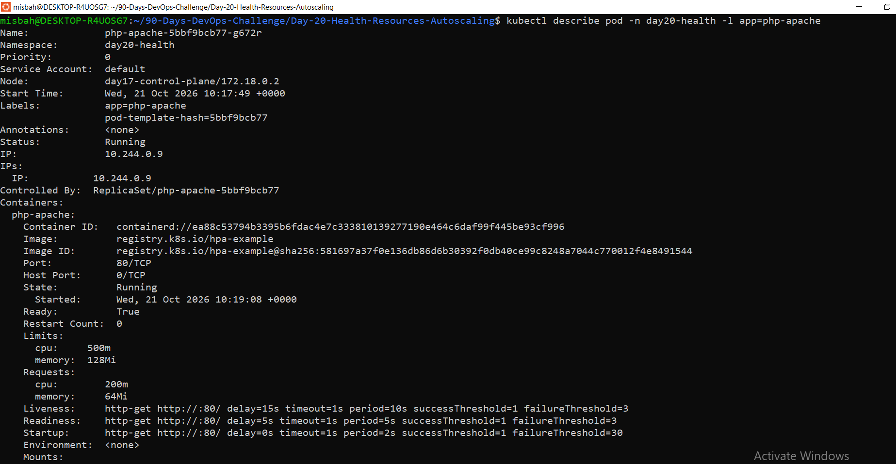
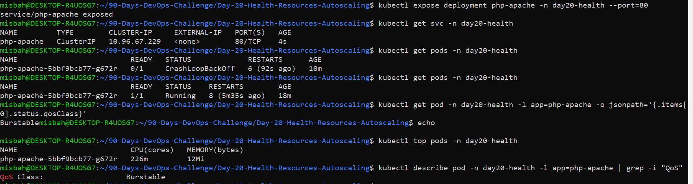
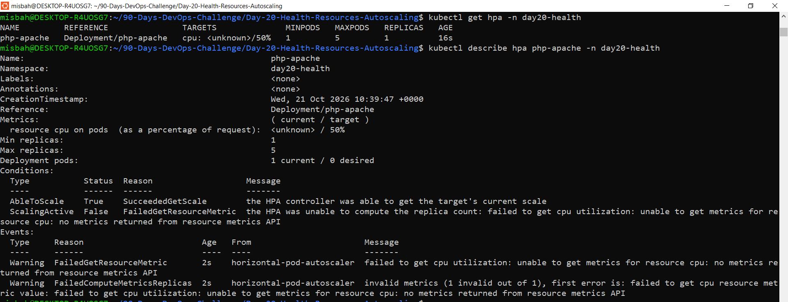
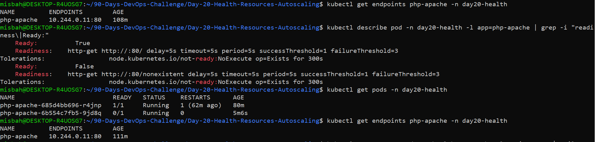
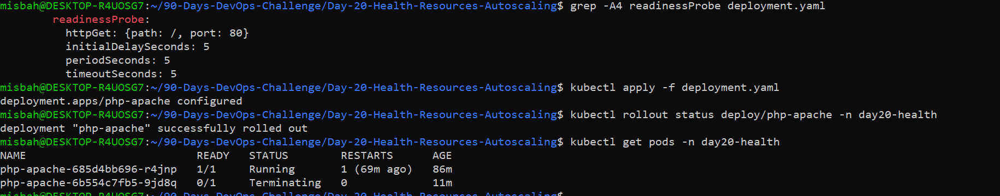

# 🚀 Day 20: Kubernetes Health, Resources & Autoscaling


## 📌 Project Overview

As part of the **DevOps Winter Arc – 90 Days Challenge**, I worked on Kubernetes health monitoring, resource management, and automatic Pod scaling.

The objective was to deploy a resource-aware application, configure health probes, monitor CPU and memory usage, and use Horizontal Pod Autoscaler (HPA) to scale Pods based on CPU utilization.

## 🎯 What I Learned

- Verified Metrics Server and Kubernetes resource metrics.
- Configured CPU and memory requests and limits.
- Implemented Startup, Readiness, and Liveness probes.
- Inspected Kubernetes Quality of Service (QoS).
- Configured Horizontal Pod Autoscaler (HPA).
- Generated HTTP load and monitored autoscaling.
- Tested readiness probe failure and recovery.
- Practiced troubleshooting using `kubectl`.

## 🛠️ Tools & Technologies

- Kubernetes
- Kind
- kubectl
- Metrics Server
- Horizontal Pod Autoscaler
- BusyBox
- YAML

## 🏗️ Project Configuration

| Setting | Value |
|---|---|
| Application | php-apache |
| Namespace | `day20-health` |
| Initial replicas | 1 |
| Minimum replicas | 1 |
| Maximum replicas | 5 |
| Target CPU utilization | 50% |
| CPU request | 200m |
| CPU limit | 500m |
| Memory request | 64Mi |
| Memory limit | 128Mi |
| QoS class | Burstable |

## ❤️ Kubernetes Health Probes

| Probe | Purpose |
|---|---|
| Startup | Gives the application time to initialize. |
| Readiness | Controls whether a Pod receives Service traffic. |
| Liveness | Detects an unhealthy or stuck container and can trigger a restart. |

I tested readiness probe failure using an invalid endpoint, observed the Pod become NotReady, and restored the correct endpoint to verify recovery.

## 📊 Resource Management & QoS

Configured CPU and memory requests and limits to manage container resources.

- **Guaranteed:** Every container has matching CPU and memory requests and limits.
- **Burstable:** Resource requests or limits are configured, but the Pod does not meet Guaranteed criteria.
- **BestEffort:** No CPU or memory requests or limits are configured.

The application used the **Burstable** QoS class.

## 📈 Horizontal Pod Autoscaler (HPA)

Configured HPA to scale the `php-apache` Deployment according to CPU utilization.

- Minimum replicas: 1
- Maximum replicas: 5
- Target CPU utilization: 50%

Generated HTTP traffic using BusyBox and monitored CPU usage, HPA metrics, and Pod replicas. Observed scaling behavior under load and after stopping the load generator.

## 💻 Useful Commands

### Check resource metrics

```bash
kubectl top nodes
kubectl top pods -n day20-health
```

### Inspect Pods

```bash
kubectl get pods -n day20-health
kubectl describe pods -n day20-health
```

### Monitor HPA

```bash
kubectl get hpa -n day20-health
kubectl describe hpa -n day20-health
kubectl get hpa -n day20-health -w
```

### Watch Pod scaling

```bash
kubectl get deployments,pods -n day20-health -w
```

### Check events

```bash
kubectl get events -n day20-health --sort-by=.metadata.creationTimestamp
```

## 📸 Screenshots & Practical Evidence

The following screenshots should be stored in the `evidence/` directory.

### 1. Metrics Server Verification


### 2. Deployment Resources and Health Probes



### 3. QoS and Pod Resource Usage



### 4. HPA Configuration



### 5. Autoscaling Under Load


### 6. Autoscaling After Load Stops


### 7. Readiness Probe Failure and Recovery





> **Note:** These images require the actual screenshot files to be uploaded to `evidence/` with matching filenames. Update the paths if your filenames differ.

## 🔍 Troubleshooting

| Problem | What to Check |
|---|---|
| `kubectl top` fails | Metrics Server status, logs, and metrics availability |
| HPA shows `<unknown>` | Metrics Server, CPU requests, and collected metrics |
| Replicas do not increase | CPU usage, load generator, HPA events, and replica limits |
| Pods keep restarting | Probe configuration, logs, and events |
| Container is `OOMKilled` | Memory usage and configured memory limits |

## 🎓 Interview Questions

**1. What is the difference between Readiness and Liveness probes?**

Readiness controls traffic eligibility. Liveness detects an unhealthy or stuck container and can trigger a restart.

**2. Why does HPA need CPU requests?**

HPA calculates CPU utilization relative to the requested CPU.

**3. What does Metrics Server do?**

It provides CPU and memory metrics used by tools such as `kubectl top` and HPA.

**4. Does autoscaling guarantee better performance?**

No. Node capacity, database latency, and other bottlenecks can still affect performance.

## ✅ Key Takeaways

- Application health monitoring using Kubernetes probes.
- CPU and memory resource management.
- QoS classification and resource inspection.
- CPU-based autoscaling with HPA.
- Load testing and replica monitoring.
- Readiness failure testing and recovery.
- Kubernetes troubleshooting fundamentals.

## 🏁 Project Status

**Day 20 Completed** — Kubernetes Health Probes, Resource Management, QoS, Metrics Server, HPA, Load Testing, and Readiness Recovery.

**Challenge:** DevOps Winter Arc – 90 Days  
**Environment:** Kubernetes Kind Cluster

#DevOps #Kubernetes #CloudComputing #HPA #DevOpsWinterArc 
