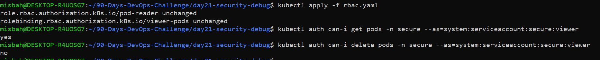
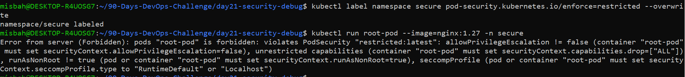
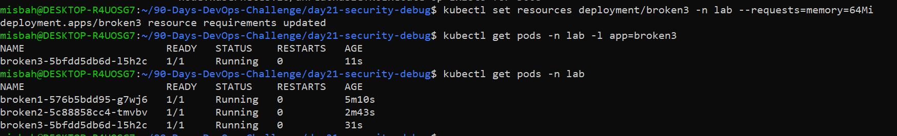

# Day 21: Kubernetes Security, RBAC & Troubleshooting

## Overview
Day 21 challenge focused on Kubernetes RBAC, Pod Security Standards, and troubleshooting broken Deployments.

## Part 1: RBAC & Least Privilege Verification
Created ServiceAccount 'viewer' and Role 'pod-reader' with read-only access in namespace 'secure'.
- get pods: Allowed (yes)
- delete pods: Denied (no)

## Part 2: Pod Security Standards & Hardening
Enforced restricted pod security profile on namespace 'secure'.
Standard root pods were rejected by admission control.

Deployed hardened pod 'secure-pod' with runAsNonRoot and readOnlyRootFilesystem.

## Part 2: Pod Security Standards & Hardening
Enforced restricted pod security profile on namespace 'secure'.
Standard root pods were rejected by admission control.

Deployed hardened pod 'secure-pod' with runAsNonRoot and readOnlyRootFilesystem.

## Part 3: Troubleshooting Broken Deployments
- broken1: Fixed ImagePullBackOff by updating invalid image tag to valid nginx:1.27.
- broken2: Fixed CrashLoopBackOff by changing exit 1 command to long-running process.
- broken3: Fixed Pending status by reducing 64Gi memory request to 64Mi.

