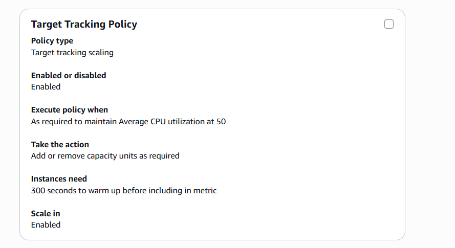
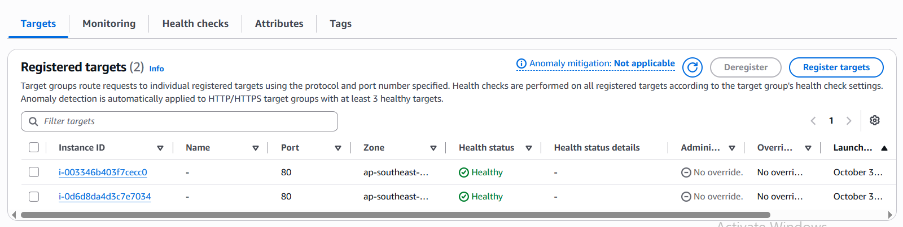
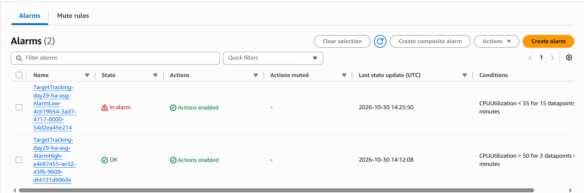
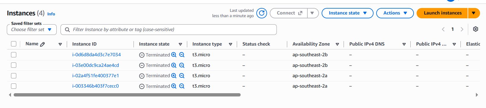

# Day 29: AWS High Availability Architecture Capstone

## 📌 Project Overview

As part of my 90 Days DevOps Challenge, I worked on an AWS High Availability Architecture Capstone project.

The objective was to understand how to build a highly available and fault-tolerant web application using AWS services such as Application Load Balancer (ALB), Auto Scaling Group (ASG), EC2 and CloudWatch.

## 🏗️ Architecture Components

- **Amazon EC2:** Hosts the web application using Nginx.
- **Application Load Balancer (ALB):** Distributes incoming HTTP traffic across healthy targets.
- **Target Group:** Monitors application health using HTTP health checks.
- **Launch Template:** Defines the EC2 configuration and user data.
- **Auto Scaling Group (ASG):** Maintains the desired number of EC2 instances and replaces terminated instances.
- **Multi-AZ:** Distributes application capacity across multiple Availability Zones.
- **Amazon CloudWatch:** Monitors metrics, alarms and infrastructure health.
- **Security Groups:** Controls traffic between the load balancer and application instances.

## ⚙️ Implementation

1. Configured security groups for ALB and application instances.
2. Created an EC2 Launch Template with Nginx user data.
3. Configured a Target Group with HTTP health checks.
4. Created an Application Load Balancer.
5. Configured an Auto Scaling Group with minimum 2, desired 2 and maximum 4 instances.
6. Tested application access through the ALB DNS endpoint.
7. Tested instance replacement through Auto Scaling.
8. Reviewed CloudWatch monitoring and alarms.

## 🧪 Testing and Validation

- Verified healthy target registration.
- Tested repeated ALB requests and instance responses.
- Tested ASG instance replacement.
- Reviewed CloudWatch alarms and dashboard.
- Verified resource cleanup after completing the lab.

## 📸 Screenshots

### 1. Initial Setup

### 2. Healthy Targets

### 3. ALB Traffic Testing

### 4. Auto Scaling Replacement

### 5. CloudWatch Monitoring

### 6. AWS Resource Cleanup

## 🧹 Cost Optimization and Cleanup

After completing the practical lab:

- Deleted the Auto Scaling Group.
- Confirmed the associated EC2 instances were terminated.
- Deleted the Application Load Balancer and Target Group.
- Removed the Launch Template and CloudWatch Dashboard.
- Checked the lab resources to avoid unnecessary ongoing charges.

## 📚 Key Learnings

- Understanding AWS High Availability.
- Difference between ALB and Target Group.
- Auto Scaling and self-healing concepts.
- Multi-AZ architecture.
- EC2 health checks and application monitoring.
- CloudWatch metrics and alarms.
- AWS resource cleanup and cost management.

## 🎯 Conclusion

This capstone helped me understand how AWS services work together to build a highly available and scalable application infrastructure.

**Day 29/90 completed – Continuing my DevOps learning journey!**

#90DaysOfDevOps #AWS #CloudComputing #DevOps #AmazonEC2 #ALB #AutoScaling #CloudWatch
