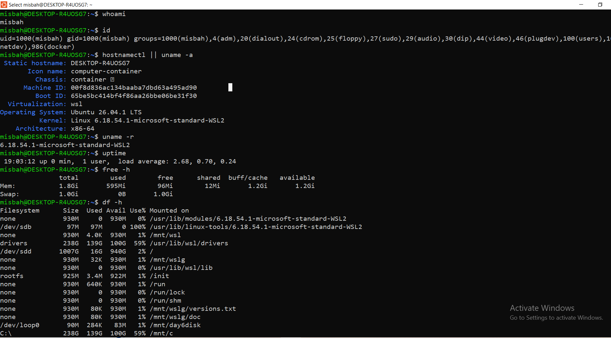
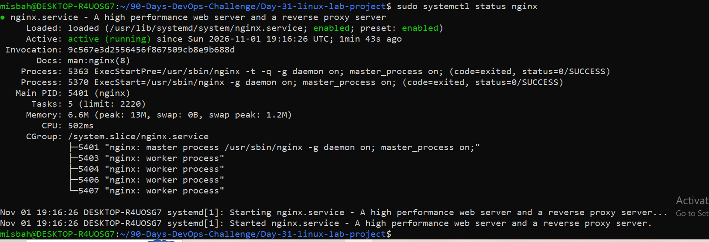
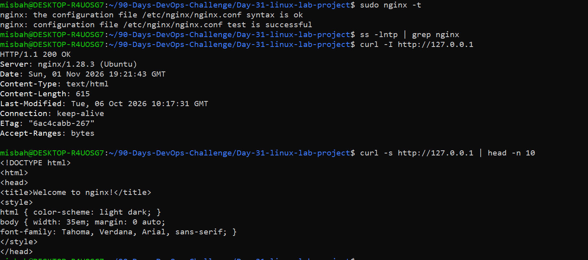
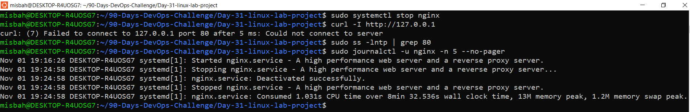
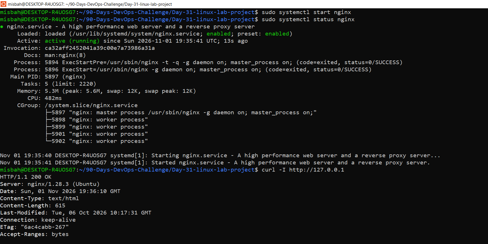

# 🐧 DevOps Winter Arc: Day 31/90
## Linux + Networking Revision Lab

> **Learn → Build → Break → Fix → Explain**


-orange)


---

## 📌 Overview

Day 31 is part of **Revision + Integration Project Week**. The goal of this lab was to practice host operation and networking on Linux: checking the system, running a web service under `systemd`, verifying its listening port and HTTP response, reading logs, and finishing with a safe break-and-fix troubleshooting drill.

Since the Day 30 app was not ready yet, I used a **temporary Nginx page**, as allowed by the lab instructions. It can be swapped for the project app later.

**Finish line:** App running on Linux ✅ · Port/logs verified ✅ · One issue fixed ✅ · Day 31 notes committed ✅

---

## 🧰 Environment

| Item | Value |
|---|---|
| Host | Windows with WSL2 |
| Distribution | Ubuntu 24.04 |
| Kernel | 6.18.54.1 |
| Web server | Nginx 1.28.3 (Ubuntu) |
| Service manager | systemd |
| Listening port | 80 (HTTP) |
| Project path | `~/90-Days-DevOps-Challenge/Day-31-linux-lab-project` |

> Everything was done in my own local WSL2 environment. No shared services or firewall rules were changed, and no AWS resources were used.

---

## 📁 Project Structure

```
Day-31-linux-lab-project/
├── README.md
└── screenshots/
    ├── 01-system-checks.png
    ├── 02-service-status.png
    ├── 03-port-curl-response.png
    ├── 04-troubleshoot-failure-evidence.png
    └── 05-successful-recovery.png
```

---

## ✅ Task A: Linux Environment & System Checks

**Objective:** Record system details, create a project directory under my home folder, and review permissions using least privilege.

```bash
whoami
id
hostnamectl
uname -r
uptime
free -h
df -h
ls -la
stat .
```

**What I checked**

- Linux distribution and kernel version (Ubuntu 24.04 on WSL2, kernel 6.18.54.1)
- Current user and group membership
- Uptime, memory usage (`free -h`) and disk space (`df -h`)
- Created the project directory inside my home folder (not in a protected system directory)
- Verified directory permissions are `0755`: owner has full access, others can only read and traverse. **`chmod 777` was not used.**

```bash
mkdir -p ~/90-Days-DevOps-Challenge/Day-31-linux-lab-project/screenshots
```

📸 **Screenshot 1: System checks**



---

## ✅ Task B: Running the App as a Linux Service

**Objective:** Start the web server, confirm the process is running, and identify the listening port.

```bash
sudo apt update
sudo apt install nginx -y
sudo systemctl start nginx
systemctl status nginx
ss -lntp
```

**Result**

- `Active: active (running)` since Sun 2026-11-01 19:35:41 UTC
- Main PID **5897** (`nginx: master process`) with four worker processes (5898, 5899, 5901, 5902)
- Runs under the `system.slice/nginx.service` cgroup
- Pre-start config test (`nginx -t`) exited with `status=0/SUCCESS`

📸 **Screenshot 2: Service status**



---

## ✅ Task C: Nginx / HTTP Networking Check

**Objective:** Validate configuration and confirm the server responds over HTTP.

```bash
sudo nginx -t
curl -I http://127.0.0.1
curl -s http://127.0.0.1 | head
ss -lntp
```

**Response received**

```
HTTP/1.1 200 OK
Server: nginx/1.28.3 (Ubuntu)
Content-Type: text/html
Content-Length: 615
Connection: keep-alive
Accept-Ranges: bytes
```

| Check | Result |
|---|---|
| Config syntax (`nginx -t`) | OK |
| Listening port | 80 |
| HTTP status | `200 OK` |
| Content | Default Nginx welcome page |

📸 **Screenshot 3: Port and curl response**



---

## ✅ Task D: Safe Troubleshooting Drill

**Objective:** Break my own service on purpose, observe the symptoms, fix it, and verify recovery. This was lab-only and non-destructive.

### 🔴 Break

```bash
sudo systemctl stop nginx
curl -I http://127.0.0.1
systemctl status nginx
journalctl -u nginx --since "30 minutes ago"
```

📸 **Screenshot 4: Failure evidence**



### 🟢 Fix

```bash
sudo systemctl start nginx
systemctl status nginx
curl -I http://127.0.0.1
```

📸 **Screenshot 5: Successful recovery**



---

## 🧾 Incident Report

| Stage | Details |
|---|---|
| **Symptom** | `curl http://127.0.0.1` failed with `curl: (7) Failed to connect ... Connection refused` |
| **Evidence** | `systemctl status nginx` showed the service as inactive (dead); `journalctl -u nginx` logged the service being stopped; `ss -lntp` showed nothing listening on port 80 |
| **Root cause** | The Nginx service had been stopped, so no process was listening on port 80 and the connection was refused |
| **Fix** | `sudo systemctl start nginx` |
| **Verification** | Service returned to `active (running)`, port 80 was listening again, and `curl -I http://127.0.0.1` returned `HTTP/1.1 200 OK` |

### 💡 Reflection

- **Root cause:** a stopped service, so nothing was bound to the port.
- **Command that identified it fastest:** `systemctl status nginx`, confirmed by `ss -lntp` and `journalctl -u nginx`.
- **Key lesson:** *Connection refused* usually means "nothing is listening." Check the service and the port first, before touching permissions or the firewall.

---

## 🔍 Troubleshooting Quick Reference

| Symptom | First checks |
|---|---|
| Connection refused | Is the app running? Correct port? Check `ss -lntp` and service status |
| HTTP 403 / permission denied | Check owner, directory execute permission, and Nginx logs; avoid broad `chmod` |
| Nginx fails to start | Run `nginx -t`; inspect status/logs; check whether port 80 is already in use |
| Works locally, not remotely | Check host IP, listening address, WSL/VM networking, authorized firewall rules |
| Disk full / app behaving oddly | Check `df -h` and logs; identify large files before deleting anything |

---

## 🎤 Interview Warm-up

**Q. What does `systemctl` do?**
It manages and inspects systemd services and system state.

**Q. How do you find a process listening on a port?**
Use `ss -lntp` and inspect the process information.

**Q. Where can you inspect a systemd service's logs?**
Use `journalctl -u <service>`, for example `journalctl -u nginx`.

**Q. Localhost vs host IP?**
Localhost means the same machine. A host IP can be reached over a network if binding and firewall rules allow it.

---

## 📋 Completion Checklist

- [x] Ran Nginx on Linux (temporary page for the project app)
- [x] Checked user, permissions, resources, and disk space
- [x] Identified the service/process and listening port
- [x] Inspected logs and verified the HTTP response
- [x] Completed one safe troubleshooting drill and documented recovery
- [x] Updated the repository with notes and 5 screenshots

---

## 🔐 Safety Notes

- Used only my own local WSL2 environment
- No shared services or firewall rules were modified
- No destructive commands and no `chmod 777`
- No secrets, tokens, or credentials included

---

## 🚀 Next Steps

- Replace the temporary Nginx page with the Day 30 project app
- Add helper scripts under `linux/` and move the incident report to `docs/day31-linux-lab.md` if the repo structure requires it
- Continue to Day 32

---

**⭐ Day 31/90 complete. Learn → Build → Break → Fix → Explain.**
