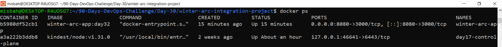
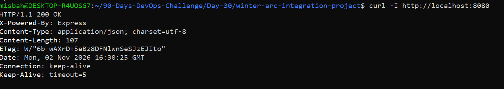
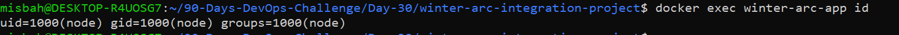
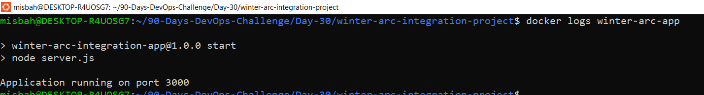

# Day 32/90 — Docker Image + Container Revision Lab

**DevOps Winter Arc** | Revision Week | Learn → Build → Break → Fix → Explain

## 🎯 Goal
Day 30 ki integration project app (Node.js) ko Docker image me package karna, container me run karna, logs/ports/non-root verify karna, aur ek controlled break/fix drill complete karna.

## 📦 Quick Summary

| Item | Value |
|------|-------|
| Base image | `node:22-alpine` |
| Image tag | `winter-arc-app:day32` |
| Container name | `winter-arc-app` |
| Port mapping | Host `8080` → Container `3000` |
| Runtime user | `node` (uid=1000, non-root) |

---

## 1. `.dockerignore`

**Kyu:** Build context chhota rakhne ke liye aur secrets image me na jaane dene ke liye.

```
node_modules
.git
.env
*.log
```

## 2. Dockerfile

```dockerfile
FROM node:22-alpine
WORKDIR /app
COPY package*.json ./
RUN npm ci --omit=dev
COPY . .
USER node
EXPOSE 3000
CMD ["npm", "start"]
```

**Design choices:**
- `alpine` base → chhota image size
- `package*.json` pehle copy → Docker layer caching ka fayda (code badle to dependencies dobara install nahi hoti)
- `USER node` → container root se nahi chalta
- `EXPOSE 3000` → app ka port document karta hai (ye port publish nahi karta)

## 3. Build & Run

```bash
docker build -t winter-arc-app:day32 .
docker run -d --name winter-arc-app -p 8080:3000 winter-arc-app:day32
```

`-p 8080:3000` ka matlab: host ka port 8080 container ke port 3000 par forward hota hai.

## 4. Verification

```bash
docker ps
docker logs winter-arc-app
curl -I http://localhost:8080
docker exec winter-arc-app id
```

| Check | Result |
|-------|--------|
| `docker ps` | Container `Up`, `0.0.0.0:8080->3000/tcp` |
| `docker logs` | `Application running on port 3000` |
| `curl -I` | `HTTP/1.1 200 OK` |
| `docker exec ... id` | `uid=1000(node)` → non-root ✅ |

### Screenshots





---

## 5. 🔧 Break/Fix Incident Report

| Stage | Details |
|-------|---------|
| **Symptom** | `curl -I http://localhost:8080` fail hua: `curl: (56) Recv failure: Connection reset by peer` |
| **Evidence** | Container `Up` tha, lekin `docker port` me mapping `8080 -> 5000` dikhi. App ke logs me port `3000` likha tha. |
| **Root cause** | Galat port mapping (`-p 8080:5000`). Host traffic container ke port 5000 par ja raha tha, jahan koi process listen nahi kar raha tha. App sirf 3000 par chal rahi thi. |
| **Fix** | Container remove kiya aur sahi mapping ke saath recreate kiya. |
| **Verification** | `curl -I` se `HTTP/1.1 200 OK` wapas aaya. |

**Commands:**
```bash
# Break
docker rm -f winter-arc-app
docker run -d --name winter-arc-app -p 8080:5000 winter-arc-app:day32
curl -I http://localhost:8080        # fails

# Investigate
docker ps -a
docker port winter-arc-app
docker logs winter-arc-app

# Fix
docker rm -f winter-arc-app
docker run -d --name winter-arc-app -p 8080:3000 winter-arc-app:day32
curl -I http://localhost:8080        # 200 OK
```

---

## 6. 🔒 Security Improvements
- ✅ Non-root user (`USER node`)
- ✅ `.env`, `.git`, logs `.dockerignore` se exclude
- ✅ Koi secret Dockerfile, build args ya image me nahi
- ✅ Privileged mode / host networking use nahi kiya
- ✅ Lightweight alpine base image

## 7. 📝 Key Learnings
- **Image vs Container:** Image packaged template hai, container uska running instance.
- **Port mapping:** `-p HOST:CONTAINER`. Container ka status `Up` hone ka matlab ye nahi ki app reachable hai.
- **0.0.0.0 binding:** App ko container ke andar `0.0.0.0` par listen karna chahiye, warna host se access block ho sakta hai.
- **.dockerignore:** Unnecessary aur sensitive files ko build context se bahar rakhta hai.

## ✅ Completion Checklist
- [x] Dockerfile likha
- [x] Image build + tag kiya
- [x] Container sahi port mapping ke saath run kiya
- [x] Logs/status check kiye, controlled failure practice ki
- [x] Non-root aur secrets exclusion verify kiya
- [x] Day 32 artifacts commit kiye

**Next:** Day 33 — Docker Compose 
