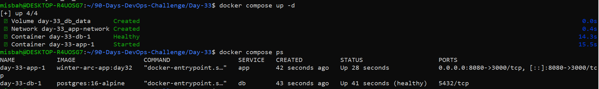
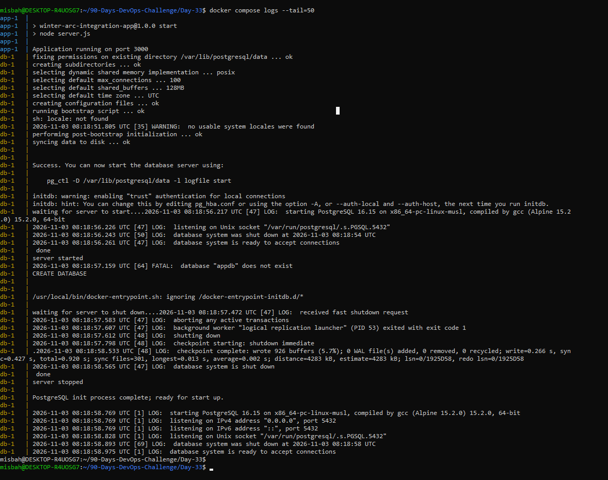
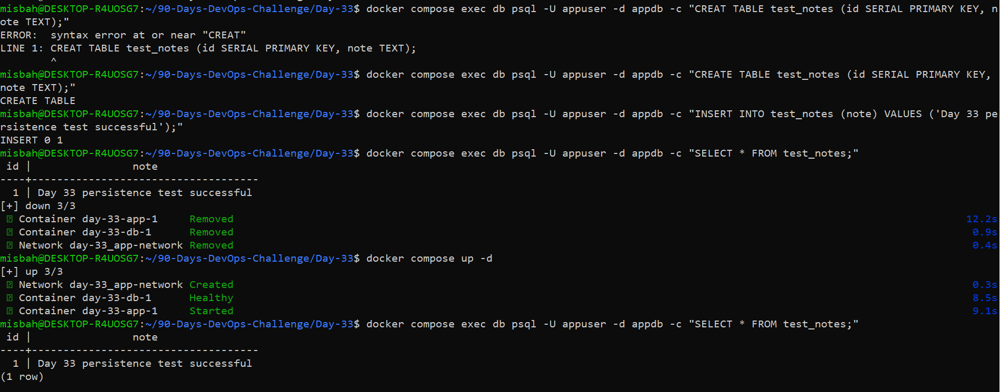
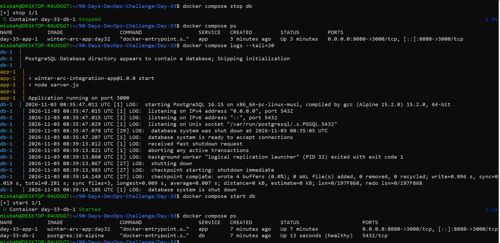

# Day 33/90 – Docker Compose Multi-Service Lab

## Overview
App aur PostgreSQL ko Docker Compose se ek stack me chalaya. App DB se service name `db` ke through connect hota hai, `localhost` se nahi.

## Services
| Service | Image | Purpose |
|---------|-------|---------|
| app | build: ./app (Day 30/32 Dockerfile) | Application |
| db | postgres:16-alpine | Database (healthcheck: `pg_isready`) |

## Network Path
`Browser -> localhost:8080 -> app:3000 -> db:5432`

Dono services ek shared Compose network par hain. DB port host par publish nahi kiya.

## Config & Secrets
- Real secrets `.env` me hain (Git-ignored).
- `.env.example` me sirf dummy values hain.

## Run
```bash
cp .env.example .env
docker compose config
docker compose up -d --build
docker compose ps
docker compose logs --tail=100
```

## Verification
- `docker compose ps` me app Up aur db healthy.
- App endpoint test kiya, dono services ke logs check kiye.
- `docker compose exec app getent hosts db` se service-name resolution verify kiya.




## Persistence Proof
Named volume `db_data` -> `/var/lib/postgresql/data`.

Test row insert kiya, `docker compose down` (bina `-v`) chalaya, phir `up -d` kiya. Restart ke baad bhi data mila.

Container ki writable layer container ke saath delete ho jati hai. Named volume Docker container ke bahar manage karta hai, isliye data bachta hai.



## Break/Fix Drill
| Step | Details |
|------|---------|
| Issue | `DB_HOST` ko galat value kar diya |
| Symptom | App DB se connect nahi ho paya |
| Evidence | `docker compose logs app` me connection/DNS error |
| Root Cause | Galat hostname; service name `db` hona chahiye |
| Fix | `DB_HOST=db` wapas kiya, `docker compose up -d` |
| Verification | App response normal, logs clean |

Volume delete nahi kiya gaya.



## Interview Notes
- **Compose kya solve karta hai?** Multi-container app ko ek stack ki tarah define aur run karta hai.
- **Services ek dusre ko kaise dhoondti hain?** Shared network par service name DNS hostname hota hai.
- **Named volume kyun?** Data writable layer se bahar rehta hai.
- **depends_on readiness guarantee karta hai?** Akele nahi; healthcheck + `condition: service_healthy` ya retry logic chahiye.

## Deliverables
- `compose.yaml`
- `.env.example`
- `docs/day33-compose-lab.md`
- `evidence/` screenshots
