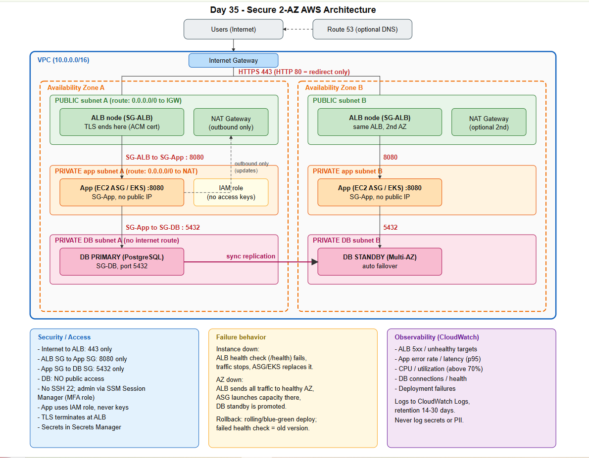
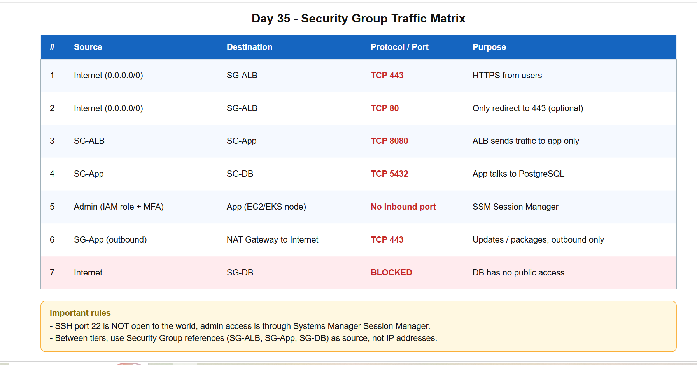
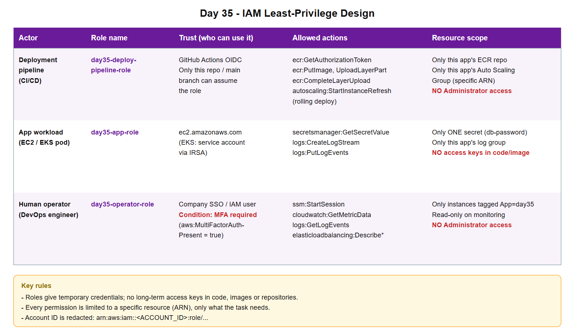
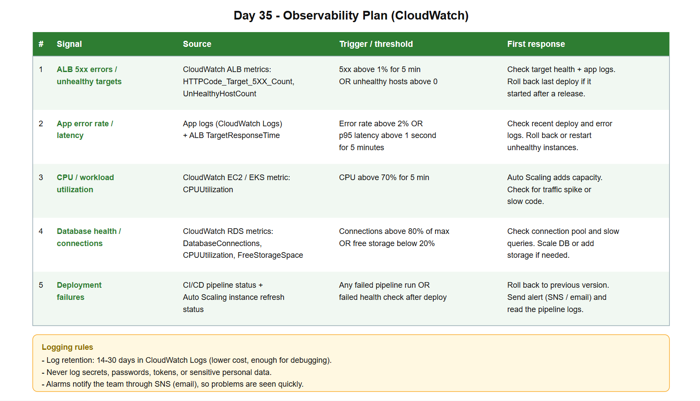
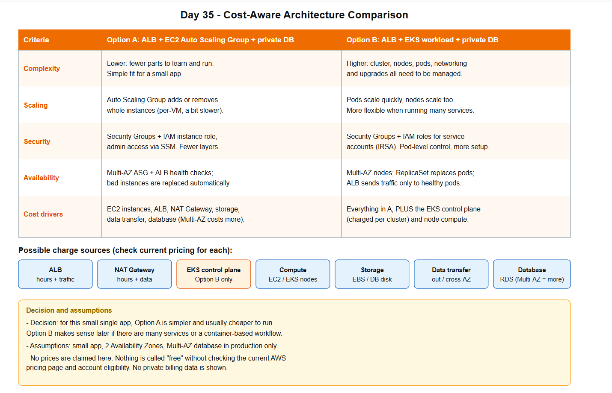

# AWS Architecture & Security Design Lab | Day 35/90

**Type:** Design-only lab. No AWS resources were created, so no cost was incurred.

## Overview
Secure and resilient AWS design for the app from Days 30-34:

`Users -> (Route 53) -> HTTPS ALB (public subnets) -> App tier (private subnets, EC2 ASG or EKS) -> Private database`

The design uses 1 VPC, 2 Availability Zones, an Internet Gateway for the public subnets, NAT only for outbound traffic from private subnets, CloudWatch for monitoring, and IAM roles for all workloads.

## 1. Architecture Diagram

**Design decisions**
- **Private app subnets:** reduce direct exposure; the app accepts traffic only from the ALB.
- **ALB in public subnets:** single controlled entry point; TLS ends at the ALB (ACM certificate).
- **Private DB subnets:** no public route; only the app can reach the database.
- **2 Availability Zones:** if one AZ fails, the other keeps serving traffic.

## 2. Network and Security-Group Matrix

| Source | Destination | Port | Purpose |
|---|---|---|---|
| Internet | SG-ALB | TCP 443 | HTTPS from users |
| Internet | SG-ALB | TCP 80 | Redirect to 443 only (optional) |
| SG-ALB | SG-App | TCP 8080 | ALB to app |
| SG-App | SG-DB | TCP 5432 | App to PostgreSQL |
| Admin (IAM role + MFA) | App | No inbound port | SSM Session Manager (no SSH 22) |
| Internet | SG-DB | Blocked | No public database access |

Between tiers, Security Group references are used as the source, not IP addresses.

## 3. IAM Least-Privilege Design

Policy files are in the [`iam/`](iam/) folder. Account IDs and regions are placeholders.

| Actor | Role | Trust | Actions | Scope |
|---|---|---|---|---|
| Deployment pipeline | `day35-deploy-pipeline-role` | GitHub Actions OIDC (this repo, main branch) | ECR push, `autoscaling:StartInstanceRefresh` | This app's ECR repo and Auto Scaling Group |
| App workload | `day35-app-role` | `ec2.amazonaws.com` (EKS: IRSA) | `secretsmanager:GetSecretValue`, log write | One secret and this app's log group |
| Human operator | `day35-operator-role` | SSO / IAM user with MFA required | `ssm:StartSession`, read-only monitoring | Instances tagged `App=day35` |

- No access keys in code, images or repositories; roles give temporary credentials.
- No Administrator access for any actor.

## 4. Resilience and Traffic Flow
- **ALB health-check path:** `/health` (expects HTTP 200). Unhealthy targets stop receiving traffic.
- **Replacing unhealthy compute:** the Auto Scaling Group terminates and replaces unhealthy instances. On EKS, the ReplicaSet replaces failed pods.
- **Components spanning AZs:** ALB, app instances/nodes, and the database standby.
- **Database:** Multi-AZ in production for automatic failover. Single-AZ is acceptable for learning/dev because it costs less, but it has no failover.
- **Safe deploy and rollback:** rolling update (or blue/green) with health checks. If checks fail, the previous version is restored.

## 5. Observability Plan

| Signal | Source | Trigger | First response |
|---|---|---|---|
| ALB 5xx / unhealthy targets | ALB metrics | 5xx above 1% or unhealthy hosts above 0 | Check target health and logs; roll back if after a deploy |
| App error rate / latency | App logs, `TargetResponseTime` | Errors above 2% or p95 above 1s | Check recent deploy; roll back or restart |
| CPU / utilization | `CPUUtilization` | Above 70% for 5 min | Auto Scaling adds capacity; check for spike |
| Database health | RDS `DatabaseConnections`, storage | Connections above 80% or storage below 20% | Check pool and slow queries; scale |
| Deployment failures | CI/CD, instance refresh status | Any failure | Roll back; alert via SNS |

**Logs:** retention 14-30 days. Never log secrets, passwords, tokens or sensitive personal data.

## 6. Cost-Aware Architecture Decision

| | Option A: ALB + EC2 ASG + private DB | Option B: ALB + EKS + private DB |
|---|---|---|
| Complexity | Lower | Higher |
| Scaling | Per-instance via ASG | Pods and nodes, more flexible |
| Security | SG + IAM instance role | SG + IAM + IRSA, pod-level control |
| Availability | Multi-AZ ASG + ALB health checks | Multi-AZ nodes + ReplicaSet |
| Cost drivers | EC2, ALB, NAT, storage, data transfer, DB | All of A, plus EKS control plane and nodes |

**Possible charge sources:** ALB, NAT Gateway, EKS control plane, compute, storage, data transfer, database.

**Decision:** for this small single app, Option A is simpler and usually cheaper. Option B fits better if the app grows into many services.

**Assumptions:** small app, 2 AZs, Multi-AZ database in production only. No resource is assumed free; current AWS pricing and account eligibility must be checked before any deployment.

## Interview Quick-Check
1. **Why private app subnets?** Less direct exposure; traffic only from approved sources like the ALB.
2. **Why IAM roles?** Scoped, temporary permissions without hard-coded keys.
3. **ALB health checks?** Identify healthy targets and stop routing to unhealthy ones.
4. **Multi-AZ vs Multi-Region?** AZ failure vs regional failure; Multi-Region costs more.
5. **Least privilege?** Only the permissions needed for the task.

## Cleanup
No AWS resources were created in this lab, so nothing needs to be deleted.
