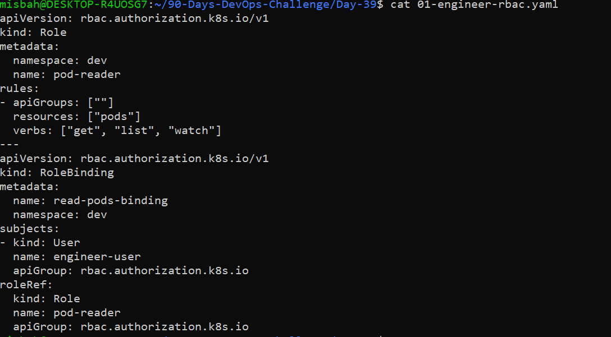
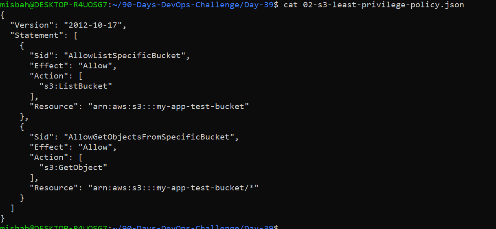
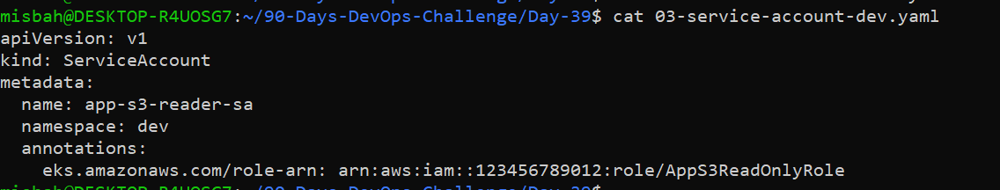
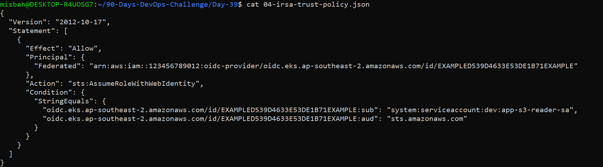
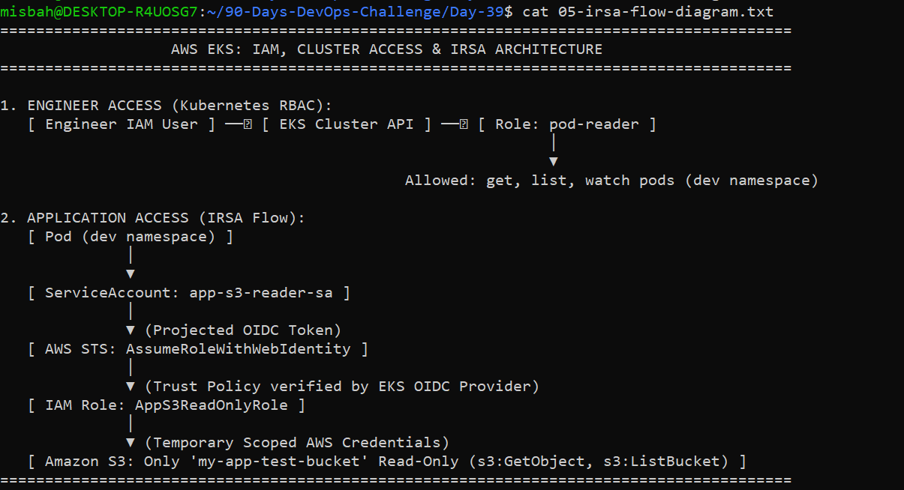

# Day 39: AWS EKS — IAM, Cluster Access & IRSA (IAM Roles for Service Accounts)

## 📌 Overview & Learning Objectives
The primary goal of Day 39 is implementing the **Principle of Least Privilege** for both human users and workloads running on Amazon EKS:
- Distinguish between **AWS IAM** and **Kubernetes RBAC**.
- Design cluster access for engineers using Kubernetes RBAC.
- Implement **IRSA (IAM Roles for Service Accounts)** so application Pods receive temporary, scoped AWS permissions instead of broad node-level permissions.
- Eliminate static AWS credentials and avoid unnecessary AWS infrastructure costs by following design-first architecture principles.

---

## ⚖️ AWS IAM vs. Kubernetes RBAC
- **AWS IAM:** Authenticates identities (users, roles, federated identities) and authorizes actions against AWS APIs (e.g., EKS control plane access, S3, RDS, DynamoDB).
- **Kubernetes RBAC:** Authorizes authenticated users or ServiceAccounts to perform actions inside the Kubernetes API server (e.g., `get`, `list`, `watch` on Pods, Services, Deployments in a namespace).

---

## 🛠️ Architecture Design & Deliverables

### 1. Engineer Access (Task A: Kubernetes RBAC)
An engineer requires read-only visibility into Pods located strictly within the `dev` namespace.
- **Manifest File:** `01-engineer-rbac.yaml`
- **Permissions:** Verbs `get`, `list`, `watch` scoped to `pods` in `namespace: dev`.

---

### 2. Application Least-Privilege S3 Policy (Task A & Task C)
The application requires read-only access to a single designated S3 bucket (`my-app-test-bucket`).
- **Policy File:** `02-s3-least-privilege-policy.json`
- **Actions Allowed:** `s3:ListBucket` (Bucket level) and `s3:GetObject` (Object level).

---

### 3. Dedicated Kubernetes ServiceAccount
A dedicated ServiceAccount in namespace `dev` binds the Pod to the designated AWS IAM Role via an annotation.
- **Manifest File:** `03-service-account-dev.yaml`
- **Annotation:** `eks.amazonaws.com/role-arn: arn:aws:iam::123456789012:role/AppS3ReadOnlyRole`

---

### 4. IRSA Trust Relationship Policy
The IAM role trust policy restricts access strictly to the cluster's OIDC identity provider, target namespace (`dev`), and ServiceAccount (`app-s3-reader-sa`).
- **Policy File:** `04-irsa-trust-policy.json`
- **Action:** `sts:AssumeRoleWithWebIdentity`
- **Condition:** Validates the OIDC subject (`sub`) and audience (`aud`).

---

### 5. IRSA End-to-End Architecture Flow
The credential exchange follows an automated, token-based verification path:

---

## 🔒 Why IRSA is Safer than Node IAM Roles (Security Explanation)
Relying on worker node IAM roles gives every Pod scheduled on that node access to the exact same AWS permissions via the instance metadata service (IMDS). If one container is compromised, the attacker inherits full node-level privileges, risking data exposure across the entire AWS account. 

IRSA completely isolates workload permissions by leveraging OIDC federated identity. Pods receive short-lived, auto-rotating AWS credentials valid only for their dedicated IAM role, constrained to their exact namespace and ServiceAccount. This ensures strict adherence to least privilege, prevents cross-pod privilege escalation, and avoids embedding long-lived static AWS access keys inside container images.

---

## 🎯 Interview Quick Check
1. **What is the difference between AWS IAM and Kubernetes RBAC?**
   AWS IAM manages identity access to AWS services, while Kubernetes RBAC manages what authenticated identities can perform inside the Kubernetes cluster API.
2. **What is an EKS access entry?**
   An EKS Access Entry is a modern, native AWS resource that grants IAM principals access to an EKS cluster with associated access policies, without editing the legacy `aws-auth` ConfigMap.
3. **What problem does IRSA solve?**
   IRSA solves the security risk of granting broad IAM permissions to underlying EC2 nodes, allowing individual pods to assume scoped IAM roles with temporary credentials.
4. **Why should a Pod not automatically inherit the node IAM role?**
   Because any pod co-located on that node can inherit the same broad access, violating least privilege and exposing shared cluster resources to privilege escalation attacks.
5. **What are the OIDC provider and trust policy used for?**
   The OIDC provider establishes cluster-to-AWS identity federation, and the trust policy validates the projected token's subject (`system:serviceaccount:<namespace>:<serviceaccount>`) before STS issues temporary credentials.

---

## 💰 Cost & Safety Compliance

In accordance with AWS cost optimization and project guidelines, no paid EKS clusters or EC2 worker nodes were provisioned for this task. The exercise was completed via architectural design, least-privilege policy manifests, and local validation
