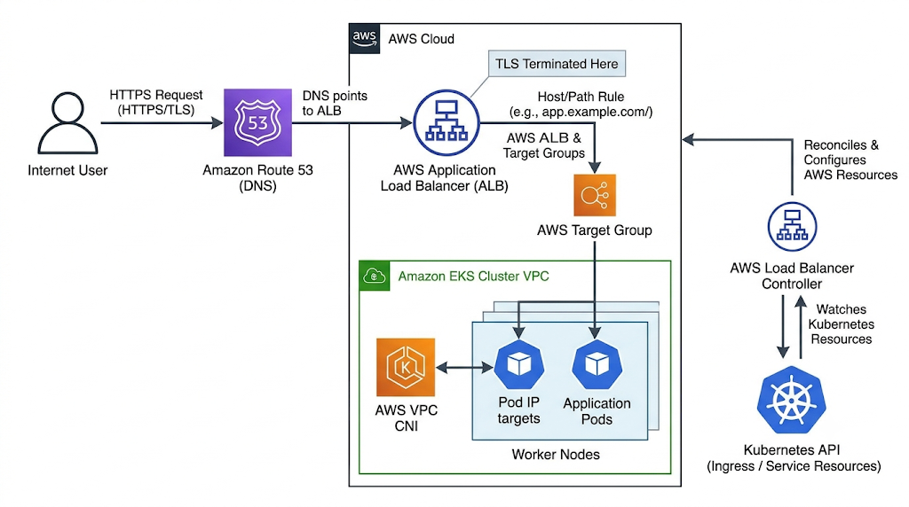
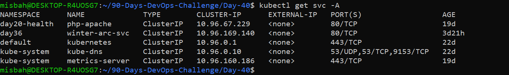
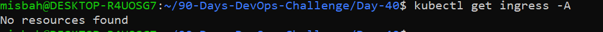
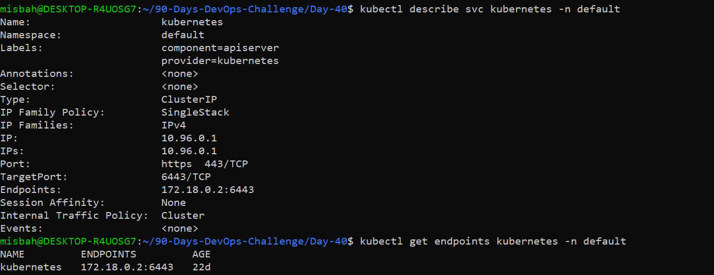
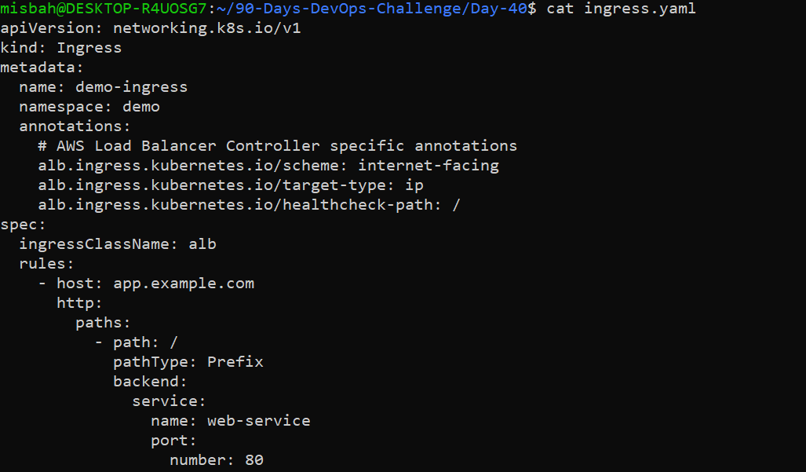

# 🚀 Day 40: AWS EKS — AWS Load Balancer Controller

> **DevOps Winter Arc | 90 Days DevOps Challenge**
> Theme: *Exposing Kubernetes Applications Safely*


---

## 📑 Table of Contents

1. [Overview](#-overview)
2. [Learning Objectives](#-learning-objectives)
3. [Pre-Check & Cost-Safety Decision](#-pre-check--cost-safety-decision)
4. [Core Concepts](#-core-concepts)
5. [Task A — ALB Request Flow](#-task-a--alb-request-flow)
6. [Task B — Exposure Methods Comparison](#-task-b--exposure-methods-comparison)
7. [Task C — Read-Only Cluster Inspection](#-task-c--read-only-cluster-inspection)
8. [Task D — Ingress Design](#-task-d--ingress-design)
9. [Task E — Optional AWS Lab](#-task-e--optional-aws-lab-approval-required)
10. [Troubleshooting Guide](#-troubleshooting-guide)
11. [Interview Quick Check](#-interview-quick-check)
12. [Completion Checklist](#-completion-checklist)
13. [Cost & Safety Note](#-cost--safety-note)
14. [Key Takeaways](#-key-takeaways)

---

## 📌 Overview

Today I learned how to expose Kubernetes applications to the outside world using **Ingress** and the **AWS Load Balancer Controller**, which provisions an **Application Load Balancer (ALB)** on AWS.

Because ALBs, EKS control planes, EC2 nodes and public IPv4 addresses are **billable**, I followed the cost-safety guidelines: all work was done as **design + read-only inspection on a local KinD cluster**. No AWS resources were created.

---

## 🎯 Learning Objectives

- Understand Kubernetes Service types: **ClusterIP, NodePort, LoadBalancer**
- Differentiate **ALB (Layer 7)** and **NLB (Layer 4)**
- Explain **Ingress** and the **AWS Load Balancer Controller**
- Understand request routing, **target groups**, **health checks** and security prerequisites

---

## 🛡️ Pre-Check & Cost-Safety Decision

Before starting, I checked whether any billable environment was running:

```bash
aws eks list-clusters
kubectl get nodes
```

**Findings**

- No billable AWS EKS cluster was running.
- A local **KinD** cluster (`day17-control-plane`) was `Ready`.
- As per the safety instructions, **no ALB/NLB or controller was created** without account-owner approval.

✅ Result: Design and inspection completed with **zero cloud cost**.

---

## 🧠 Core Concepts

| Concept | Description |
|---|---|
| **ClusterIP** | Exposes a Service only inside the cluster |
| **NodePort** | Opens a port (30000–32767) on every node |
| **LoadBalancer** | Asks the cloud provider for an external load balancer |
| **Ingress** | Declares HTTP/HTTPS routing rules (host/path) — needs a controller to work |
| **Ingress Controller** | The component that actually implements the Ingress rules |
| **AWS Load Balancer Controller** | Watches Ingress/Service resources and creates/updates ALBs, NLBs, listeners, rules and target groups on AWS |
| **Target Group** | The set of destinations (instances or Pod IPs) that receive traffic |
| **Health Check** | Periodic probe that decides whether a target should receive traffic |

### ALB vs NLB

| Feature | ALB | NLB |
|---|---|---|
| OSI Layer | Layer 7 | Layer 4 |
| Protocols | HTTP, HTTPS, gRPC | TCP, UDP, TLS |
| Routing | Host / path / header based | Port based |
| Created by | Ingress | Service `type: LoadBalancer` |
| Best for | Web apps, microservices, APIs | High-throughput, low-latency TCP/UDP, static IPs |

---

## 🏗️ Task A — ALB Request Flow



**Flow:**

```
Internet User
    ↓
Route 53 (DNS: app.example.com → ALB DNS name)
    ↓
AWS Application Load Balancer
    ↓  Listener :443  (TLS terminated here using ACM certificate)
Host / Path Rule  (app.example.com  +  /)
    ↓
Target Group  (target-type: ip)
    ↓
Kubernetes Pod  (via AWS VPC CNI, Pod IP)
    ↓
Response back to the user
```

**Where things happen**

- **DNS:** Route 53 record (Alias/CNAME) points `app.example.com` to the ALB DNS name.
- **TLS termination:** At the ALB HTTPS listener (port 443) using an ACM certificate.
- **Reconciliation:** The AWS Load Balancer Controller watches Ingress resources through the Kubernetes API and compares the *desired state* (Ingress spec) with the *actual state* in AWS. It then creates, updates or deletes the ALB, listeners, rules and target groups until both match.

### Ingress vs Service of type LoadBalancer

| | Service `type: LoadBalancer` | Ingress + ALB |
|---|---|---|
| Layer | L4 (NLB) | L7 (ALB) |
| Load balancers | One per Service | One shared ALB for many Services |
| Routing | Port based | Host and path based |
| TLS / HTTP features | Limited | Full (redirects, host rules, WAF, etc.) |
| Cost | Higher with many services | Lower — one ALB serves many apps |

---

## ⚖️ Task B — Exposure Methods Comparison

| Method | Layer | Accessible From | Typical Use Case | Things to Consider |
|---|---|---|---|---|
| **ClusterIP** | L4 | Inside cluster only | Service-to-service communication | Default type; most secure |
| **NodePort** | L4 | Node IP + port (30000–32767) | Dev/testing, building block for LBs | Exposes nodes directly; control with security groups |
| **LoadBalancer** | L4 | Internet / VPC via cloud LB | TCP/UDP apps, static IPs (NLB) | One LB per Service = higher cost |
| **Ingress + AWS LB Controller** | L7 | Internet / VPC via ALB | Web apps with host/path routing, TLS | Requires controller, IAM, subnet tags |

**When is an NLB suitable?** For non-HTTP traffic (TCP/UDP), ultra-low latency, very high throughput, or when static/Elastic IPs are required.

---

## 🔍 Task C — Read-Only Cluster Inspection

Only **read-only** commands were used on the local KinD cluster. Nothing was modified.

### 1. All Services

```bash
kubectl get svc -A
```



### 2. All Ingress resources

```bash
kubectl get ingress -A
```



**Result:** `No resources found` — no Ingress exists in this local cluster. This is recorded as-is; no AWS resources were created just to produce output.

### 3. Describe a Service and its endpoints

```bash
kubectl describe svc kubernetes -n default
kubectl get endpoints kubernetes -n default
```



| Field | Value |
|---|---|
| Service | `kubernetes` |
| Namespace | `default` |
| Type | `ClusterIP` |
| Port | `443/TCP` |
| Selector | None (managed by the control plane) |
| Endpoints | Control-plane API server address |

---

## 📝 Task D — Ingress Design

> ⚠️ **Design only.** This manifest was **not applied** to AWS.

**Requirements**

| Item | Value |
|---|---|
| Namespace | `demo` |
| Service | `web-service` |
| Service port | `80` |
| Host | `app.example.com` |
| Path | `/` |
| Path type | `Prefix` |
| IngressClass | `alb` |

### `ingress.yaml`

```yaml
apiVersion: networking.k8s.io/v1
kind: Ingress
metadata:
  name: web-ingress
  namespace: demo
  annotations:
    alb.ingress.kubernetes.io/scheme: internet-facing
    alb.ingress.kubernetes.io/target-type: ip
    alb.ingress.kubernetes.io/healthcheck-path: /
    # --- Recommended for production (placeholders) ---
    # alb.ingress.kubernetes.io/listen-ports: '[{"HTTP":80},{"HTTPS":443}]'
    # alb.ingress.kubernetes.io/ssl-redirect: "443"
    # alb.ingress.kubernetes.io/certificate-arn: arn:aws:acm:REGION:ACCOUNT_ID:certificate/CERT_ID
spec:
  ingressClassName: alb
  rules:
    - host: app.example.com
      http:
        paths:
          - path: /
            pathType: Prefix
            backend:
              service:
                name: web-service
                port:
                  number: 80
```



### Why is the AWS Load Balancer Controller required?

An Ingress is only a **declaration** of rules. Kubernetes itself does nothing with it. The AWS Load Balancer Controller is the **implementation**: it reads the Ingress and creates the ALB, listeners, rules, target groups and registers Pod IPs on AWS.

### Design Considerations

**DNS**
- Create a Route 53 Alias/CNAME record: `app.example.com` → ALB DNS name.

**TLS Certificate**
- Request/import a certificate in **AWS Certificate Manager (ACM)** for `app.example.com`.
- Reference it using the `certificate-arn` annotation and enable HTTP → HTTPS redirect.

**Subnets**
- Public subnets tagged `kubernetes.io/role/elb = 1` for internet-facing ALBs.
- Private subnets tagged `kubernetes.io/role/internal-elb = 1` for internal ALBs.
- Subnets must span at least two Availability Zones.

**Security Groups**
- ALB SG: allow inbound 80/443 from the intended sources.
- Node/Pod SG: allow inbound from the ALB SG on the application port only.

**Health Checks**
- Path `/`, correct port, expected success codes (e.g. `200`).
- Pods must pass readiness checks to become healthy targets.

**IAM**
- Dedicated IAM role with **scoped** permissions for the controller (IRSA or EKS Pod Identity). No admin access.

### How I would verify it

```bash
# 1. Ingress has an address
kubectl get ingress -n demo
kubectl describe ingress web-ingress -n demo

# 2. Controller is healthy and reconciling
kubectl get pods -n kube-system | grep aws-load-balancer-controller
kubectl logs -n kube-system deploy/aws-load-balancer-controller

# 3. Backend is ready
kubectl get endpoints web-service -n demo

# 4. Application response
curl -I https://app.example.com
```

- In the AWS Console/CLI: confirm ALB state is `active`, listener rules match, and **target group targets are `healthy`**.

---

## ☁️ Task E — Optional AWS Lab (Approval Required)

**Not performed** — no approved EKS cluster was available, and the lab can create billable resources.

If approved in the future, the steps would be:

1. Check official AWS installation prerequisites for the cluster version.
2. Create a dedicated, least-privilege IAM role (IRSA / EKS Pod Identity).
3. Verify subnet tags, security groups, DNS and networking.
4. Install the controller using the current official AWS EKS documentation.
5. Apply a **reviewed** sample Ingress; inspect controller events, ALB, target registration and health.
6. Delete **only** the lab Ingress/resources and verify the ALB is removed.

---

## 🛠️ Troubleshooting Guide

| Symptom | What to Check |
|---|---|
| **No Ingress address** | `ingressClassName`, controller Pods/logs, Ingress events, IAM permissions, subnet discovery tags |
| **ALB not created** | Controller installation, IAM permissions, subnet tags, security groups |
| **Unhealthy targets / 502 / 503** | Target type (`ip` vs `instance`), Service port, Pod readiness, health-check path/port, security group rules |
| **404 response** | Host/path rules, listener rules, backend Service name and port |
| **No connectivity / timeout** | DNS record, listener and target health, security groups, network ACLs, app readiness |
| **Ingress created but no ALB** | Controller not installed or wrong IngressClass |

**Useful commands**

```bash
kubectl describe ingress INGRESS_NAME -n NAMESPACE
kubectl get events -n NAMESPACE --sort-by=.lastTimestamp
kubectl logs -n kube-system deploy/aws-load-balancer-controller
kubectl get endpoints SERVICE_NAME -n NAMESPACE
```

---

## 🎤 Interview Quick Check

**1. ALB vs NLB — what is the difference?**
ALB works at Layer 7 (HTTP/HTTPS) with host/path-based routing. NLB works at Layer 4 (TCP/UDP/TLS) and offers very high performance and static IPs.

**2. What does the AWS Load Balancer Controller do?**
It watches Kubernetes Ingress and Service resources and automatically creates and manages AWS load balancers, listeners, rules and target groups to match them.

**3. Ingress resource vs Ingress controller?**
The Ingress resource is a set of routing rules (YAML). The Ingress controller is the software that reads those rules and configures a real load balancer.

**4. Why might an Ingress exist without an ALB address?**
The controller isn't installed or is failing, the `ingressClassName` is wrong, IAM permissions are missing, or subnet tags/security groups are misconfigured.

**5. What are target groups and health checks?**
A target group is the list of destinations (instances or Pod IPs) that receive traffic. Health checks periodically probe each target and only healthy ones receive requests.

---

## ✅ Completion Checklist

- [x] I can compare ClusterIP, NodePort, LoadBalancer and Ingress
- [x] I can explain ALB vs NLB and the controller's role
- [x] I designed an Ingress rule and request flow
- [x] I know the main troubleshooting checks
- [x] I avoided creating paid resources without approval

---

## 💰 Cost & Safety Note

ALBs/NLBs, data processing, public IPv4 addresses, the EKS control plane, EC2 nodes and network components can incur charges. The controller and AWS Ingress were **not** installed or created without approval. AWS Budgets alerts are **not** a hard spending cap. Only resources created for an approved lab should be cleaned up.

---

## 💡 Key Takeaways

- **Ingress is just rules** — the AWS Load Balancer Controller makes them real.
- Use **ALB** for HTTP/HTTPS host/path routing and **NLB** for TCP/UDP.
- `target-type: ip` sends traffic directly to Pod IPs via the VPC CNI.
- One ALB can serve many Services, which saves cost.
- Always follow least-privilege IAM and never create billable resources without approval.

---

⭐ *Part of the [90 Days DevOps Challenge](#) — Day 40 / 90*
