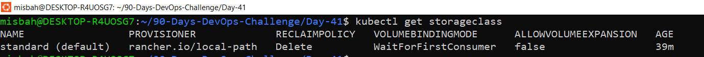
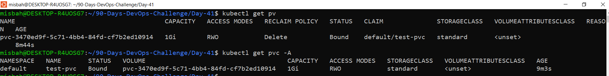
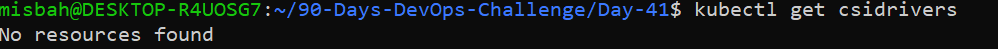
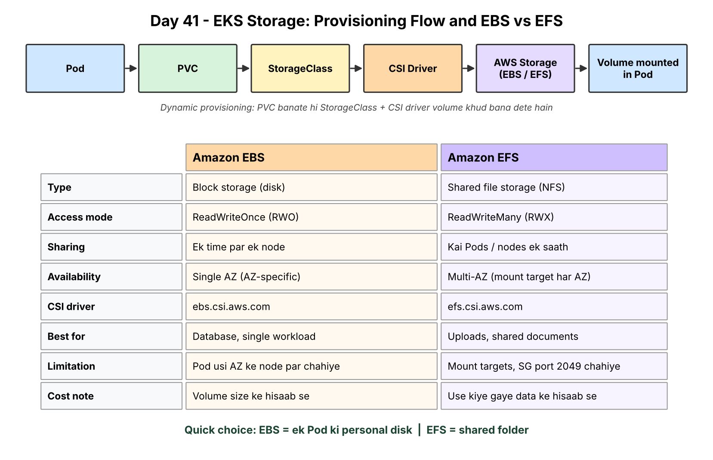
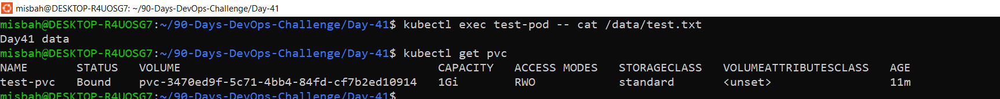

# DevOps Winter Arc — Day 41: AWS EKS EBS & EFS Storage

**Theme:** Persistent storage for Kubernetes workloads
**Environment:** Local `kind` cluster (`day41`) on WSL2. No billable AWS resources were created.

---

## 1. Learning Objectives
- Why Pods need persistent storage
- PV, PVC, StorageClass
- Amazon EBS vs Amazon EFS
- Role of EBS CSI and EFS CSI drivers
- Choosing storage by workload, access mode and availability

## 2. Core Concepts

| Term | Meaning |
|------|---------|
| **PV** | A piece of cluster storage (admin-provisioned or dynamically created) |
| **PVC** | A workload's request for storage |
| **StorageClass** | Defines how storage is provisioned (provisioner + parameters) |
| **CSI driver** | Connects Kubernetes storage operations to a storage system |

Data in a container's writable layer may be lost when the container is replaced, hence PVCs.

---

## 3. Task A — Storage Decision

| Scenario | Choice | Access mode | Why / Trade-offs |
|----------|--------|-------------|------------------|
| Database Pod needing its own disk | **EBS** | `ReadWriteOnce` | Block storage, low latency, one node at a time. AZ-specific, so the Pod must run in the volume's AZ. Needs snapshots for resilience. |
| Multiple web Pods on different nodes sharing uploads | **EFS** | `ReadWriteMany` | Shared file system mountable by many Pods across nodes/AZs. Needs mount targets, NFS (2049) access, security groups. Higher latency than EBS, billed per usage. |
| Data must survive Pod replacement | **EBS** (single writer) or **EFS** (shared) via a **PVC** | RWO / RWX | Any PVC-backed volume outlives the Pod. Check the PV reclaim policy so data is not deleted unexpectedly. |
| Shared documents folder | **EFS** | `ReadWriteMany` | Many clients need the same files. Simple sharing, elastic capacity; watch cost and throughput needs. |

---

## 4. Task B — Inspect Storage (Read-only)

```bash
kubectl get storageclass
kubectl get pv
kubectl get pvc -A
kubectl get csidrivers
kubectl get pods -A
kubectl get events -A --sort-by=.lastTimestamp
```

**Findings (local kind cluster)**
- StorageClass: `standard` (default), provisioner `rancher.io/local-path`, reclaim policy `Delete`, binding mode `WaitForFirstConsumer`.
- PV, PVC (all namespaces), CSI drivers: **No resources found** at inspection time (nothing had requested storage, and AWS EBS/EFS CSI drivers are not part of kind).
- All `kube-system` Pods `Running`, including `local-path-provisioner`.
- One `FailedScheduling` event (node not-ready taint) appeared during cluster start-up and cleared once the node became `Ready`.

### StorageClass


### PV and PVC


### CSI drivers


### EBS vs EFS comparison and provisioning flow diagram


---

## 5. Task C — Provisioning Flow

```
Pod → PVC → StorageClass → CSI driver → AWS storage (EBS/EFS) → volume mounted in Pod
```

**Static vs Dynamic provisioning**
- **Static:** an admin creates the PV manually; a PVC then binds to a matching PV.
- **Dynamic:** a PVC references a StorageClass; the CSI driver creates the storage and PV automatically.

**Why use a PVC?** It decouples the app from storage details. Developers request size and access mode; the cluster decides how to supply it. Storage lifecycle is separate from the Pod lifecycle.

**Checks when a PVC stays Pending**
1. StorageClass exists and is correct (or a default exists).
2. Provisioner / CSI driver is installed and healthy.
3. `kubectl describe pvc` and events for errors.
4. Requested capacity and access mode are supported.
5. IAM permissions for the driver (EBS/EFS APIs).
6. `WaitForFirstConsumer`: PVC stays Pending until a Pod uses it (can be normal).

**Why EBS Availability Zone affects scheduling:** an EBS volume exists in one AZ and can attach only to nodes in that AZ. The Pod must be scheduled on a node in the same AZ, otherwise it stays unschedulable or fails to attach.

---

## 6. Task D — Design Only (Not Applied)

> StorageClass names and parameters depend on the cluster setup. Values in `<>` are placeholders to confirm with `kubectl get storageclass`.

### 6.1 EBS-backed PVC (single database workload)

- **Capacity:** e.g. 20Gi (size to the dataset plus growth)
- **Access mode:** `ReadWriteOnce`
- **StorageClass:** `<EBS-backed StorageClass in the cluster>`
- **CSI driver:** Amazon EBS CSI driver (`ebs.csi.aws.com`)

```yaml
apiVersion: v1
kind: PersistentVolumeClaim
metadata:
  name: db-data
spec:
  accessModes:
    - ReadWriteOnce
  storageClassName: <EBS_STORAGECLASS_NAME>
  resources:
    requests:
      storage: 20Gi
```

**Considerations**
- Volume is AZ-bound; schedule the Pod in the same AZ.
- Check EBS attachment limits per node.
- Plan snapshots/backups; check reclaim policy.

### 6.2 EFS-backed shared PVC (multiple web Pods)

- **Access mode:** `ReadWriteMany`
- **StorageClass / PV:** `<EFS-backed StorageClass or pre-created PV>`
- **CSI driver:** Amazon EFS CSI driver (`efs.csi.aws.com`)

```yaml
apiVersion: v1
kind: PersistentVolumeClaim
metadata:
  name: shared-uploads
spec:
  accessModes:
    - ReadWriteMany
  storageClassName: <EFS_STORAGECLASS_NAME>
  resources:
    requests:
      storage: 5Gi   # required by the API; EFS itself is elastic
```

**Mount considerations**
- Mount targets must exist in the AZs where worker nodes run.
- Handle file permissions/ownership (UID/GID) for the web app.
- Concurrent writes need application-level care.

### 6.3 IAM, Network and Security Group Considerations

| Area | EBS | EFS |
|------|-----|-----|
| **IAM** | Driver needs permission to create/attach/detach/delete volumes (and snapshots if used), typically via IRSA / Pod Identity | Driver needs EFS permissions (e.g. access points for dynamic provisioning), via IRSA / Pod Identity |
| **Network** | Node and volume in the same AZ | Mount targets in node subnets/AZs, VPC routing and DNS resolution |
| **Security groups** | Not NFS-based | Allow **TCP 2049** from node/Pod security groups to EFS mount targets |

---

## 7. Task E — Practical Lab

### AWS lab (EBS/EFS on EKS): Skipped
Not performed because it needs approval and can incur AWS charges (EBS, EFS, mount targets, EC2, EKS).

### Local lab on kind (free): Completed
To practise the same PVC concept without cloud cost, a PVC and a Pod were created on the local kind cluster using `lab.yaml`.

```bash
kubectl apply -f lab.yaml
kubectl get pvc
kubectl get pv
kubectl exec test-pod -- sh -c "echo 'Day41 data' > /data/test.txt"
kubectl delete pod test-pod
kubectl apply -f lab.yaml          # PVC unchanged, Pod recreated
kubectl wait --for=condition=Ready pod/test-pod --timeout=60s
kubectl exec test-pod -- cat /data/test.txt
```

**Result**
- PVC `test-pvc` became `Bound` (1Gi, `ReadWriteOnce`, StorageClass `standard`) and a PV was created dynamically.
- `/data/test.txt` was still present after the Pod was deleted and recreated, so data survived Pod replacement because it lives on the PVC-backed volume.
- `WaitForFirstConsumer` means the volume is created only after a Pod uses the PVC.



**Cleanup**
```bash
kubectl delete -f lab.yaml
kubectl get pv     # PV removed automatically because reclaim policy is Delete
```
Only resources created for this lab were deleted. Reclaim policy was checked before deleting the PVC.

---

## 8. Troubleshooting Quick Reference

| Symptom | Checks |
|---------|--------|
| PVC Pending | StorageClass, provisioner/CSI, events, capacity, access mode, binding mode |
| EBS attach failure | AZ mismatch, attachment limits, CSI components, IAM |
| Pod stuck in ContainerCreating | Pod events, CSI node plugin, VolumeAttachment, mount errors |
| EFS mount failure | Mount targets, VPC routing, DNS, port 2049, security groups |
| Data disappears | Pod not using a PVC-backed mount; reclaim policy; volume lifecycle |

```bash
kubectl describe pvc <PVC_NAME> -n <NAMESPACE>
kubectl describe pv <PV_NAME>
kubectl get events -A --sort-by=.lastTimestamp
```

---

## 9. Interview Quick Check

- **PV vs PVC?** PV is the actual storage resource; PVC is a request for it.
- **StorageClass?** Defines the provisioner and parameters for dynamic provisioning.
- **EBS vs EFS?** EBS: single-workload block storage (RWO, AZ-bound). EFS: shared file storage (RWX) across Pods/nodes.
- **CSI driver?** Translates Kubernetes volume operations into calls to the storage backend.
- **EBS AZ constraint?** A volume attaches only within its AZ, so Pods must be scheduled there.
- **Pending PVC causes?** Missing/incorrect StorageClass, driver not installed, IAM issues, unsupported mode/size, waiting for first consumer.

---

## 10. Completion Checklist
- [x] I can explain PV, PVC and StorageClass.
- [x] I can compare EBS and EFS.
- [x] I understand the role of CSI drivers.
- [x] I can explain the storage provisioning flow.
- [x] I know the main PVC and mount troubleshooting checks.
- [x] I avoided billable resources without approval.

## Cost & Safety Note
EBS, EFS, mount targets, data transfer, EC2 nodes and EKS can incur charges. Deleting a PVC does not always delete the underlying storage; it depends on the PV reclaim policy. AWS Budgets alerts are not a hard spending cap. Never delete shared or production storage.

## Repository Structure
```
Day-41/
├── README.md
├── lab.yaml
└── screenshots/
    ├── 01_storageclass_output.png
    ├── 02_pv_pvc_output.png
    ├── 03_csidrivers_output.png
    ├── 04_ebs_vs_efs_diagram.png
    └── 05_lab_pvc_bound_file.png
```
