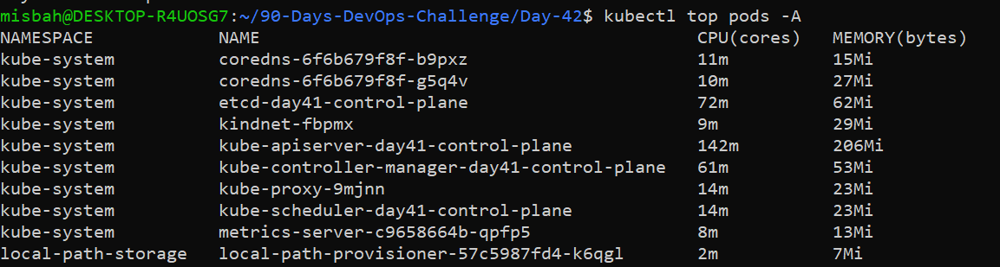
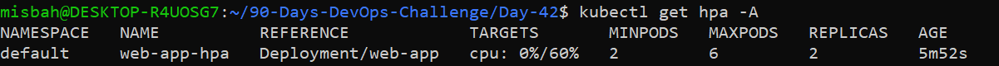
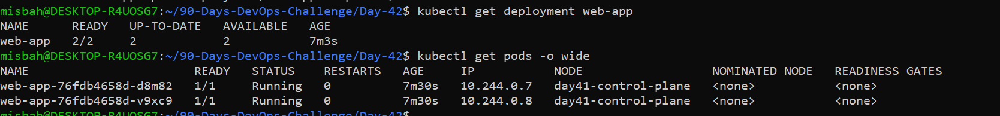
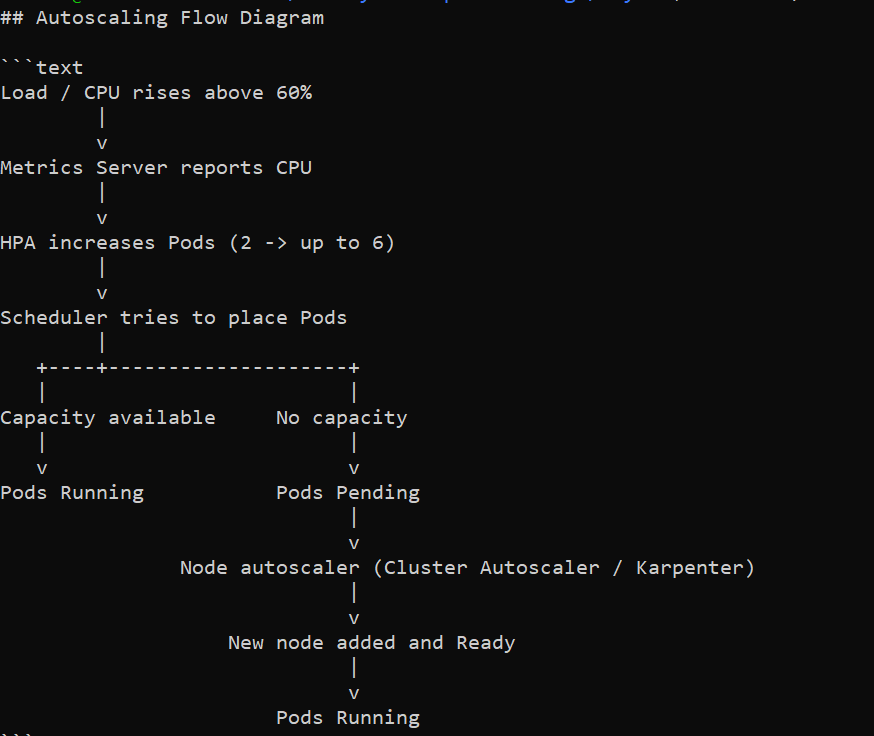

# DevOps Winter Arc - Day 42: AWS EKS Autoscaling

> Practiced on a **local kind cluster** (no AWS resources created, no cost).

## Learning Objectives
- Why Pods and worker nodes need different scaling mechanisms
- HPA vs Cluster Autoscaler vs Karpenter
- Resource requests, metrics-server and scheduling
- How EKS managed node groups provide worker capacity
- Common autoscaling failures and cost risks

## Task A: Autoscaler Comparison

| | HPA | Cluster Autoscaler | Karpenter |
|---|---|---|---|
| **Scales** | Pod replicas | Node-group size (EC2 count) | EC2 compute capacity directly |
| **Trigger** | CPU/memory above target | Pods Pending (unschedulable) | Pods Pending (unschedulable) |
| **Needs** | metrics-server + resource requests | Node group min/max, IAM, discovery tags | NodePool/EC2NodeClass config, IAM |

**Key point:** HPA scales Pods. Cluster Autoscaler or Karpenter scales nodes. More Pods do not guarantee enough nodes exist.

**Why Pods stay Pending after HPA scales up:** HPA only increases replica count. If existing nodes have no free CPU/memory, the scheduler cannot place the new Pods.

**How node autoscaling fixes it:** The node autoscaler sees the Pending Pods, adds a node, and the scheduler places the Pods there.

## Task C: HPA Design for web-app

| Setting | Value |
|---|---|
| Deployment | web-app |
| Container port | 8080 |
| CPU request | 200m per Pod |
| Target avg CPU utilization | 60% |
| Min replicas | 2 |
| Max replicas | 6 |

**Config file:** `web-app-hpa.yaml`

**What happens when average CPU stays above 60%?**
HPA calculates the desired replica count and increases Pods step by step, up to the max of 6. If CPU drops below target, it scales back down, but never below 2.

**Why is a CPU request important?**
Utilization-based HPA calculates usage as a percentage of the Pod's CPU request. Without a request, HPA cannot compute utilization and shows `<unknown>`. With a 200m request, 60% target means about 120m average CPU per Pod.

**How to verify current/desired replicas and HPA events:**
```bash
kubectl get deployment web-app -n NAMESPACE
kubectl get hpa -n NAMESPACE
kubectl describe hpa HPA_NAME -n NAMESPACE
kubectl get pods -n NAMESPACE -o wide
```

## Task D: Node Autoscaling

**Why can a Pod stay Pending after HPA increases replicas?**
HPA only creates more Pod objects. The scheduler must still find a node with enough free CPU/memory. If no node fits, the Pod stays Pending.

**Checks for Pending Pods:**
- Insufficient CPU/memory: `kubectl describe pod POD_NAME` (see Events)
- Node selectors: does any node have the required labels?
- Taints/tolerations: does the Pod tolerate the node taints?
- Affinity/anti-affinity: do the rules allow any available node?
- PVC/zone: is the volume in an AZ where a node exists?

**Cluster Autoscaler + EKS managed node group:**
Cluster Autoscaler watches for unschedulable Pods and increases the node group's desired size. It can never go above the group's configured max size or below its min size.

**Karpenter (high level):**
Karpenter reads the requirements of Pending Pods (CPU, memory, zone, etc.), picks a suitable EC2 instance type allowed by its NodePool and EC2NodeClass, launches it, and removes it when no longer needed.

**Why two autoscalers should not manage the same capacity pool:**
They can make conflicting decisions, one adding nodes while the other removes them, causing instability and extra cost. Use a deliberate design, for example separate node pools for each.

## Troubleshooting

| Problem | What to check |
|---|---|
| HPA shows unknown metrics | metrics-server installed/healthy, API aggregation, resource requests set, HPA events |
| Replicas do not increase | HPA target, metrics available, min/max values, workload actually using CPU |
| Pods remain Pending | Pod events, node capacity, scheduling constraints, PVC/AZ placement |
| Nodes do not scale | Autoscaler logs, node-group min/max, IAM permissions, discovery tags, EC2 capacity |
| Unexpected cost increase | Node count and instance types; stop the lab safely |

## Autoscaling Flow Diagram

```text
Load / CPU rises above 60%
        |
        v
Metrics Server reports CPU
        |
        v
HPA increases Pods (2 -> up to 6)
        |
        v
Scheduler tries to place Pods
        |
   +----+--------------------+
   |                         |
Capacity available     No capacity
   |                         |
   v                         v
Pods Running           Pods Pending
                             |
                             v
               Node autoscaler (Cluster Autoscaler / Karpenter)
                             |
                             v
                   New node added and Ready
                             |
                             v
                       Pods Running
```

## Interview Quick Check

- **HPA vs Cluster Autoscaler?** HPA scales Pods based on metrics. Cluster Autoscaler scales nodes when Pods are unschedulable.
- **What does Karpenter do?** It provisions and removes EC2 capacity based on Pending Pod requirements and configured constraints.
- **Why are resource requests important?** The scheduler uses them for placement, and utilization-based HPA calculates percentage from them.
- **Why can HPA-created Pods stay Pending?** No node has enough free resources or the Pods violate scheduling constraints.
- **HPA reports unknown metrics, what to check?** metrics-server, API aggregation, resource requests, events.
- **How can autoscaling affect an AWS bill?** More nodes mean more EC2, EBS, load balancer, NAT Gateway and data transfer charges.

## Completion Checklist

- [x] I can explain HPA, Cluster Autoscaler and Karpenter
- [x] I understand metrics-server and resource requests
- [x] I designed the sample HPA correctly
- [x] I can explain why Pods may remain Pending
- [x] I know the main autoscaling troubleshooting checks
- [x] I avoided paid scaling without approval

## Cost & Safety Note

Practiced on a local kind cluster only. No AWS login, no EC2 launched, no node-group limits changed, no autoscaler installed on AWS. Optional AWS lab (Task E) skipped because approval was not available.

## Screenshots

### 1. kubectl top nodes and pods


### 2. kubectl get hpa


### 3. Deployment replicas and Pod placement


### 4. Autoscaling flow diagram

