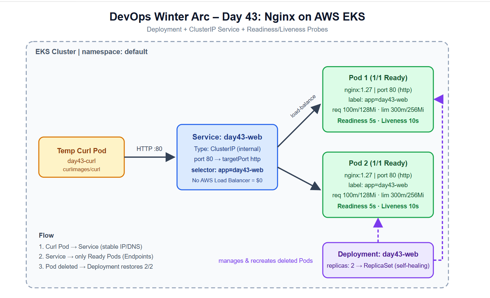
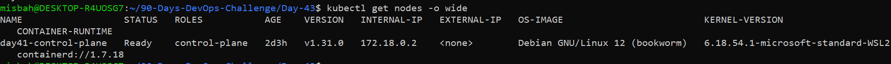
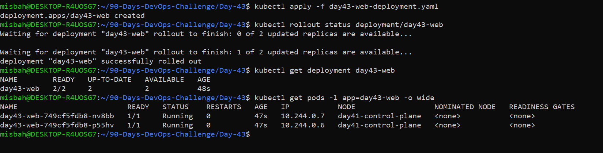
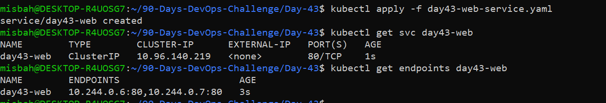
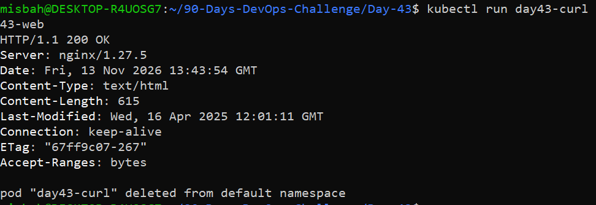
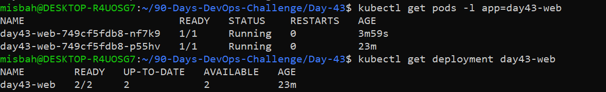

# Day 43 – Deploy an Application on AWS EKS

> **90 Days DevOps Challenge · DevOps Winter Arc**
> Deploy a containerized Nginx app on Kubernetes using a Deployment and a ClusterIP Service, test it internally, and verify self-healing.

| | |
|---|---|
| **Level** | Intermediate |
| **Focus** | End-to-end application deployment |
| **Tools** | kubectl, AWS CLI, Kubernetes (EKS), Nginx, Git |
| **Cost** | No load balancer created, no extra AWS cost |

---

## Table of Contents

1. [Objective](#1-objective)
2. [Architecture](#2-architecture)
3. [Project Structure](#3-project-structure)
4. [Task A – Pre-deployment Checks](#4-task-a--pre-deployment-checks)
5. [Task B – Create the Deployment](#5-task-b--create-the-deployment)
6. [Task C – Expose Internally with ClusterIP](#6-task-c--expose-internally-with-clusterip)
7. [Task D – Test and Observe](#7-task-d--test-and-observe)
8. [Readiness vs Liveness Probe](#8-readiness-vs-liveness-probe)
9. [Troubleshooting Guide](#9-troubleshooting-guide)
10. [Interview Quick Check](#10-interview-quick-check)
11. [Cleanup](#11-cleanup)
12. [Cost and Safety Notes](#12-cost-and-safety-notes)
13. [Key Learnings](#13-key-learnings)
14. [Completion Checklist](#14-completion-checklist)

---

## 1. Objective

- Connect `kubectl` to an existing cluster safely.
- Deploy a containerized application using **Deployment** and **Service** resources.
- Configure **replicas, resource requests/limits and health probes**.
- Verify Pod placement, Service endpoints, logs and application response.
- Observe Kubernetes **self-healing** when a Pod is deleted.
- Understand deployment cost and security considerations.

**Scenario:** Deploy a simple Nginx web application with 2 replicas, expose it internally using a ClusterIP Service, test it, and verify that Kubernetes replaces a deleted Pod.

---

## 2. Architecture



**How the flow works**

1. A temporary curl Pod sends an HTTP request to the Service `day43-web` on port 80.
2. The Service uses the selector `app=day43-web` to find matching Pods.
3. Only Pods that pass the readiness probe receive traffic.
4. The Deployment (through its ReplicaSet) keeps exactly 2 Pods running at all times.

---

## 3. Project Structure

```
Day-43/
├── README.md
├── day43-web-deployment.yaml
├── day43-web-service.yaml
└── Screenshots/
    ├── 01-nodes-ready.png
    ├── 02-deployment-pods-ready.png
    ├── 03-service-endpoints.png
    ├── 04-internal-http-test.png
    ├── 05-pod-replacement.png
    └── architecture-diagram.png
```

---

## 4. Task A – Pre-deployment Checks

Always verify **who you are** and **which cluster is active** before deploying anything.

```bash
aws sts get-caller-identity
aws eks list-clusters --region <REGION>
aws eks update-kubeconfig --region <REGION> --name <CLUSTER_NAME>
kubectl config current-context
kubectl get nodes -o wide
```

**What I confirmed**

- AWS identity is correct.
- Active Kubernetes context is the intended cluster.
- Nodes are in `Ready` state.
- I have permissions in the `default` namespace.

> Rule: if you are unsure which cluster is active, **stop** and do not deploy.

📸 `Screenshots/01-nodes-ready.png`



---

## 5. Task B – Create the Deployment

**File:** `day43-web-deployment.yaml`

```yaml
apiVersion: apps/v1
kind: Deployment
metadata:
  name: day43-web
  namespace: default
spec:
  replicas: 2
  selector:
    matchLabels:
      app: day43-web
  template:
    metadata:
      labels:
        app: day43-web
    spec:
      containers:
        - name: nginx
          image: nginx:1.27
          ports:
            - name: http
              containerPort: 80
          resources:
            requests:
              cpu: 100m
              memory: 128Mi
            limits:
              cpu: 300m
              memory: 256Mi
          readinessProbe:
            httpGet:
              path: /
              port: http
            periodSeconds: 5
          livenessProbe:
            httpGet:
              path: /
              port: http
            periodSeconds: 10
```

**Apply and verify**

```bash
kubectl apply -f day43-web-deployment.yaml
kubectl rollout status deployment/day43-web
kubectl get deployment day43-web
kubectl get pods -l app=day43-web -o wide
```

**Expected result:** Deployment shows `2/2` READY and both Pods are `Running` with `1/1` READY.

**Why these settings?**

| Setting | Purpose |
|---|---|
| `replicas: 2` | High availability, one Pod can fail and the app stays up |
| `image: nginx:1.27` | Pinned version for predictable, repeatable deploys (avoid `latest`) |
| `requests` | Minimum CPU/memory the scheduler reserves for the Pod |
| `limits` | Maximum the container can use, protects other workloads |
| `readinessProbe` | Controls whether the Pod receives traffic |
| `livenessProbe` | Restarts the container if it hangs |
| named port `http` | Service can refer to `http` instead of a number |

📸 `Screenshots/02-deployment-pods-ready.png`



---

## 6. Task C – Expose Internally with ClusterIP

**File:** `day43-web-service.yaml`

```yaml
apiVersion: v1
kind: Service
metadata:
  name: day43-web
spec:
  type: ClusterIP
  selector:
    app: day43-web
  ports:
    - name: http
      port: 80
      targetPort: http
```

**Apply and verify**

```bash
kubectl apply -f day43-web-service.yaml
kubectl get svc day43-web
kubectl get endpoints day43-web
```

**Expected result:** The Service gets a cluster IP and the Endpoints list shows the **2 Pod IPs**.

### How does the Service selector find Pods?

The Service uses `selector: app: day43-web`. Kubernetes continuously looks for Pods carrying the label `app: day43-web`. When those Pods pass their readiness checks, their IPs are added to the Service's Endpoints, and traffic is load-balanced across them. If a Pod is replaced and gets a new IP, the Endpoints update automatically.

### Why ClusterIP for internal testing?

- Reachable **only inside the cluster**, so there is no public exposure.
- Does **not** create a billable AWS Load Balancer (ALB/NLB).
- Fast, secure and cost-free for smoke tests and service-to-service communication.

📸 `Screenshots/03-service-endpoints.png`



---

## 7. Task D – Test and Observe

**Inspect the resources**

```bash
kubectl describe deployment day43-web
kubectl describe service day43-web
kubectl get pods -l app=day43-web
kubectl logs deployment/day43-web
kubectl get events --sort-by=.lastTimestamp
```

**Internal HTTP test using a temporary Pod**

```bash
kubectl run day43-curl --image=curlimages/curl:8.10.1 --restart=Never --rm -it -- curl -I http://day43-web
```

**Expected result:** `HTTP/1.1 200 OK` from Nginx. The `--rm` flag deletes the test Pod automatically afterwards.

📸 `Screenshots/04-internal-http-test.png`



**Self-healing test: delete a Pod**

```bash
kubectl delete pod <one-day43-web-pod-name>
kubectl get pods -l app=day43-web -w
kubectl get deployment day43-web
```

**Observation:** As soon as one Pod was deleted, the ReplicaSet noticed that the actual count (1) was lower than the desired count (2) and created a new Pod. Within seconds the Deployment returned to `2/2` Ready.

📸 `Screenshots/05-pod-replacement.png`



---

## 8. Readiness vs Liveness Probe

| | Readiness Probe | Liveness Probe |
|---|---|---|
| **Question it answers** | Is the container ready to receive traffic? | Is the container still alive and healthy? |
| **On failure** | Pod IP is **removed from Service endpoints**, no restart | Container is **restarted** by the kubelet |
| **In this lab** | `GET /` on port `http` every **5s** | `GET /` on port `http` every **10s** |
| **Use case** | App is starting up or temporarily overloaded | App is deadlocked or hung |

**One-line summary:** Readiness controls *traffic*, Liveness controls *restarts*.

---

## 9. Troubleshooting Guide

| Problem | What to check |
|---|---|
| `ImagePullBackOff` | Image name/tag, registry access, Pod events (`kubectl describe pod`) |
| Pod `Pending` | Node capacity, resource requests, taints, node selectors, PVC constraints |
| `CrashLoopBackOff` | `kubectl logs`, probes, command/arguments, exit reason |
| Service has no endpoints | Pod labels, Service selector, readiness status, `targetPort` |
| Application unreachable | Service port, endpoints, DNS, NetworkPolicy, load balancer health (if any) |

**Useful debug commands**

```bash
kubectl get pods --show-labels
kubectl describe pod <pod-name>
kubectl logs <pod-name>
kubectl get endpoints day43-web
kubectl get events --sort-by=.lastTimestamp
```

---

## 10. Interview Quick Check

**Q1. Deployment vs Service?**
A Deployment manages the lifecycle of Pods: replicas, rolling updates and self-healing. A Service gives a stable virtual IP and DNS name that routes traffic to a changing set of Pods using label selectors.

**Q2. Why use ClusterIP for internal access?**
It restricts access to workloads inside the cluster, removes external attack surface, and avoids the cost of a cloud load balancer.

**Q3. Readiness probe vs liveness probe?**
Readiness decides whether a Pod receives traffic (no restart). Liveness decides whether a container should be restarted.

**Q4. How does a Deployment recover when a Pod is deleted?**
The Deployment manages a ReplicaSet whose control loop compares desired state (`replicas: 2`) with actual state. When a Pod disappears, the ReplicaSet creates a new one to restore the count.

**Q5. What would you check if a Service has no endpoints?**
- Service selector matches Pod labels (`kubectl get pods --show-labels`).
- Pods are `Running` and pass the readiness probe (`1/1 Ready`).
- `targetPort` matches the container port or named port.

---

## 11. Cleanup

Run only after capturing evidence, and only for **your own lab resources**.

```bash
kubectl delete -f day43-web-service.yaml
kubectl delete -f day43-web-deployment.yaml
```

> Never delete shared or production workloads.

---

## 12. Cost and Safety Notes

- This lab uses an **existing** cluster, no new cluster was created.
- Possible AWS charges in general: EKS control plane, EC2 nodes, EBS/EFS, load balancers, NAT Gateway, public IPv4 and data transfer.
- **ClusterIP does not create an AWS load balancer**, so this lab adds no load balancer cost.
- External access (Ingress with ALB/NLB) is optional and needs approval because it creates billable resources. It was **not** done in this lab.
- AWS Budgets alerts are **not** a hard spending cap.
- Hide sensitive details (account IDs, IPs, cluster names) in screenshots before sharing.

---

## 13. Key Learnings

- Always verify the AWS identity and Kubernetes context before deploying.
- Labels and selectors are the glue between Deployments, Pods and Services.
- Resource requests and limits help scheduling and protect the cluster.
- Readiness and liveness probes make applications reliable.
- A Deployment gives self-healing for free, a deleted Pod is replaced automatically.
- ClusterIP is the safest and cheapest option for internal access.
- Clean up lab resources to avoid unnecessary cost.

---

## 14. Completion Checklist

- [x] Verified AWS identity and active Kubernetes context
- [x] Deployed two application replicas
- [x] Exposed Pods through ClusterIP
- [x] Tested the app internally
- [x] Observed Pod replacement and recovery
- [x] Cleaned up only lab resources
- [x] Documented with architecture diagram and screenshots

---

⭐ Part of my **90 Days DevOps Challenge**. Follow along for the next days!
