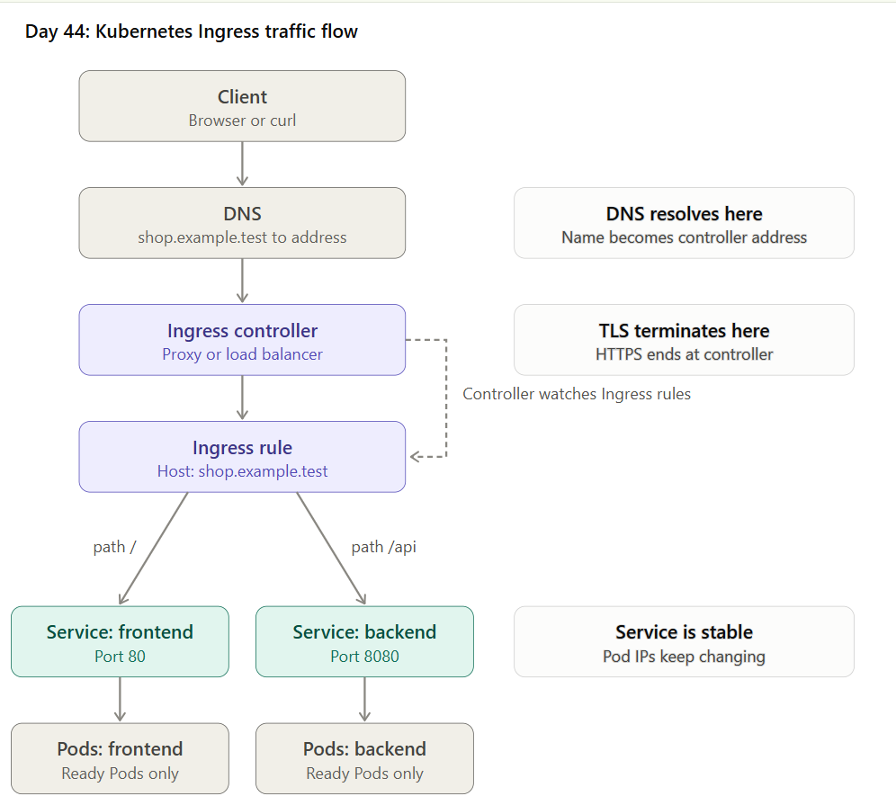
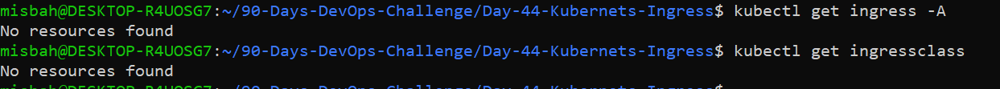
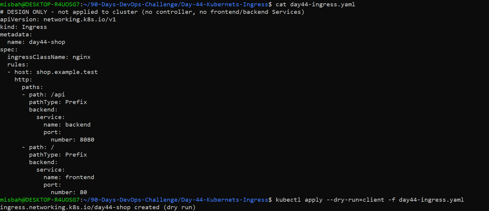

# Day 44: Kubernetes Production - Ingress and Traffic Management

Part of my [90 Days DevOps Challenge](../README.md). This day covers how HTTP/HTTPS traffic safely reaches applications running inside a Kubernetes cluster using Ingress.

| | |
|---|---|
| **Level** | Intermediate |
| **Focus** | Route application traffic safely |
| **Environment** | Local `kind` cluster (no cloud resources) |

> **Status:** Design and documentation. The Ingress was **not applied** because the cluster has no Ingress controller and no `frontend`/`backend` Services. No cloud load balancers were created.

## Table of Contents

1. [Learning Objectives](#learning-objectives)
2. [Core Concepts](#core-concepts)
3. [Task A: Traffic Flow](#task-a-traffic-flow)
4. [Task B: Cluster Inspection](#task-b-cluster-inspection-read-only)
5. [Task C: Host and Path Routing](#task-c-host-and-path-routing)
6. [Task D: Ingress Manifest](#task-d-ingress-manifest)
7. [Task E: TLS Design](#task-e-tls-design)
8. [Troubleshooting](#troubleshooting)
9. [Interview Questions and Answers](#interview-questions-and-answers)
10. [Completion Checklist](#completion-checklist)
11. [Cost and Safety](#cost-and-safety)
12. [Project Files](#project-files)

## Learning Objectives

- Understand how Ingress routes HTTP/HTTPS traffic to Kubernetes Services
- Differentiate an Ingress resource, an Ingress controller and an IngressClass
- Design host-based and path-based routing
- Understand TLS termination and backend Service mapping
- Troubleshoot common routing, DNS, TLS and backend errors

## Core Concepts

| Concept | Description |
|---------|-------------|
| Service | Stable endpoint for a set of Pods |
| Ingress | Resource that defines HTTP/HTTPS routing rules |
| Ingress controller | Watches Ingress resources and implements the rules using a proxy or cloud load balancer |
| IngressClass | Identifies which controller should process an Ingress |
| Host routing | Routes by hostname, for example `app.example.com` |
| Path routing | Routes by URL path, for example `/api` or `/store` |
| TLS termination | HTTPS is handled at the ingress or load-balancer layer |

An Ingress object alone does not route traffic. A compatible controller must be installed and configured.

## Task A: Traffic Flow

```
Client -> DNS -> Ingress Controller -> Ingress rule -> Service -> Ready Pods
```



- **DNS** resolves `shop.example.test` to the controller address.
- **TLS** terminates at the Ingress controller (or load balancer).
- The controller **watches** Ingress resources and configures routing from them.
- The **Service** is the stable backend because individual Pod IPs change when Pods restart or scale. A Service keeps one fixed address and sends traffic only to ready Pods.

## Task B: Cluster Inspection (Read-only)

Commands used on the local kind cluster:

```
kubectl get ingress -A
kubectl get ingressclass
kubectl get svc -A
```

**Findings:**
- No Ingress resources exist.
- No IngressClass exists, so no controller is installed.
- Only system Services are present (`kubernetes`, `kube-dns`, `metrics-server`). There are no `frontend` or `backend` Services.

An Ingress is not assumed to work just because its YAML is accepted.



## Task C: Host and Path Routing

Host: `shop.example.test`

| Host | Path | pathType | Backend Service | Port |
|------|------|----------|-----------------|------|
| shop.example.test | `/api` | Prefix | backend | 8080 |
| shop.example.test | `/` | Prefix | frontend | 80 |

**If the backend Service has no ready endpoints:** the controller has nowhere to send the request, so the client receives a 502/503 error. The Ingress can look correct while the backend is unhealthy.

**Requirements for a real domain:**
- A DNS record (A, AAAA or CNAME) pointing to the address published by the controller
- A valid TLS certificate for the hostname

## Task D: Ingress Manifest

File: [`day44-ingress.yaml`](day44-ingress.yaml) (design only, not applied)

```yaml
apiVersion: networking.k8s.io/v1
kind: Ingress
metadata:
  name: day44-shop
spec:
  ingressClassName: nginx
  rules:
  - host: shop.example.test
    http:
      paths:
      - path: /api
        pathType: Prefix
        backend:
          service:
            name: backend
            port:
              number: 8080
      - path: /
        pathType: Prefix
        backend:
          service:
            name: frontend
            port:
              number: 80
```

Validated with a client-side dry run (no cluster changes):

```
kubectl apply --dry-run=client -f day44-ingress.yaml
```



`describe` output was skipped because the Ingress was not applied (no controller and no backend Services).

## Task E: TLS Design

Design only, not applied. Added under `spec` for `shop.example.test`:

```yaml
  tls:
  - hosts:
    - shop.example.test
    secretName: shop-tls
```

- The certificate and private key are stored in a Kubernetes Secret named `shop-tls` (type `kubernetes.io/tls`) in the same namespace as the Ingress.
- The Ingress only references the Secret name. The controller reads it and serves HTTPS.
- **Client to Ingress:** HTTPS (encrypted), TLS terminates at the controller.
- **Ingress to backend:** usually plain HTTP inside the cluster, unless the design requires HTTPS to the backend as well.
- Private keys and TLS Secrets are never committed to a public repository.

## Troubleshooting

| Symptom | What to check |
|---------|---------------|
| No Ingress address | Controller installation, IngressClass, events, cloud provisioning prerequisites |
| 404 | Host header, path, pathType, rule matching, backend Service name |
| 502 / 503 | Service port, ready endpoints (`kubectl get endpoints`), Pod health, controller-to-backend connectivity |
| TLS warning | Certificate validity, hostname match, Secret name and namespace, controller configuration |
| DNS failure | DNS record, address published by the controller |
| No traffic to Pods | Service selectors, endpoints, NetworkPolicy, controller logs |

Useful commands:

```
kubectl describe ingress INGRESS_NAME -n NAMESPACE
kubectl get svc SERVICE_NAME -n NAMESPACE -o wide
kubectl get endpoints SERVICE_NAME -n NAMESPACE
kubectl get events -A --sort-by=.lastTimestamp
```

## Interview Questions and Answers

**1. What is the difference between an Ingress and an Ingress controller?**
An Ingress is a Kubernetes resource (YAML) that only defines routing rules such as host and path. An Ingress controller is the program (for example NGINX) that watches Ingress resources and actually routes the traffic. Without a controller, an Ingress does nothing.

**2. What is an IngressClass?**
An IngressClass identifies which controller should handle a given Ingress. It is referenced using `ingressClassName`, which allows several controllers to run in one cluster.

**3. What is the difference between host-based and path-based routing?**
Host-based routing selects the backend by hostname (for example `shop.example.test`). Path-based routing selects the backend by URL path (for example `/api` goes to `backend`, `/` goes to `frontend`). They can be combined in one Ingress.

**4. What happens if an Ingress backend has no endpoints?**
The Ingress rule is valid, but the controller has no Pod to forward to, so the client gets a 502/503 error. Check with `kubectl get endpoints SERVICE_NAME`, then verify Service selectors and Pod readiness.

**5. Where can TLS terminate?**
At the Ingress controller or load balancer (most common), or at the backend Pods (passthrough or re-encryption). With termination at the controller, client-to-ingress traffic is HTTPS and ingress-to-backend is usually HTTP.

**6. What is Gateway API?**
Gateway API is the newer Kubernetes API for traffic routing. It is more expressive than Ingress and separates roles: infrastructure teams manage Gateways, and application teams manage Routes (such as HTTPRoute).

## Completion Checklist

- [x] I understand the full ingress traffic flow
- [x] I can explain Ingress, controller and IngressClass
- [x] I designed host and path routing
- [x] I created and validated an Ingress manifest (dry run)
- [x] I understand TLS and common routing failures
- [x] I did not create cloud load balancers without approval

## Cost and Safety

- Used only a local `kind` cluster. No AWS login and no cloud resources.
- In AWS, the AWS Load Balancer Controller can create billable ALBs and related resources. DNS, public IPv4, data processing and networking may also incur charges. Controllers and cloud-backed Ingress resources should not be applied without approval.
- Internal services must never be exposed publicly by accident.
- No private keys, TLS Secrets or credentials are committed in this repository.

## Project Files

| File | Description |
|------|-------------|
| `README.md` | Project overview and documentation |
| `day44-ingress.yaml` | Design-only Ingress manifest |
| `day44-notes.md` | Study notes: routing table, troubleshooting, TLS, interview check |
| `Screenshots/1-get-ingress-ingressclass.png` | Cluster inspection output |
| `Screenshots/2-ingress-yaml-dryrun.png` | Ingress YAML and dry-run validation |
| `Screenshots/4-traffic-flow-diagram.png` | Traffic-flow diagram |
