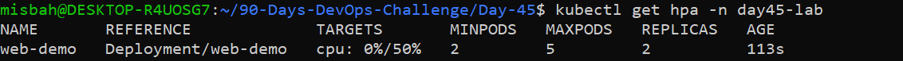
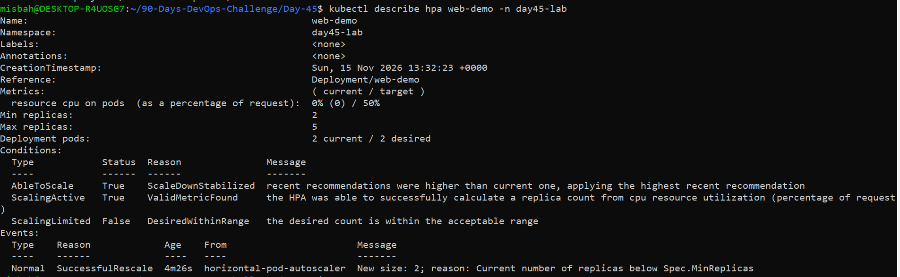
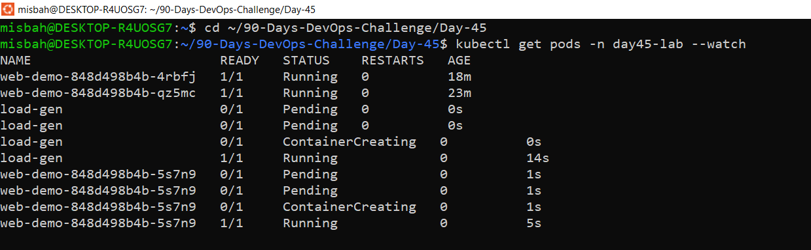
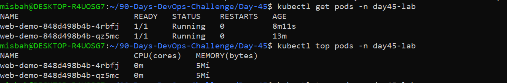
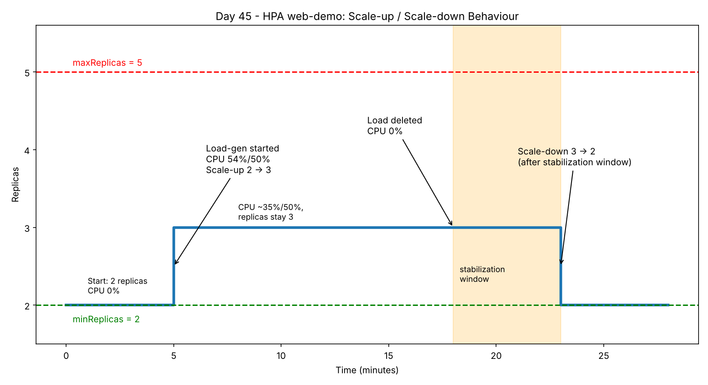

# DevOps Winter Arc – Day 45
## Kubernetes Production: HPA & Advanced Autoscaling

> **Focus:** Automatically scale Pods based on demand using the Horizontal Pod Autoscaler (HPA)
> **Level:** Intermediate | **Duration:** 2–3 hours
> **Environment:** Local `kind` cluster on WSL2 Ubuntu (no cloud account, zero cost)

---

## Table of Contents
1. [Learning Objectives](#1-learning-objectives)
2. [Environment](#2-environment)
3. [Core Concepts](#3-core-concepts)
4. [Task A – Inspect Autoscaling (Read-only)](#4-task-a--inspect-autoscaling-read-only)
5. [Task B – Prepare a Test Deployment](#5-task-b--prepare-a-test-deployment)
6. [Task C – Configure CPU-based HPA](#6-task-c--configure-cpu-based-hpa)
7. [Task D – Observe Scaling](#7-task-d--observe-scaling)
8. [Task E – Advanced Behaviour](#8-task-e--advanced-behaviour)
9. [Troubleshooting Guide](#9-troubleshooting-guide)
10. [HPA vs Cluster Autoscaler](#10-hpa-vs-cluster-autoscaler)
11. [Interview Quick Check](#11-interview-quick-check)
12. [Cleanup](#12-cleanup)
13. [Deliverables & Screenshots](#13-deliverables--screenshots)
14. [Safety & Cost Notes](#14-safety--cost-notes)
15. [Key Takeaways](#15-key-takeaways)
16. [Completion Checklist](#16-completion-checklist)

---

## 1. Learning Objectives
- Understand how HPA adjusts Deployment replica counts.
- Configure CPU-based autoscaling using resource requests and metrics-server.
- Understand HPA behaviour, stabilization windows and scaling policies.
- Inspect HPA status, events and workload resource usage.
- Differentiate Pod autoscaling (HPA) from node autoscaling (Cluster Autoscaler).

---

## 2. Environment

| Item | Value |
|---|---|
| Host OS | Windows 10 + WSL2 (Ubuntu) |
| Container runtime | Docker Engine 29.9.0 (installed directly in WSL) |
| Kubernetes | kind cluster `day41`, node `day41-control-plane`, `v1.31.0` |
| Metrics | metrics-server (already installed in `kube-system`) |
| Test image | `nginx:1.27` |
| Lab namespace | `day45-lab` (disposable) |

**Starting the environment after a restart**
```bash
sudo service docker start
docker start day41-control-plane
kubectl get nodes        # expect STATUS: Ready
```

**Stopping safely**
```bash
docker stop day41-control-plane
sudo service docker stop
```

---

## 3. Core Concepts

| Concept | Description |
|---|---|
| **HPA** | Adjusts Pod replicas using observed metrics and configured targets. |
| **Metrics Server** | Supplies resource metrics (CPU/memory) to the Kubernetes API. |
| **Resource requests** | The baseline for utilization calculations; also used by the scheduler. |
| **Scale target** | Usually a Deployment or StatefulSet. |

Key points:
- CPU utilization is calculated **relative to the CPU request**. Without requests, HPA cannot compute utilization (`<unknown>`).
- HPA checks metrics periodically (default ~15s) and adjusts replicas within `minReplicas`/`maxReplicas`.
- HPA scales **Pods, not nodes**. A separate node autoscaler is needed when Pods cannot be scheduled.
- Stabilization windows and scaling policies reduce rapid scale-up/scale-down changes (flapping).

Desired replica formula:

```
desiredReplicas = ceil( currentReplicas × currentMetric / targetMetric )
```

---

## 4. Task A – Inspect Autoscaling (Read-only)

```bash
kubectl get hpa -A
kubectl top nodes
kubectl top pods -A
kubectl get deployments -A
kubectl get events -A --sort-by=.lastTimestamp | tail -15
kubectl get deployment metrics-server -n kube-system
```

**Findings**
- `kubectl get hpa -A` → `No resources found` (no HPA existed beforehand).
- `kubectl top nodes` worked → **metrics-server was already installed and functioning**.
  - Node `day41-control-plane`: ~395m CPU (9%), ~870Mi memory (46%).
- `kubectl top pods -A` showed all system pods using minimal resources.
- Deployments present: `coredns` (2/2), `metrics-server` (1/1), `local-path-provisioner` (1/1).
- `metrics-server` Deployment: `READY 1/1`.
- Events contained `Warning` entries (liveness/readiness probe failures, BackOff) that were ~20 minutes old and caused by the cluster restart. All components later reached `Running` – no action required.

> `kubectl describe hpa HPA_NAME` was run later in Task C, once an HPA existed.

---

## 5. Task B – Prepare a Test Deployment

```bash
kubectl create namespace day45-lab
kubectl create deployment web-demo --image=nginx:1.27 -n day45-lab
kubectl set resources deployment/web-demo -n day45-lab \
  --requests=cpu=100m,memory=64Mi --limits=cpu=300m,memory=128Mi
kubectl get deployment web-demo -n day45-lab
```

Result: `web-demo   1/1   1   1`

**Resource configuration (evidence of CPU requests)**

| | CPU | Memory |
|---|---|---|
| Requests | 100m | 64Mi |
| Limits | 300m | 128Mi |

Limits also protect the laptop: no Pod can consume more than 300m CPU.

---

## 6. Task C – Configure CPU-based HPA

```bash
kubectl autoscale deployment web-demo -n day45-lab --cpu-percent=50 --min=2 --max=5
kubectl get hpa -n day45-lab
kubectl describe hpa web-demo -n day45-lab
```

> Newer kubectl versions print a deprecation warning for `--cpu-percent`; the preferred form is `--cpu=50%`. The HPA was still created successfully.

**HPA configuration**

| Setting | Value |
|---|---|
| Target | `Deployment/web-demo` |
| minReplicas | 2 |
| maxReplicas | 5 |
| Metric | CPU, average utilization **50%** |

The HPA immediately raised replicas from 1 to **2** (the minimum).

**Describe output – conditions**
- `AbleToScale: True` – HPA can fetch and update the scale.
- `ScalingActive: True` – metrics are available and scaling calculations work.

### Why are CPU requests required?
HPA computes `utilization = actual CPU usage / CPU request`. Without a request there is no denominator, so the target shows `<unknown>` and HPA cannot scale.

### What does the 50% target mean?
HPA tries to keep the **average CPU usage across all Pods at 50% of the request**. With a 100m request, that is ~50m per Pod. If the average goes above 50%, HPA adds replicas; below, it removes them (subject to stabilization).

---

## 7. Task D – Observe Scaling

Three terminals were used (kept minimal to protect the laptop):

| Terminal | Purpose | Command |
|---|---|---|
| 1 | Watch HPA | `kubectl get hpa -n day45-lab --watch` |
| 2 | Watch Pods | `kubectl get pods -n day45-lab --watch` |
| 3 | Run commands | – |

**Baseline (before load)**
```bash
kubectl top pods -n day45-lab      # 2 pods, 0m CPU, ~5Mi memory each
```

**Controlled load generation** (single small Pod, deleted afterwards)
```bash
kubectl expose deployment web-demo -n day45-lab --port=80
kubectl run load-gen -n day45-lab --image=busybox:1.36 --restart=Never \
  -- /bin/sh -c "while true; do wget -q -O- http://web-demo; done"
```

**Observed timeline**

| Phase | CPU (target 50%) | Replicas | Notes |
|---|---|---|---|
| Before load | 0% | 2 | Minimum replicas |
| Load started | 13% → 54% | 2 | Utilization crossed the target |
| Scale-up | 57% → 41% | **2 → 3** | New Pod went `Pending → ContainerCreating → Running` |
| Steady under load | ~35–37% | 3 | Load now spread across 3 Pods |
| Load removed (`kubectl delete pod load-gen`) | 0% | 3 | Replicas held during stabilization |
| Scale-down | 0% | **3 → 2** | After the stabilization window |

### Why scaling is not immediate
- Metrics are scraped periodically (metrics-server ~15s) and HPA syncs on an interval.
- New Pods need time to be scheduled, pull images and become Ready.
- Scale-down is deliberately delayed by the stabilization window (default **300 s**) to avoid flapping.

---

## 8. Task E – Advanced Behaviour

### 8.1 Scale-down stabilization window (design)
A custom `behavior` block was applied with a 60 s scale-down window (shortened for the lab) and rate-limiting policies:

```bash
kubectl patch hpa web-demo -n day45-lab --type merge -p '{"spec":{"behavior":{"scaleDown":{"stabilizationWindowSeconds":60,"policies":[{"type":"Pods","value":1,"periodSeconds":60}]},"scaleUp":{"stabilizationWindowSeconds":0,"policies":[{"type":"Pods","value":2,"periodSeconds":60}]}}}}'
```

Equivalent YAML:
```yaml
behavior:
  scaleDown:
    stabilizationWindowSeconds: 60
    policies:
      - type: Pods
        value: 1
        periodSeconds: 60
  scaleUp:
    stabilizationWindowSeconds: 0
    policies:
      - type: Pods
        value: 2
        periodSeconds: 60
```

Before the patch, `grep behavior` returned nothing because HPA was using Kubernetes defaults (scale-down window 300 s). After the patch, the `behavior` block was confirmed in the HPA YAML.

**Why it works:** during the window HPA remembers the *highest* desired replica count and uses it for scale-down decisions. A brief traffic dip therefore does not remove Pods that would be recreated moments later.

### 8.2 How scale-up and scale-down policies limit the rate of change
Each policy defines the maximum change allowed per `periodSeconds` (as a number of Pods or a percentage).
- Scale-up: max **2 Pods per 60 s**
- Scale-down: max **1 Pod per 60 s**

This prevents sudden jumps (e.g. 2 → 50 Pods) and keeps the cluster stable. With multiple policies, `selectPolicy` (default `Max`) chooses which applies.

### 8.3 What happens when HPA reaches `maxReplicas` and demand keeps rising?
HPA will **not** exceed `maxReplicas` (5 here), even at 200% CPU. Pods stay overloaded, latency rises and requests may fail. The HPA reports `ScalingLimited: True` with reason `TooManyReplicas`. Fixes: raise `maxReplicas` (if capacity exists), optimize the application, or add capacity.

### 8.4 Why might a Pod remain Pending after HPA adds replicas, and how does a node autoscaler help?
HPA only changes the **Pod count**. If nodes lack allocatable CPU/memory (based on requests), or taints, selectors, affinity or PVC/AZ constraints block placement, the scheduler cannot place the Pod and it stays `Pending`. A node autoscaler (**Cluster Autoscaler** or **Karpenter**) detects unschedulable Pods and adds a node, then removes idle nodes when load drops.

---

## 9. Troubleshooting Guide

| Symptom | What to check |
|---|---|
| `<unknown>` metrics | metrics-server health, API aggregation, resource requests, events |
| Missing CPU utilization | CPU requests on **all** containers in the Pod |
| Replicas do not increase | Scale target, metrics, min/max, workload activity, HPA events |
| Pods `Pending` | Node capacity, taints, selectors, affinity, PVC/AZ constraints |
| Replicas fluctuate | Noisy metrics; tune stabilization windows and scaling policies |

Useful commands:
```bash
kubectl get deployment metrics-server -n kube-system
kubectl describe hpa <name> -n <namespace>
kubectl get events -n <namespace> --sort-by=.lastTimestamp
kubectl describe pod <pod> -n <namespace>
```

---

## 10. HPA vs Cluster Autoscaler

| | HPA | Cluster Autoscaler |
|---|---|---|
| Scales | Pod replicas | Cluster nodes |
| Trigger | Metrics (CPU, memory, custom) vs target | Unschedulable (`Pending`) Pods / underused nodes |
| Scope | Workload (Deployment/StatefulSet) | Infrastructure |
| Cost impact | Uses existing capacity | Launches billable nodes (e.g. EC2 on EKS) |
| In this lab | Used | Theory only (kind has no node autoscaling) |

They work together: HPA adds Pods → if there is no room, Cluster Autoscaler adds nodes.

---

## 11. Interview Quick Check

**What does HPA scale?** The replica count of a scalable workload (Deployment, StatefulSet, etc.).

**Why are CPU requests needed?** Utilization is measured as usage ÷ request; no request means no utilization value.

**Current vs desired replicas?** *Current* = Pods running now; *desired* = the count HPA has calculated it should have. They differ during scaling.

**What happens at `maxReplicas`?** No further scale-up; the HPA reports `ScalingLimited`.

**How do stabilization windows reduce flapping?** HPA uses the highest (scale-down) or lowest (scale-up) recommendation over the window, ignoring short spikes and dips.

**HPA vs Cluster Autoscaler?** HPA scales Pods; Cluster Autoscaler scales nodes.

---

## 12. Cleanup
Only the disposable lab namespace was removed:
```bash
kubectl delete namespace day45-lab
kubectl get namespace day45-lab     # Error ... NotFound  (expected)
kubectl get pods -A                 # only kube-system / local-path-storage remain
```
This deleted the Deployment, HPA, Service and load-gen Pod. Shared/system resources were not touched.

---

## 13. Deliverables & Screenshots

```
Day-45/
├── README.md
├── hpa-day45.yaml
└── Screenshots/
    ├── 01-get-hpa.png
    ├── 02-describe-hpa.png
    ├── 03-pods-replica-changes.png
    ├── 04-top-pods.png
    └── 05-scale-behaviour-diagram.png
```

| # | File | Shows |
|---|---|---|
| 1 | `01-get-hpa.png` | `kubectl get hpa -n day45-lab` – min 2, max 5, target 50% |
| 2 | `02-describe-hpa.png` | HPA describe with conditions and events |
| 3 | `03-pods-replica-changes.png` | New Pod going `Pending → Running` (replica change) |
| 4 | `04-top-pods.png` | `kubectl top pods` – CPU/memory metrics |
| 5 | `05-scale-behaviour-diagram.png` | Scale-up / scale-down behaviour diagram |







**Deliverable checklist**
- [x] HPA output/YAML showing min 2, max 5, CPU target 50%
- [x] Evidence of Deployment CPU requests (100m)
- [x] HPA describe output with conditions/events explained
- [x] Before/after Pod count (2 → 3 → 2) and CPU metrics
- [x] Short HPA vs node autoscaling comparison

> **Note:** `hpa-day45.yaml` was exported before the custom `behavior` block was applied, so it shows the base configuration (min 2, max 5, 50% CPU). The behavior YAML is documented in [Task E](#81-scale-down-stabilization-window-design).

---

## 14. Safety & Cost Notes
- Everything ran on a **local kind cluster** – no AWS/EKS, so no cloud charges.
- Load was generated by **one small, controlled Pod** and removed immediately afterwards.
- CPU/memory **limits** were set to keep the laptop responsive.
- Only the `day45-lab` namespace was deleted.
- On EKS, extra replicas may need more EC2 capacity and a node autoscaler can launch billable instances; load balancers, NAT, public IPv4 and data transfer also cost money. AWS Budgets alerts are not a hard spending cap. Never run heavy load or change production scaling limits without approval.

---

## 15. Key Takeaways
1. HPA needs **metrics-server** and **CPU requests** to work with utilization targets.
2. Scaling is intentionally gradual: sync intervals, Pod start-up time and stabilization windows all add delay.
3. `behavior` lets you tune scale-up/scale-down speed and avoid flapping.
4. HPA is bounded by `maxReplicas` and by cluster capacity – pair it with a node autoscaler in production.
5. Always test with controlled load and clean up only your own namespace.

---

## 16. Completion Checklist
- [x] Inspected HPA and metrics-server
- [x] Created a test Deployment with CPU requests
- [x] Configured HPA: min 2, max 5, target 50%
- [x] Observed scaling behaviour (2 → 3 → 2)
- [x] Understood stabilization and node autoscaling
- [x] Cleaned up only the lab namespace

---

*DevOps Winter Arc – Day 45 complete.*
