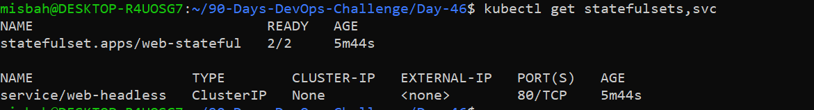
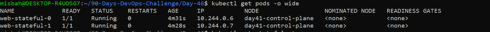
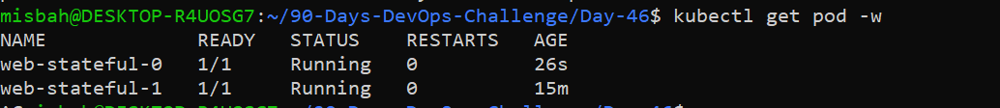
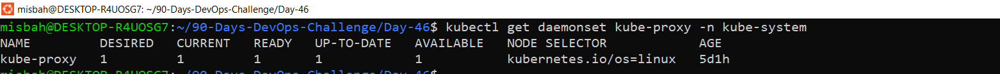
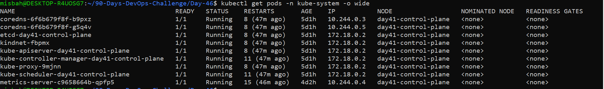

# Day 46: Kubernetes Production - StatefulSets & DaemonSets

Part of the **DevOps Winter Arc / 90-Days-DevOps-Challenge**.

## 1. Objective

Understand when a workload needs stable identity (StatefulSet) and when a Pod must run on every eligible node (DaemonSet), and practise inspecting both workload types on a local cluster.

## 2. Environment

| Item | Value |
|------|-------|
| Host | Windows 10 + WSL2 (Ubuntu) |
| Container runtime | Docker Engine inside WSL2 (no Docker Desktop) |
| Cluster | Local kind cluster `day41` (single node: `day41-control-plane`) |
| Kubernetes version | v1.31.0 |
| Node OS / runtime | Debian GNU/Linux 12 (bookworm), containerd 1.7.18 |
| Lab namespace | `day46-lab` |
| Cloud usage | None. No AWS/EKS, no cloud cost. |

## 3. Deployment vs StatefulSet vs DaemonSet

| Workload | Purpose | Identity / Placement |
|----------|---------|----------------------|
| Deployment | Stateless application replicas | Pods are interchangeable and replaceable, with random names |
| StatefulSet | Stateful or identity-sensitive apps | Stable ordinal names (`app-0`, `app-1`), ordered creation and termination |
| DaemonSet | Node-level agents (logging, monitoring, networking) | One Pod per eligible node |

In my own words: a **Deployment** keeps N identical, disposable Pods running. A **StatefulSet** keeps N Pods that each have a fixed identity (name, DNS record, optionally their own storage), so a replacement Pod comes back as the same member. A **DaemonSet** is not about replica count; it guarantees node coverage, so every eligible node runs exactly one copy.

## 4. Lab A: StatefulSet with a Headless Service

> Note: this lab uses `emptyDir`, so it demonstrates **identity only**, not persistent storage.

### 4.1 Setup

```bash
kubectl create namespace day46-lab
kubectl config set-context --current --namespace=day46-lab
```

### 4.2 Manifest

The manifest is saved as [`statefulset.yaml`](statefulset.yaml). It contains:

- A headless Service `web-headless` (`clusterIP: None`, selector `app: web-stateful`, port 80).
- A StatefulSet `web-stateful` (2 replicas, `serviceName: web-headless`, image `nginx:1.27`, `emptyDir` volume mounted at `/usr/share/nginx/html`).

### 4.3 Apply and inspect

```bash
kubectl apply -f statefulset.yaml
kubectl get statefulsets
kubectl get pods -o wide
kubectl get statefulsets,svc
kubectl describe statefulset web-stateful
kubectl get endpointslices
```

### 4.4 Actual results

- `service/web-headless` and `statefulset.apps/web-stateful` were created successfully.
- StatefulSet `web-stateful` reached **READY 2/2**.
- Pods were created with stable ordinal names, both `Running` with `RESTARTS 0`, on node `day41-control-plane`:

| Pod | Ready | Status | IP (at creation) | Node |
|-----|-------|--------|------------------|------|
| `web-stateful-0` | 1/1 | Running | 10.244.0.6 | day41-control-plane |
| `web-stateful-1` | 1/1 | Running | 10.244.0.7 | day41-control-plane |

- Service `web-headless`: type `ClusterIP`, **CLUSTER-IP `None`** (headless), port `80/TCP`, selector `app=web-stateful`.

Screenshots:





### 4.5 Pod recreation test

Performed only inside the disposable `day46-lab` namespace:

```bash
kubectl delete pod web-stateful-0
kubectl get pods -w
```

**Result:** Kubernetes recreated the Pod with the **same name, `web-stateful-0`**.

Evidence from `evidence-day46.txt`, captured after the test:

| Pod | AGE | IP |
|-----|-----|----|
| `web-stateful-0` | 22m | 10.244.0.8 |
| `web-stateful-1` | 37m | 10.244.0.7 |

`web-stateful-0` is younger than `web-stateful-1`, confirming it is a brand-new Pod. Its IP changed from `10.244.0.6` to `10.244.0.8`, while its name stayed the same. This shows that a StatefulSet Pod's identity comes from its **name and DNS record**, not from its IP address.



## 5. Lab B: Inspecting a DaemonSet

Chosen DaemonSet: **`kube-proxy`** in namespace **`kube-system`** (inspected read-only; nothing in `kube-system` was modified).

```bash
kubectl get daemonsets -A
kubectl describe daemonset kube-proxy -n kube-system
kubectl get daemonset kube-proxy -n kube-system
kubectl get pods -n kube-system -o wide
kubectl get nodes -o wide
kubectl describe node day41-control-plane | grep -i taints
kubectl get daemonset kube-proxy -n kube-system -o jsonpath='{.spec.template.spec.tolerations}'
```

### 5.1 Counts

| Field | Value |
|-------|-------|
| Namespace | `kube-system` |
| DESIRED | 1 |
| CURRENT | 1 |
| READY | 1 |
| UP-TO-DATE | 1 |
| AVAILABLE | 1 |
| Node selector | `kubernetes.io/os=linux` |



### 5.2 Node coverage

| Node | Status | Role | Version | Internal IP |
|------|--------|------|---------|-------------|
| `day41-control-plane` | Ready | control-plane | v1.31.0 | 172.18.0.2 |

The cluster has one node and `kube-proxy` desired/current/ready are all 1, so there is **full coverage: one Pod on every eligible node**.



### 5.3 Why some nodes may not run a DaemonSet Pod

- **Node selectors / affinity:** `kube-proxy` uses `kubernetes.io/os=linux`, so a non-Linux node would be skipped.
- **Taints and tolerations:** a tainted node rejects DaemonSet Pods that do not tolerate the taint.
- **Observed in this cluster:** the node shows `Taints: <none>`, and `kube-proxy` has the toleration `[{"operator":"Exists"}]`, which tolerates every taint. It would therefore run even on a tainted node.

A snapshot of the lab state was saved before cleanup in [`evidence-day46.txt`](evidence-day46.txt).

## 6. Troubleshooting Observations

1. **Flattened YAML in the PDF:** the manifest in the PDF was printed on a single line, which is invalid YAML. I rewrote it with correct indentation and verified it with `cat statefulset.yaml` before running `kubectl apply`. Indentation errors are a common reason a manifest is rejected or Pods are never created.
2. **Pod IP changes, identity does not:** after deleting `web-stateful-0`, the replacement Pod kept the name but received a new IP (`10.244.0.6` to `10.244.0.8`). Applications must therefore address StatefulSet members by DNS name (for example `web-stateful-0.web-headless`), never by Pod IP.
3. **DaemonSet coverage depends on node eligibility:** on this single-node kind cluster there were no taints, so coverage was complete. If `READY` is lower than `DESIRED` in a bigger cluster, the first checks are node eligibility, taints/tolerations, image pulls and resource pressure.

## 7. Interview Questions

**1. What problem does a StatefulSet solve that a Deployment does not?**
A Deployment treats Pods as interchangeable. A StatefulSet gives each Pod a stable name, a stable network identity and (via `volumeClaimTemplates`) its own persistent storage, with ordered creation and termination. This is needed for databases, queues and clustered systems.

**2. Why is a headless Service used with StatefulSets?**
A headless Service (`clusterIP: None`) does not load-balance behind a single virtual IP. It publishes DNS records for each Pod, so peers can reach a specific Pod such as `web-stateful-0.web-headless`.

**3. What does the ordinal in a StatefulSet Pod name mean?**
It is the Pod's fixed index (0, 1, 2...). Pods are created in ascending order and terminated in reverse order, and a replacement Pod keeps the same ordinal and identity.

**4. What is the purpose of a DaemonSet?**
To ensure a copy of a Pod runs on every eligible node (or a selected subset), so node-level services get automatic coverage as nodes are added or removed.

**5. Give two real-world DaemonSet examples.**
Log collectors (for example Fluent Bit) and node monitoring agents (for example Prometheus Node Exporter). Network components such as `kube-proxy` and CNI agents are also DaemonSets.

**6. Does a DaemonSet always run on every node? Explain.**
No. It runs only on **eligible** nodes. Node selectors, node affinity and taints without a matching toleration can exclude nodes. Resource pressure or image pull problems can also stop a Pod from becoming ready.

## 8. Screenshots

| # | File | Shows |
|---|------|-------|
| 1 | `01-statefulset-headless-svc.png` | StatefulSet and headless Service applied |
| 2 | `02-stable-ordinal-pods.png` | Pods with stable ordinal names |
| 3 | `03-pod-recreation.png` | Pod recreation with the same ordinal name |
| 4 | `04-daemonset-counts.png` | DaemonSet desired/current/ready counts |
| 5 | `05-daemonset-node-placement.png` | DaemonSet Pods with node placement |

## 9. Cleanup and Safety

Only the assignment namespace was deleted. No shared or `kube-system` resources were changed. No cloud resources were created.

```bash
kubectl delete namespace day46-lab
kubectl config set-context --current --namespace=default
```

## 10. Completion Checklist

- [x] I can explain StatefulSet vs Deployment.
- [x] I understand headless Services and stable Pod identity.
- [x] I inspected a DaemonSet and its node coverage.
- [x] I saved the required evidence.
- [x] I cleaned up `day46-lab`.
