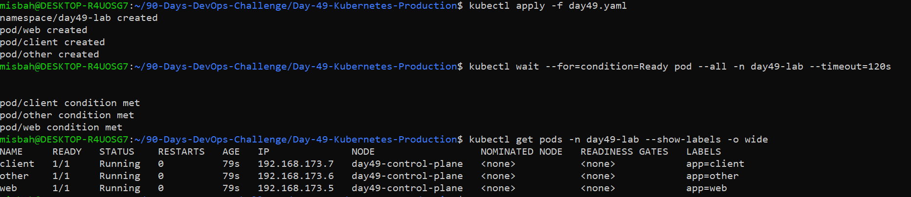
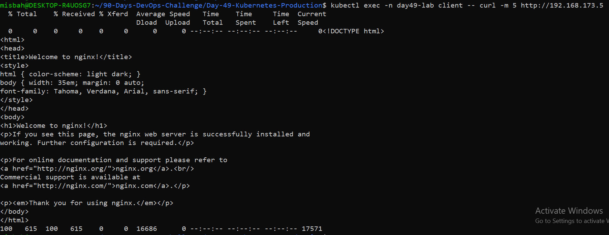
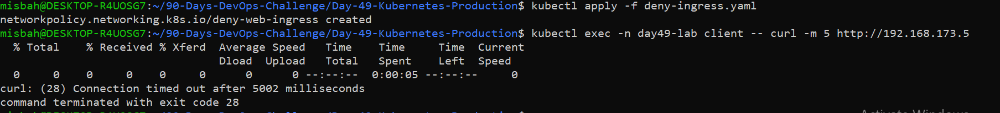
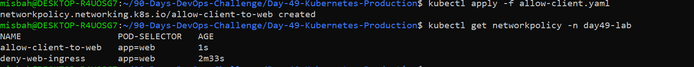
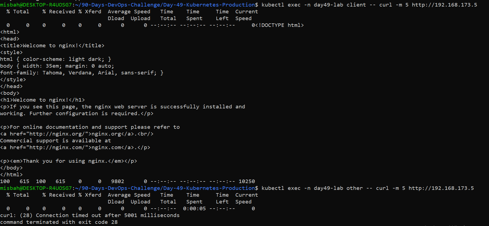

# DevOps Winter Arc — Day 49: Kubernetes Production NetworkPolicy

## 1. Overview & Learning Objectives
In Kubernetes, Pods can communicate freely with one another across the cluster by default[cite: 1, 2]. **NetworkPolicy** provides Layer 3/Layer 4 network segmentation to control ingress (incoming) and egress (outgoing) traffic at the Pod level using label selectors[cite: 1, 2].

**Key Objectives:**
* Configure a local Kind cluster with a NetworkPolicy-capable CNI plugin (**Calico**)[cite: 1].
* Understand `NetworkPolicy`, `podSelector`, `policyTypes`, `Ingress`, and `Egress`[cite: 1].
* Verify baseline Pod-to-Pod connectivity before applying policies[cite: 1].
* Enforce a **default-deny ingress** policy on a target workload (`web`)[cite: 1].
* Apply an additive **allow rule** permitting traffic exclusively from authorized Pods (`client`) while keeping unauthorized Pods (`other`) blocked[cite: 1, 2].
* Analyze **egress isolation** and explicit **DNS (port 53)** allow rules[cite: 2].

---

## 2. Core Concepts
* **Ingress vs. Egress:** `Ingress` governs incoming connections entering selected Pods, whereas `Egress` governs outbound connections leaving selected Pods[cite: 1].
* **Additive Policy Model:** Before any policy selects a Pod, all traffic is allowed[cite: 1, 2]. Once at least one NetworkPolicy selects a Pod for a given direction (`Ingress` or `Egress`), all traffic in that direction is denied unless explicitly permitted by at least one matching allow rule[cite: 1, 2].
* **Empty `podSelector` (`{}`):** Matches **all Pods** within the policy's namespace[cite: 1].
* **CNI Enforcement Dependency:** The Kubernetes API server accepts NetworkPolicy objects regardless of the CNI plugin, but actual packet filtering only occurs if the underlying CNI (such as Calico or Cilium) implements NetworkPolicy enforcement[cite: 1, 2]. Default `kindnet` does not enforce NetworkPolicies.

---

## 3. Environment & Cluster Setup (Kind + Calico CNI)
To ensure genuine NetworkPolicy enforcement locally, a dedicated Kind cluster (`day49`) was provisioned with `disableDefaultCNI: true`, followed by installing **Project Calico v3.28.0**.

    cat << 'YAML' > kind-calico.yaml
    kind: Cluster
    apiVersion: kind.x-k8s.io/v1alpha4
    networking:
      disableDefaultCNI: true
      podSubnet: 192.168.0.0/16
    nodes:
    - role: control-plane
    YAML

    kind create cluster --name day49 --config kind-calico.yaml
    kubectl apply -f https://raw.githubusercontent.com/projectcalico/calico/v3.28.0/manifests/calico.yaml
    kubectl wait --for=condition=Ready pod -l k8s-app=calico-node -n kube-system --timeout=180s

---

## 4. Lab Execution & Verification

### Step 1: Deploy Test Namespace & Workloads (`day49.yaml`)
Created an isolated namespace `day49-lab` containing three Pods: `web` (`nginx:1.27`), `client` (`curlimages/curl:8.10.1`), and `other` (`curlimages/curl:8.10.1`)[cite: 1].

    kubectl apply -f day49.yaml
    kubectl wait --for=condition=Ready pod --all -n day49-lab --timeout=120s
    kubectl get pods -n day49-lab --show-labels -o wide

| Pod Name | Namespace | IP Address | Labels | Status |
| :--- | :--- | :--- | :--- | :--- |
| `web` | `day49-lab` | `192.168.173.5` | `app=web` | Running[cite: 6] |
| `other` | `day49-lab` | `192.168.173.6` | `app=other` | Running[cite: 6] |
| `client` | `day49-lab` | `192.168.173.7` | `app=client` | Running[cite: 6] |

[cite: 2, 11]

---

### Step 2: Lab A — Baseline Connectivity Test
Tested HTTP connectivity from `client` to `web` (`192.168.173.5`) prior to applying any NetworkPolicy[cite: 1, 6].

    kubectl exec -n day49-lab client -- curl -m 5 http://192.168.173.5

* **Result:** **Success** — Returned the default Nginx welcome HTML page (`Welcome to nginx!`), confirming unrestricted baseline Pod-to-Pod networking[cite: 7].

[cite: 2, 11]

---

### Step 3: Lab B — Default-Deny Ingress on `web` (`deny-ingress.yaml`)
Applied `deny-web-ingress` targeting `app: web` with `policyTypes: ["Ingress"]` and no `ingress` allow rules[cite: 1, 2].

    kubectl apply -f deny-ingress.yaml
    kubectl exec -n day49-lab client -- curl -m 5 http://192.168.173.5

* **Result:** **Blocked / Timed Out** (`curl: (28) Connection timed out after 5002 milliseconds`), verifying that Calico enforced the default-deny ingress boundary[cite: 2, 8].

[cite: 2, 11]

---

### Step 4: Lab C — Selective Ingress Allow (`allow-client.yaml`)
Applied `allow-client-to-web` to permit incoming TCP traffic on port `80` strictly from Pods matching `app: client` within `day49-lab`[cite: 2].

    kubectl apply -f allow-client.yaml
    kubectl get networkpolicy -n day49-lab

[cite: 2, 11]

Tested connectivity from both `client` and `other` Pods against `web` (`192.168.173.5`)[cite: 2, 6]:

    kubectl exec -n day49-lab client -- curl -m 5 http://192.168.173.5
    kubectl exec -n day49-lab other -- curl -m 5 http://192.168.173.5

* **Result from `client` (`app=client`):** **Allowed** — Returned `Welcome to nginx!`[cite: 9].
* **Result from `other` (`app=other`):** **Blocked** — Failed with `curl: (28) Connection timed out after 5001 milliseconds`[cite: 9].

[cite: 2, 11]

---

## 5. Egress Isolation & DNS Investigation (`deny-egress-example.yaml`)
A standalone default-deny egress manifest was authored for a disposable namespace (`day49-egress-test`) without applying it to cluster management workloads[cite: 2]:

* **How Default-Deny Egress Blocks Outbound Traffic:** Specifying `policyTypes: ["Egress"]` with an empty/omitted `egress` rule list isolates the selected Pod (`app: client`) from initiating any outbound connections—blocking external internet access, internal cluster services, and DNS lookups[cite: 2].
* **Permitting DNS & Required Destinations:** When egress is isolated, Pods cannot resolve Kubernetes Service names or external domains because queries to `kube-dns`/`CoreDNS` in `kube-system` are dropped[cite: 2]. To restore name resolution while maintaining zero-trust egress, an explicit egress rule must allow **UDP and TCP port 53** to the DNS Pods/namespace alongside specific destination CIDR blocks or Pod/Namespace selectors on required ports[cite: 2]:

    egress:
    - to:
      - namespaceSelector:
          matchLabels:
            kubernetes.io/metadata.name: kube-system
        podSelector:
          matchLabels:
            k8s-app: kube-dns
      ports:
      - protocol: UDP
        port: 53
      - protocol: TCP
        port: 53

---

## 6. Repository Deliverables
* `kind-calico.yaml` — Kind cluster configuration with default CNI disabled for Calico installation.
* `day49.yaml` — Namespace (`day49-lab`) and test Pods (`web`, `client`, `other`)[cite: 1].
* `deny-ingress.yaml` — Default-deny ingress NetworkPolicy targeting `app=web`[cite: 1].
* `allow-client.yaml` — Additive ingress NetworkPolicy permitting `app=client` on TCP/80[cite: 2].
* `deny-egress-example.yaml` — Reference default-deny egress manifest for outbound isolation analysis[cite: 2].
* `screenshots/` — Evidence captures (`01` through `05`) documenting every lab stage[cite: 2, 11].

---

## 7. Interview Questions & Answers

1. **What is a NetworkPolicy?**
   A Kubernetes resource (`networking.k8s.io/v1`) that acts as a software firewall for Pods, specifying allowed ingress and egress network flows using Pod selectors, Namespace selectors, IP blocks, and ports[cite: 1, 2].

2. **What is the difference between Ingress and Egress?**
   **Ingress** controls incoming traffic destined *for* the selected Pods, while **Egress** controls outgoing traffic originating *from* the selected Pods[cite: 1].

3. **What does an empty `podSelector` (`podSelector: {}`) select?**
   It selects **all Pods** in the namespace where the NetworkPolicy is created[cite: 1].

4. **Are Pods denied by default before any policy is applied?**
   No[cite: 1, 2]. By default, Kubernetes Pods are **non-isolated** and accept all ingress and egress traffic until at least one NetworkPolicy selects them for that traffic direction[cite: 1, 2].

5. **Why does CNI support matter for NetworkPolicies?**
   Kubernetes only stores NetworkPolicy definitions in etcd; the Container Network Interface (CNI) plugin programs the underlying iptables/eBPF rules on nodes[cite: 1, 2]. Without a NetworkPolicy-capable CNI (e.g., Calico, Cilium, Weave), policies are accepted by the API server but never enforced[cite: 1, 2].

6. **What is the difference between `podSelector` and `namespaceSelector`?**
   `podSelector` filters traffic based on labels on Pods (scoped to the policy's own namespace unless combined with `namespaceSelector`), whereas `namespaceSelector` allows or restricts traffic from all Pods residing in namespaces matching specific namespace labels[cite: 2].

7. **Why might DNS fail after applying an egress isolation policy?**
   Because DNS resolution requires outbound packets to CoreDNS on **UDP/TCP port 53**[cite: 2]. A default-deny egress policy blocks all outbound traffic unless port 53 to `kube-dns` is explicitly whitelisted[cite: 2].

---

## 8. Cleanup & Safety
After capturing all verification screenshots, the lab namespace was safely removed without affecting cluster system components[cite: 3]:

    kubectl delete namespace day49-lab

*(No AWS cloud resources were provisioned or required for this lab[cite: 3].)*
