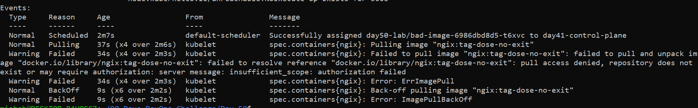
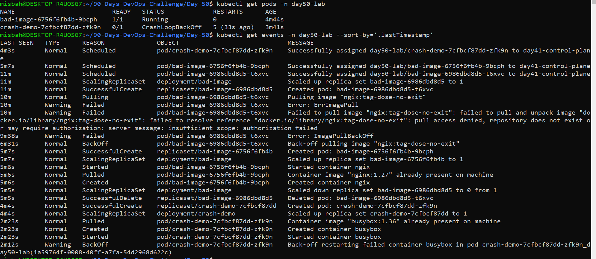
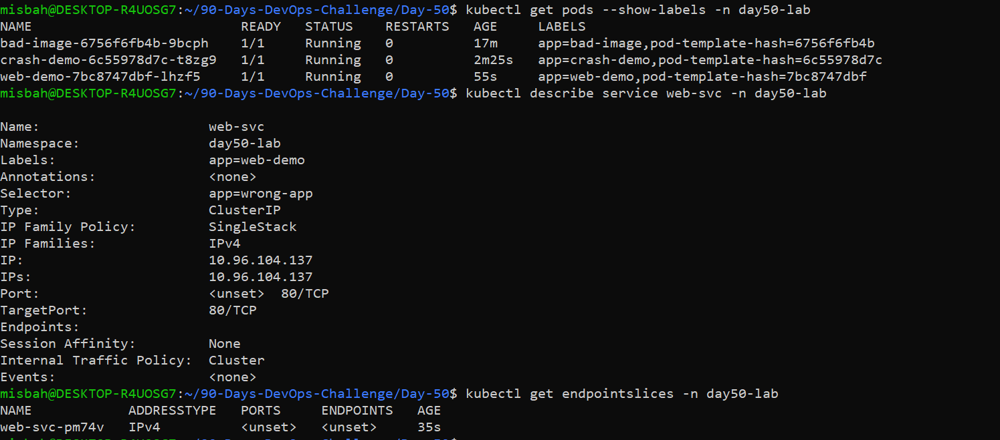
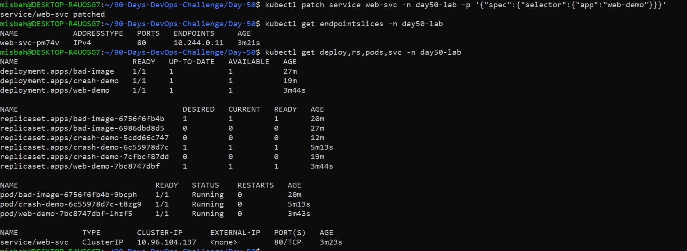
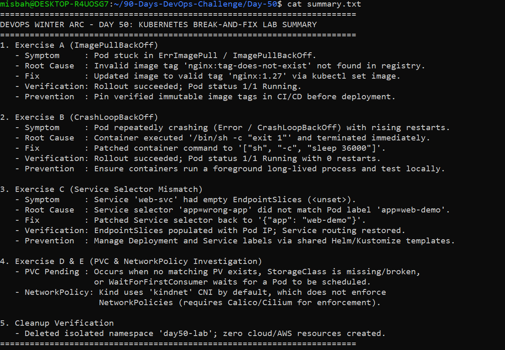

# Day 50 — Kubernetes Production: Break-and-Fix Lab

> **DevOps Winter Arc | 90 Days DevOps Challenge**
> Diagnosing and repairing common Kubernetes failures in a safe, isolated local namespace, with **zero cloud/AWS resources**.


---

## Table of Contents
1. [Objective](#1-objective)
2. [Environment & Safety Setup](#2-environment--safety-setup)
3. [Troubleshooting Workflow](#3-troubleshooting-workflow)
4. [Exercise A — ImagePullBackOff](#4-exercise-a--imagepullbackoff)
5. [Exercise B — CrashLoopBackOff](#5-exercise-b--crashloopbackoff)
6. [Exercise C — Service Selector Mismatch](#6-exercise-c--service-selector-mismatch)
7. [Exercise D — PVC Pending Investigation](#7-exercise-d--pvc-pending-investigation)
8. [Exercise E — NetworkPolicy & CNI Check](#8-exercise-e--networkpolicy--cni-check)
9. [Root Cause Summary](#9-root-cause-summary)
10. [Interview Questions & Answers](#10-interview-questions--answers)
11. [Cleanup](#11-cleanup)
12. [Completion Checklist](#12-completion-checklist)
13. [Key Takeaways](#13-key-takeaways)

---

## 1. Objective

- Follow an evidence-based troubleshooting workflow.
- Fix `ImagePullBackOff` and `CrashLoopBackOff`.
- Diagnose Service selector problems.
- Investigate PVC and NetworkPolicy symptoms.
- Verify every fix and document root causes.

---

## 2. Environment & Safety Setup

| Item | Value |
|------|-------|
| Cluster | Kind (`day41-control-plane`) |
| Context | `kind-day41` |
| Namespace | `day50-lab` (isolated, disposable) |
| Cloud/AWS resources | None |

```bash
kubectl config current-context
kubectl create namespace day50-lab
kubectl config set-context --current --namespace=day50-lab
```

**Safety measures:**
- Verified the context before every destructive command.
- Changed resources **only** inside `day50-lab`.
- Never touched `default` or system namespaces.

---

## 3. Troubleshooting Workflow

1. **Observe** the symptom
2. **Inspect** status and events
3. **Check** logs and configuration
4. **Identify** the root cause
5. **Apply** the smallest safe fix
6. **Verify** recovery

```bash
kubectl get all -n day50-lab
kubectl get pods -o wide -n day50-lab
kubectl describe pod <pod-name> -n day50-lab
kubectl get events -n day50-lab
```

---

## 4. Exercise A — ImagePullBackOff

| | |
|---|---|
| **Symptom** | Pod stuck in `ErrImagePull` / `ImagePullBackOff` |
| **Root cause** | Invalid image tag `nginx:tag-does-not-exist` |
| **Fix** | Updated the image to `nginx:1.27` |
| **Verification** | Rollout succeeded, Pod `1/1 Running` |
| **Prevention** | Pin valid image tags and validate them in CI before deploying |

**Break:**
```bash
kubectl create deployment bad-image --image=nginx:tag-does-not-exist -n day50-lab
kubectl get pods -n day50-lab
kubectl describe pod <pod-name> -n day50-lab
```

**Fix & verify:**
```bash
kubectl set image deployment/bad-image nginx=nginx:1.27 -n day50-lab
kubectl rollout status deployment/bad-image -n day50-lab
kubectl get pods -n day50-lab
```

📸 **Evidence:**



---

## 5. Exercise B — CrashLoopBackOff

| | |
|---|---|
| **Symptom** | Pod restarting repeatedly with increasing back-off |
| **Root cause** | Container command `/bin/sh -c "exit 1"` terminates immediately with a non-zero exit code |
| **Fix** | Changed the command to `["sh", "-c", "sleep 36000"]` so the process stays alive |
| **Verification** | Pod stabilized at `1/1 Running` |
| **Prevention** | Use proper long-running entrypoints, add liveness/readiness probes, and check `--previous` logs early |

**Break:**
```bash
kubectl create deployment crash-demo --image=busybox:1.36 -n day50-lab -- /bin/sh -c "exit 1"
kubectl get pods -n day50-lab
kubectl logs deployment/crash-demo -n day50-lab
kubectl logs <pod> --previous -n day50-lab
```

**Fix & verify:**
```bash
kubectl edit deployment crash-demo -n day50-lab
# command: ["sh", "-c", "sleep 36000"]
kubectl rollout status deployment/crash-demo -n day50-lab
kubectl get pods -n day50-lab
```

📸 **Evidence:**



---

## 6. Exercise C — Service Selector Mismatch

| | |
|---|---|
| **Symptom** | Service had no backends; EndpointSlices showed `<unset>` |
| **Root cause** | Service selector `app=wrong-app` did not match the Pod label `app=web-demo` |
| **Fix** | Patched the Service selector back to `{"app": "web-demo"}` |
| **Verification** | EndpointSlices populated with the Pod IP; routing restored |
| **Prevention** | Manage Deployment and Service labels through shared Helm/Kustomize templates |

**Break & diagnose:**
```bash
kubectl create deployment web-demo --image=nginx:1.27 -n day50-lab
kubectl expose deployment web-demo --name=web-svc --port=80 --target-port=80 -n day50-lab
kubectl patch service web-svc -n day50-lab -p '{"spec":{"selector":{"app":"wrong-app"}}}'
kubectl get pods --show-labels -n day50-lab
kubectl describe svc web-svc -n day50-lab
kubectl get endpointslices -n day50-lab
```

**Fix & verify:**
```bash
kubectl patch service web-svc -n day50-lab -p '{"spec":{"selector":{"app":"web-demo"}}}'
kubectl get endpointslices -n day50-lab
```

📸 **Evidence:**



---

## 7. Exercise D — PVC Pending Investigation

```bash
kubectl get storageclass
kubectl get pv
kubectl get pvc -A
```

**Findings:** The cluster has a default `standard` StorageClass using the `rancher.io/local-path` provisioner with `WaitForFirstConsumer` binding mode. No storage configuration was changed.

**Why a PVC may stay `Pending`:**
1. **No matching PV**: no PersistentVolume satisfies the requested size, access mode, or StorageClass.
2. **Missing or broken provisioner**: the StorageClass is absent or its dynamic provisioner is not working.
3. **WaitForFirstConsumer**: the PVC waits until a Pod that uses it is scheduled.

**Prevention:** Verify that a default StorageClass exists and that its provisioner is healthy before deploying stateful workloads.

---

## 8. Exercise E — NetworkPolicy & CNI Check

Inspected the `kube-system` Pods and confirmed that the Kind cluster uses **kindnet** as its CNI.

> ⚠️ `kindnet` provides Pod networking but **does not enforce NetworkPolicy**. A CNI such as **Calico** or **Cilium** is required for enforcement. If a policy has no visible effect, check CNI support first.

---

## 9. Root Cause Summary

| Exercise | Symptom | Root Cause | Fix | Prevention |
|----------|---------|------------|-----|------------|
| A | ImagePullBackOff | Invalid image tag | `kubectl set image` to `nginx:1.27` | Pin valid tags, validate in CI |
| B | CrashLoopBackOff | Process exits immediately (`exit 1`) | Long-running command (`sleep 36000`) | Proper entrypoints and probes |
| C | No endpoints | Selector `wrong-app` ≠ label `web-demo` | Patch Service selector | Shared Helm/Kustomize labels |
| D | PVC Pending (analysis) | No PV / broken provisioner / WaitForFirstConsumer | Investigation only | Check StorageClass health |
| E | Policy not enforced (analysis) | kindnet lacks NetworkPolicy support | Use Calico/Cilium | Verify CNI capabilities |

📸 **Verified fixes:**



📸 **Root-cause summary:**



---

## 10. Interview Questions & Answers

**1. ImagePullBackOff vs CrashLoopBackOff?**
`ImagePullBackOff` means the kubelet cannot pull the image (wrong tag, missing registry credentials, or a network problem), so the container never starts. `CrashLoopBackOff` means the image was pulled and the container started, but the process keeps exiting, so Kubernetes restarts it with an increasing back-off delay.

**2. How do you investigate a Pending Pod?**
Run `kubectl describe pod` and read the Events. Common causes are insufficient CPU/memory, node selectors/taints without matching tolerations, or an unbound PVC.

**3. Why can a Service have no endpoints?**
The selector does not match any Pod labels, the Pods are not Ready (failing readiness probes), or no Pods exist. Check with `kubectl get endpointslices` and `kubectl get pods --show-labels`.

**4. How do you view logs from a previous crashed container?**
```bash
kubectl logs <pod> --previous -n <namespace>
```

**5. Why inspect events before changing resources?**
Events show what the cluster actually reports (scheduling, pull errors, probe failures). Acting on evidence avoids guesswork, prevents unnecessary changes, and keeps the fix minimal and safe.

---

## 11. Cleanup

```bash
kubectl config current-context        # confirm the context first
kubectl delete namespace day50-lab
kubectl config set-context --current --namespace=default
```

- Deleted the isolated `day50-lab` namespace.
- Reset the default namespace for the context.
- Stopped the local Kind cluster container to free system resources.
- **Zero cloud/AWS resources were created.**

---

## 12. Completion Checklist

- [x] Fixed the image pull issue
- [x] Diagnosed and repaired the crashing container
- [x] Fixed the Service selector
- [x] Investigated PVC and NetworkPolicy behavior
- [x] Documented root causes and verified fixes
- [x] Cleaned up the lab namespace

---

## 13. Key Takeaways

- Always **observe → inspect events → check logs → fix → verify**.
- Events are the first place to look; `--previous` logs reveal crashed containers.
- Service problems are usually **label/selector mismatches**.
- Storage and network policy issues often come from the **cluster setup** (provisioner, CNI), not the workload.
- Isolated namespaces make break-and-fix practice safe.

---

*Part of the **90 Days DevOps Challenge** — Day 50 ✅*
