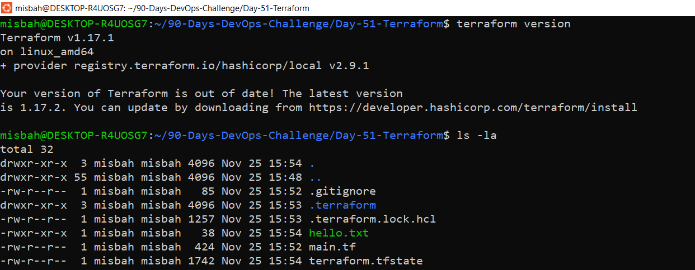
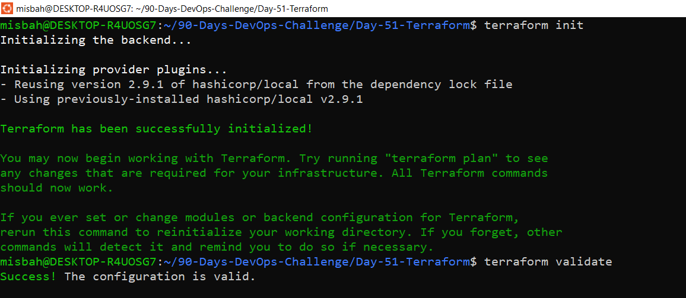
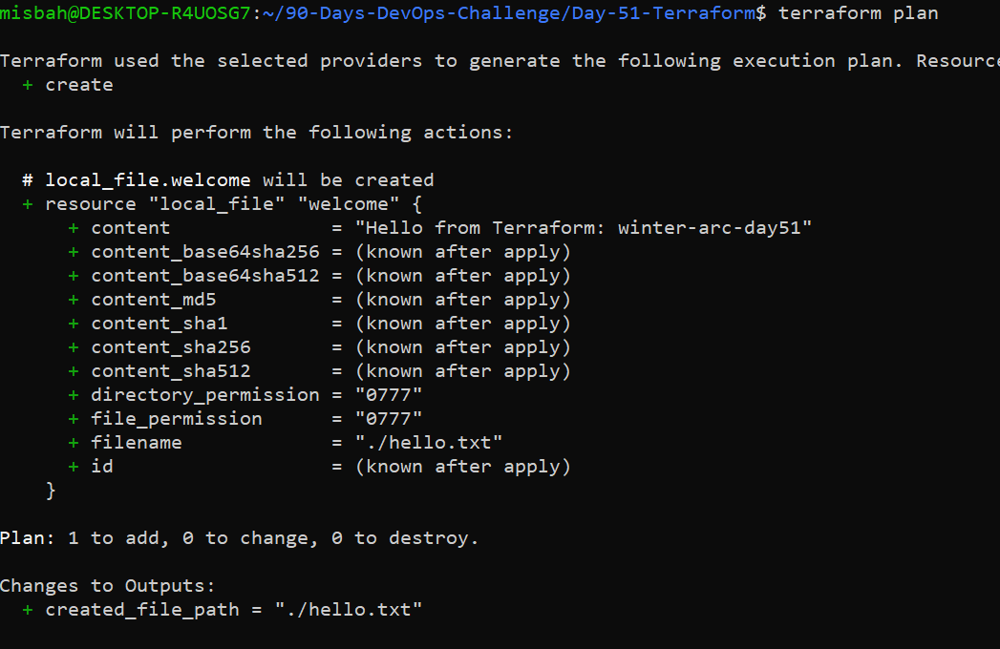
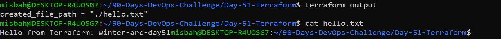
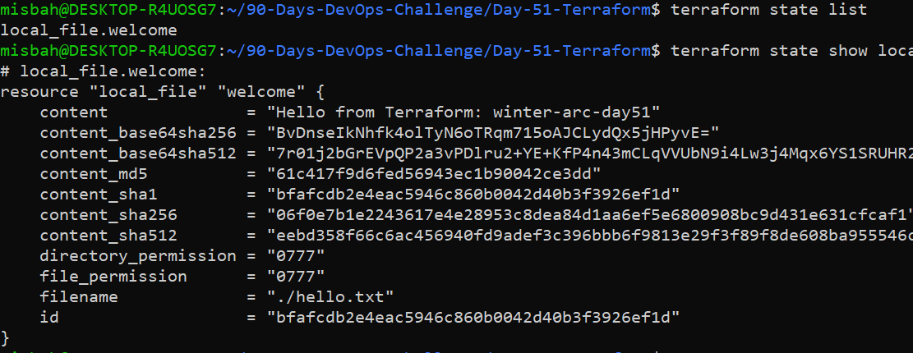

cat << 'EOF' > README.md
# Day 51: Terraform — Infrastructure as Code (IaC) Fundamentals

## Goal
Learn Terraform's end-to-end workflow and safely manage a small local resource (`local_file`) without creating billable AWS infrastructure.

---

## 1. Learning Objectives
- Explain Infrastructure as Code (IaC).
- Understand providers, resources, variables, outputs, and state.
- Run `init`, `fmt`, `validate`, `plan`, and `apply`.
- Review an execution plan before making changes and safely destroy lab resources.

---

## 2. Core Concepts & Terraform Workflow

| Concept | Description |
| :--- | :--- |
| **IaC** | Manage infrastructure declaratively through configuration files. |
| **Provider** | Plugin connecting Terraform to a platform or API (e.g., `hashicorp/local`). |
| **Resource** | Object that Terraform manages (`local_file.welcome`). |
| **Variable** | Input parameter (`project_name`) to make configurations reusable. |
| **Output** | Value displayed after `terraform apply` (`created_file_path`). |
| **State** | Terraform's JSON record (`terraform.tfstate`) of managed resources. Must be protected as it may contain sensitive data. |

**Standard Workflow:**
Write configuration → `terraform init` → `terraform fmt` → `terraform validate` → `terraform plan` (review) → `terraform apply` → `terraform output` / inspect state → `terraform destroy`

---

## 3. Lab Execution & Deliverables

### Lab A & B: Installation Verification & Local Resource Creation
- Verified Terraform CLI installation (`v1.17.1` on `linux_amd64`).
- Configured `main.tf` using the `hashicorp/local` (`~> 2.5`) provider to create `./hello.txt` using variable `project_name = "winter-arc-day51"`.

**Plan Output Summary (Before Apply):**
- Action: `# local_file.welcome will be created`
- Attributes: `filename = "./hello.txt"`, `content = "Hello from Terraform: winter-arc-day51"`
- Summary: `Plan: 1 to add, 0 to change, 0 to destroy.`

**Generated Output & File Content:**
- `terraform output` → `created_file_path = "./hello.txt"`
- `cat hello.txt` → `Hello from Terraform: winter-arc-day51`

---

### Lab C: Configuration Change & Drift Inspection
- Updated `project_name` default value in `main.tf` to `"winter-arc-day51-updated"`.
- Ran `terraform fmt`, `terraform validate`, and `terraform plan`.
- **Why Terraform proposed updating the file:** Terraform compared the updated configuration file against `terraform.tfstate` and detected a change in the `content` argument (`"winter-arc-day51"` → `"winter-arc-day51-updated"`), proposing resource replacement/update.
- Applied changes after reviewing the plan and verified the updated `hello.txt`.

---

### Lab D: State Inspection & Security
- `terraform state list` → `local_file.welcome`
- **Resource Address Explanation:** `local_file.welcome` consists of the resource type (`local_file`, provided by `hashicorp/local`) followed by the local logical resource name (`welcome`) declared in `main.tf`.
- **Inspected Attributes (`terraform state show local_file.welcome`):**
  - `filename = "./hello.txt"`
  - `content = "Hello from Terraform: winter-arc-day51"`
- **Why `terraform.tfstate` must be protected:** State files map configuration code to real-world resources and can store sensitive values (passwords, API keys, secrets, or infrastructure metadata) in plain text. Never edit state files manually and never commit them to a public repository.

---

## 4. Project Files & `.gitignore` Hygiene

| File / Folder | Purpose | Git Tracking Status |
| :--- | :--- | :--- |
| `main.tf` | Primary Terraform configuration file | Committed |
| `.terraform.lock.hcl` | Locks exact provider versions and checksums | Committed |
| `.gitignore` | Excludes local working and state files | Committed |
| `.terraform/` | Local provider plugin working directory | Ignored |
| `terraform.tfstate*` | Terraform state and backup files | Ignored |

---

## 5. Lab Screenshots

### 1. Terraform Version & Project Folder

### 2. Successful `init` and `validate`

### 3. Plan Showing One Resource to Add

### 4. Generated File and Output

### 5. State List & Show Managed Resource

---

## 6. Interview Questions & Answers
1. **What is IaC?** Managing and provisioning infrastructure using declarative configuration files instead of manual console operations.
2. **What is a Terraform provider?** A plugin that enables Terraform to interact with cloud platforms, SaaS APIs, or local system resources.
3. **Resource vs Data Source?** A `resource` creates, updates, and destroys infrastructure objects; a `data source` only queries/reads existing infrastructure information.
4. **What is Terraform state?** A JSON file (`terraform.tfstate`) that tracks the binding between configuration code and real-world resources.
5. **What does `terraform plan` do?** Compares current state with desired configuration and generates an execution preview without making actual changes.
6. **Why review a plan before apply?** To catch unintended deletions, modifications, or unexpected cloud costs before execution.
7. **What is `.terraform.lock.hcl` used for?** Records exact provider versions and cryptographic hashes to guarantee reproducible environments across machines.

---

## 7. Cleanup & Cost Safety
- Reviewed teardown plan via `terraform plan -destroy` to verify only `local_file.welcome` was targeted.
- Executed `terraform destroy` (`Plan: 0 to add, 0 to change, 1 to destroy`) to safely remove `./hello.txt`.
- **Zero AWS resources were created** during this lab.

### Completion Checklist
- [x] Understand IaC, providers, resources, and state
- [x] Ran `init`, `fmt`, `validate`, and `plan`
- [x] Reviewed the plan before `apply`
- [x] Inspected outputs and state
- [x] Safely destroyed the local lab resource
EOF
