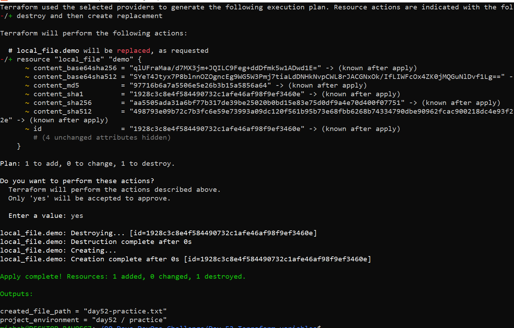
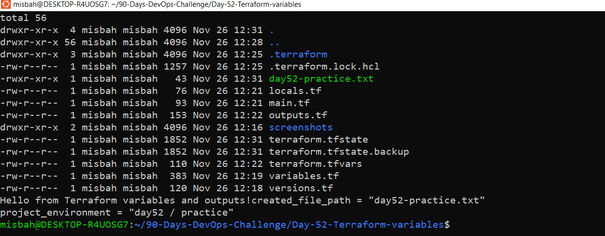
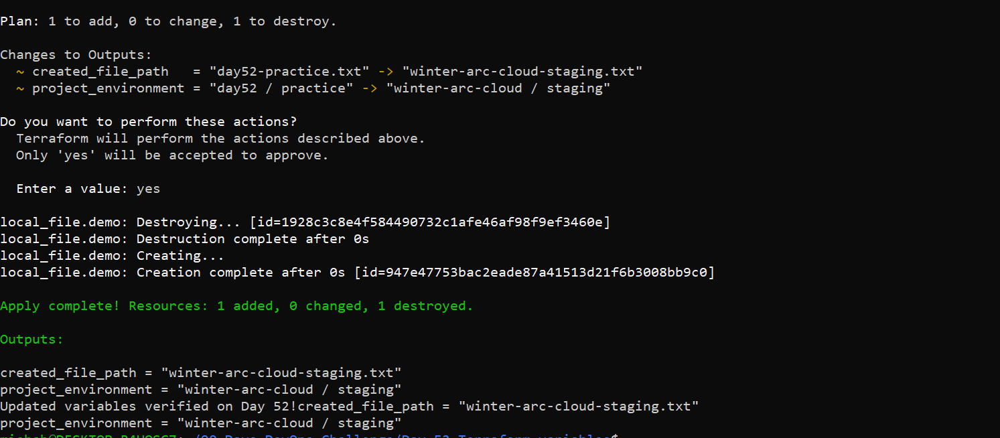

# Day 52: Terraform Variables, Outputs & Data Sources

## Objective
Make Terraform configurations reusable and dynamic using input variables, local values (`locals`), outputs, and data sources. This lab uses Terraform's `local` provider to generate and manage a local file safely with zero cloud/AWS charges.

---

## Project Folder Structure
- `versions.tf` — Configures Terraform required providers (`hashicorp/local ~> 2.5`)
- `variables.tf` — Declares input variables (`project_name`, `environment`, `message`) with types and defaults
- `locals.tf` — Defines local expression `output_filename` combining project name and environment
- `main.tf` — Defines `local_file.demo` resource using locals and input variables
- `outputs.tf` — Exposes `created_file_path` and `project_environment` values
- `terraform.tfvars` — Supplies custom variable values for the configuration
- `.gitignore` — Excludes `.terraform/`, `*.tfstate`, and sensitive `.tfvars` files from Git
- `screenshots/` — Contains verification outputs for `init`, `validate`, `plan`, `apply`, generated file, and variable updates

---

## Execution & Verification Screenshots

### 1. Terraform Init, Validate, Plan & Apply
Initialized the local provider, validated HCL syntax, previewed the execution plan, and applied the configuration to generate `day52-practice.txt`.

### 2. Generated File & Terraform Output
Verified the created text file content and retrieved output values (`created_file_path` and `project_environment`) using `terraform output`.

### 3. Updating Variables & Re-Applying Configuration
Updated `project_name`, `environment`, and `message` inside `terraform.tfvars`, then ran `terraform plan` and `terraform apply` to observe Terraform replacing the old file with `winter-arc-cloud-staging.txt`.

---

## Key Terraform Concepts Comparison

| Comparison | Concept A | Concept B |
| :--- | :--- | :--- |
| **Resource vs Data Source** | **Resource (`resource`)**: Creates, updates, and deletes (manages full lifecycle) infrastructure objects in `terraform.tfstate`. | **Data Source (`data`)**: Reads/fetches read-only information about existing objects without modifying or managing their lifecycle. |
| **Variable vs Local** | **Input Variable (`variable`)**: Accepts external values from users via `.tfvars`, CLI flags (`-var`), or environment variables. | **Local Value (`locals`)**: Defines internal computed expressions or repeated values inside a module (not overridable externally). |
| **Input vs Output** | **Input (`variable`)**: Passes data **into** a Terraform configuration to parameterize settings. | **Output (`output`)**: Exposes generated data **out of** a configuration after `apply` (e.g., file paths, IDs). |

---

## Data Source Concept Task (Reference Example)

### How a Data Source Works
A **data source** allows Terraform to query and read metadata or attributes from an existing resource (created outside Terraform or in another workspace) without taking ownership of its lifecycle. Unlike a `resource` block, Terraform never creates, updates, or destroys the target of a `data` block.

### Official Registry Example: `local_file` Data Source (`hashicorp/local`)
> **Note:** Labeled as a **reference example** (not executed in the active lab configuration).

    data "local_file" "existing_readme" {
      filename = "${path.module}/README.md"
    }

    output "readme_sha256" {
      value = data.local_file.existing_readme.content_sha256
    }

- **Required Argument:**
  - `filename` (`String`) — Path to the existing file on disk to read.
- **Exported Attributes (Read-Only):**
  - `content` — Raw string content of the file.
  - `content_base64` — Base64-encoded content of the file.
  - `content_sha256` — SHA256 checksum of the file content.
  - `id` — Unique identifier (SHA1 checksum of the file content).

---

## Cleanup & Security Best Practices
- **Resource Cleanup:** Ran `terraform destroy` at the end of the lab to remove all Terraform-managed local `.txt` files safely.
- **State & Secret Protection:** Configured `.gitignore` to exclude `.terraform/`, `*.tfstate`, `*.tfstate.*`, and sensitive `.tfvars` files from being committed to GitHub.
