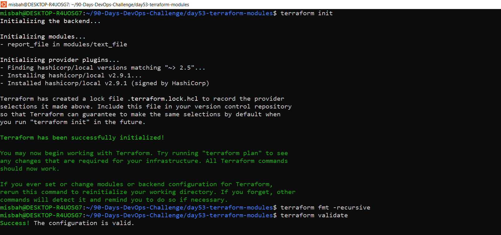
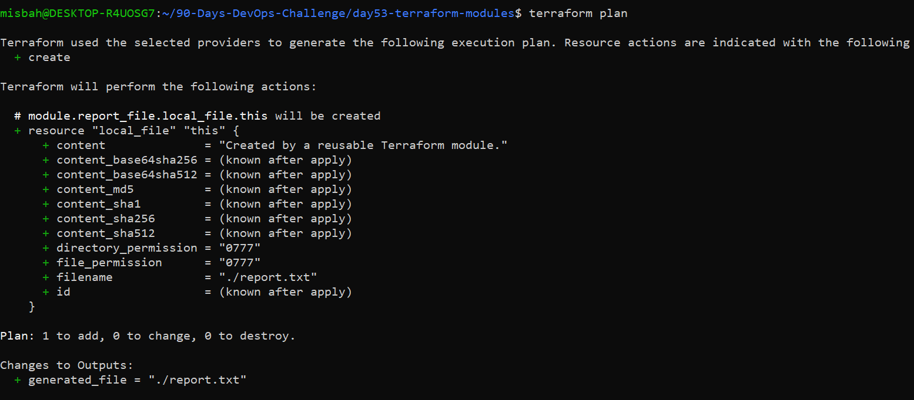
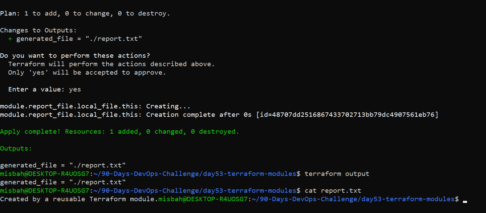
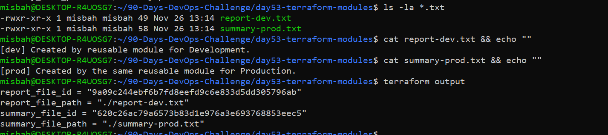

# Day 53: Terraform Modules — Reusable Infrastructure as Code

## 1. Objective
Organize Terraform configuration into reusable modules by building a root module that calls a local child module, passes input variables (`environment`, `filename`, `content`), and reads module outputs (`file_path`, `file_id`)[cite: 1, 2]. All resources in this lab are created locally using the `hashicorp/local` provider with zero AWS resources or cloud charges[cite: 1, 2].

---

## 2. Topics Covered
* Terraform modules and why they are useful[cite: 1]
* Root module vs child module[cite: 1]
* Module folder structure and the `source` argument[cite: 1]
* Passing input variables into modules[cite: 1]
* Returning and consuming module outputs[cite: 1]
* Reusing one module with different inputs[cite: 1]
* Terraform Registry and module versioning[cite: 1]

---

## 3. Project Folder Structure
```text
Day-53-terraform-modules/
├── .gitignore
├── README.md
├── main.tf
├── outputs.tf
├── modules/
│   └── text_file/
│       ├── main.tf
│       ├── outputs.tf
│       └── variables.tf
└── screenshots/
    ├── 01-init-validate.png
    ├── 02-plan.png
    ├── 03-apply-output.png
    └── 04-two-module-files.png
```

---

## 4. Module Configuration Files

### Child Module (`modules/text_file/`)

**`modules/text_file/variables.tf`**
```hcl
variable "filename" {
  type = string
}

variable "content" {
  type = string
}

variable "environment" {
  type    = string
  default = "dev"
}
```

**`modules/text_file/main.tf`**
```hcl
resource "local_file" "this" {
  filename = var.filename
  content  = "[${var.environment}] ${var.content}"
}
```

**`modules/text_file/outputs.tf`**
```hcl
output "file_path" {
  value = local_file.this.filename
}

output "file_id" {
  value = local_file.this.id
}
```

---

### Root Module (`Day-53-terraform-modules/`)

**`main.tf`**
```hcl
terraform {
  required_providers {
    local = {
      source  = "hashicorp/local"
      version = "~> 2.5"
    }
  }
}

module "report_file" {
  source      = "./modules/text_file"
  environment = "dev"
  filename    = "${path.module}/report-dev.txt"
  content     = "Created by reusable module for Development."
}

module "summary_file" {
  source      = "./modules/text_file"
  environment = "prod"
  filename    = "${path.module}/summary-prod.txt"
  content     = "Created by the same reusable module for Production."
}
```

**`outputs.tf`**
```hcl
output "report_file_path" {
  value = module.report_file.file_path
}

output "report_file_id" {
  value = module.report_file.file_id
}

output "summary_file_path" {
  value = module.summary_file.file_path
}

output "summary_file_id" {
  value = module.summary_file.file_id
}
```

---

## 5. Execution & Verification Screenshots

### Step 1: Initialize & Validate (`terraform init` & `terraform validate`)


### Step 2: Execution Plan (`terraform plan`)


### Step 3: Apply & Outputs (`terraform apply` & `terraform output`)


### Step 4: Reusability Verification — Both Generated Files (`report-dev.txt` & `summary-prod.txt`)


---

## 6. Core Concepts & Submission Explanations

* **Root Module:** The main working directory (`Day-53-terraform-modules/`) where Terraform commands (`init`, `plan`, `apply`, `destroy`) are executed and top-level configuration files reside[cite: 1, 2].
* **Child Module:** A reusable, encapsulated sub-directory (`modules/text_file/`) containing resources, variables, and outputs that is called by a root or parent module[cite: 1].
* **`source` Argument:** Defines the file path or remote registry/Git URL where Terraform locates the child module code (e.g., `source = "./modules/text_file"`)[cite: 1].
* **Inputs (`variables.tf`):** Input parameters (`filename`, `content`, `environment`) passed from the root module into the child module to customize each instance without modifying child code[cite: 1, 2].
* **Outputs (`outputs.tf`):** Return values (`file_path`, `file_id`) exposed by the child module so the root module can read, display, or pass them to other resources[cite: 1, 2].

### Reusing the Module in Another Project
This `text_file` module can be reused in another Terraform project in two ways[cite: 2]:
1. **Local Copy:** Copy the `modules/text_file/` folder into the new project's `modules/` directory and call it using `source = "./modules/text_file"`[cite: 1, 2].
2. **Remote Git Repository:** Push `modules/text_file/` to a dedicated GitHub repository and reference it across multiple projects with version pinning using `source = "git::[https://github.com/misbabanu64/](https://github.com/misbabanu64/)<repo>.git//modules/text_file?ref=v1.0.0"`[cite: 1, 2].

### Terraform Registry Public Module Example
* **Module Name:** `terraform-aws-modules/vpc/aws`[cite: 2]
* **Purpose:** A widely adopted, community-maintained module on the Terraform Registry that provisions a complete, standardized AWS VPC network—including public and private subnets across Availability Zones, NAT Gateways, an Internet Gateway, and route tables—eliminating repetitive boilerplate networking code[cite: 2].

---

## 7. Interview Questions & Answers

1. **What is a Terraform module?**
   A container for multiple Terraform resources that are used together, enabling code reuse, standardization, and clean separation of infrastructure components[cite: 1].
2. **Root module vs child module?**
   The root module is the main directory where Terraform CLI commands are executed; a child module is any module called by another module via a `module` block[cite: 1].
3. **How do you call a local module?**
   Using a `module "<name>"` block with a relative path in the `source` argument, such as `source = "./modules/text_file"`[cite: 1].
4. **How are variables passed into a module?**
   By defining `variable` blocks inside the child module's `variables.tf` and passing values as key-value arguments inside the root module's `module` block[cite: 1].
5. **How does the root module access a child output?**
   Using the syntax `module.<MODULE_NAME>.<OUTPUT_NAME>` (e.g., `module.report_file.file_path`)[cite: 1].
6. **Why are clear module inputs and outputs important?**
   Clear inputs act as a well-defined contract for customization, while clear outputs expose only necessary attributes—preventing tight coupling and making modules safe to reuse across teams[cite: 2].
7. **What is the Terraform Registry?**
   HashiCorp's public repository of pre-built, versioned providers and reusable infrastructure modules maintained by HashiCorp, cloud vendors, and the community[cite: 1].

---

## 8. Safety & Cleanup
* No credentials or secrets were hardcoded in any module file[cite: 2].
* Added `.gitignore` to prevent committing `.terraform/`, `*.tfstate`, and `*.tfvars` files to GitHub[cite: 2].
* Executed `terraform destroy` at the end of the lab and verified that both generated files (`report-dev.txt` and `summary-prod.txt`) were completely removed[cite: 2, 8].
