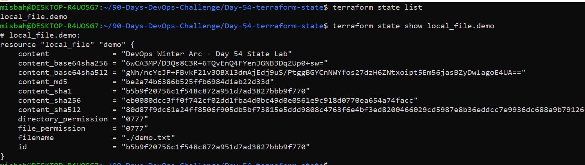
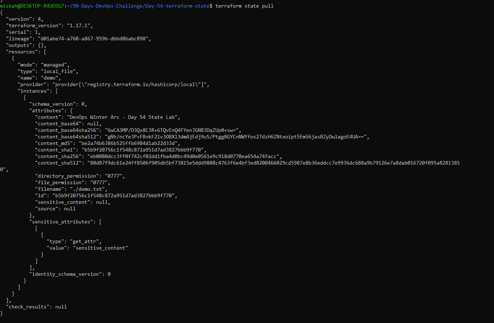

# Day 54: Terraform State & Backend

## Objective
Understand how Terraform tracks infrastructure using state files, inspect state safely using CLI commands, compare local and remote backends, and learn state locking, backup, and security best practices using local resources only.

---

## 1. Practical Lab Summary
1. Created a local-provider Terraform configuration (`main.tf`) to generate a local file (`demo.txt`).
2. Ran `terraform init`, `terraform plan`, and `terraform apply` to generate the `terraform.tfstate` file.
3. Created a safe manual backup (`terraform.tfstate.backup_safe`) before running inspection commands.
4. Inspected tracked resources using `terraform state list`, `terraform state show local_file.demo`, and `terraform state pull`.
5. Destroyed the local lab resource using `terraform destroy` and configured `.gitignore` so no state or backup files are committed to GitHub.

---

## 2. Verification Screenshots

### 1. State List and State Show

### 2. Terraform State Pull

---

## 3. Core Concepts & Notes

### What is Terraform State and Why Does It Matter?
* **Definition:** Terraform state (`terraform.tfstate`) is a JSON-formatted metadata file that maps your `.tf` configuration code to real-world deployed infrastructure resources.
* **Why It Matters:** It allows Terraform to know which resources already exist, track resource dependencies, detect configuration drift, and calculate exact additions, updates, or deletions during `terraform plan`.
* **Impact of Loss or Manual Edits:** If the state file is lost, Terraform loses track of existing resources and may attempt to create duplicates or fail. Manually editing `terraform.tfstate` can corrupt the JSON schema or metadata, breaking future deployments.

### Local Backend vs. Remote Backend
| Feature | Local Backend | Remote Backend |
| :--- | :--- | :--- |
| **Storage Location** | Stored locally on the user's machine (`terraform.tfstate`). | Stored in a shared remote service (e.g., AWS S3, Terraform Cloud). |
| **Team Collaboration** | Not suitable for teams; leads to version conflicts. | Ideal for teams; everyone accesses a single source of truth. |
| **State Locking** | Not supported. | Supported (e.g., S3 with DynamoDB, Azure Blob, GCS). |
| **Security & Backups** | Depends on local disk security; manual backups needed. | Built-in encryption at rest, versioning/backups, and IAM access control. |

### Reference Example: AWS S3 Backend (Study Only — Not Applied)
    terraform {
      backend "s3" {
        bucket = "EXISTING-BUCKET-NAME"
        key    = "day54/terraform.tfstate"
        region = "ap-south-1"
      }
    }

* **`bucket`:** The name of the existing S3 bucket where the state file is stored.
* **`key`:** The exact folder path and file name inside the S3 bucket (`day54/terraform.tfstate`).
* **`region`:** The AWS region where the S3 bucket is hosted (`ap-south-1` / Mumbai).
* **Migration Note:** Any change to the backend block requires re-running `terraform init` to migrate state safely.

### State Locking, Backup, and Access Control
* **State Locking:** Prevents two team members from running `terraform apply` at the exact same time, avoiding race conditions and state file corruption.
* **Backups:** Remote backends like S3 use bucket versioning to automatically keep previous versions of the state file for disaster recovery.
* **Access Control & Encryption:** Because state files can store sensitive values (like database passwords or keys) in plain text, remote backends must enforce encryption at rest, encryption in transit, and strict IAM access restrictions.

### `terraform state mv` vs `terraform state rm`
* **`terraform state mv`:** Renames a resource or moves it into/out of a module inside the state file without destroying and recreating the actual infrastructure. *(Use case: Refactoring code or moving a resource into a module)*.
* **`terraform state rm`:** Removes a resource from Terraform's state tracking without deleting the actual resource in the cloud/system. *(Use case: Importing a resource into another state or detaching legacy resources from Terraform management)*.

---

## 4. Interview Questions & Answers

1. **What is Terraform state?**
   A JSON file (`terraform.tfstate`) used by Terraform to store the current state and metadata of managed infrastructure mapped to your configuration files.
2. **Why does Terraform maintain a state file?**
   To track resource IDs, manage dependencies, improve performance on large infrastructures, and determine what changes need to be applied.
3. **What is a backend?**
   A backend defines where Terraform stores its state snapshots and how operations like state locking are executed.
4. **Local backend vs. remote backend?**
   A local backend saves `terraform.tfstate` on your local disk, whereas a remote backend stores it in a centralized, encrypted, and lock-capable remote location like AWS S3 for team collaboration.
5. **What is state locking?**
   A mechanism that locks the state file during write operations (`apply`, `destroy`) so concurrent runs do not corrupt the state.
6. **Why must state files be protected?**
   State files often contain sensitive credentials and secrets in plain text, so they must be encrypted, access-restricted, and never committed to GitHub.
7. **What do `terraform state mv` and `terraform state rm` do?**
   `state mv` renames/relocates a resource address in state without recreating it, while `state rm` stops Terraform from tracking a resource without destroying the real resource.
8. **What does `terraform state pull` do?**
   It downloads the current state from the configured backend and prints the raw JSON to standard output (`stdout`) for safe inspection or backup.

---

## 5. Safety Rules Followed
* Never edited `terraform.tfstate` manually.
* Created a local backup before running state commands.
* Added `*.tfstate`, `*.tfstate.*`, `.terraform/`, and `*.tfvars` to `.gitignore` so no sensitive state files are uploaded to GitHub.
* Ran `terraform destroy` after capturing screenshots to clean up lab resources.
