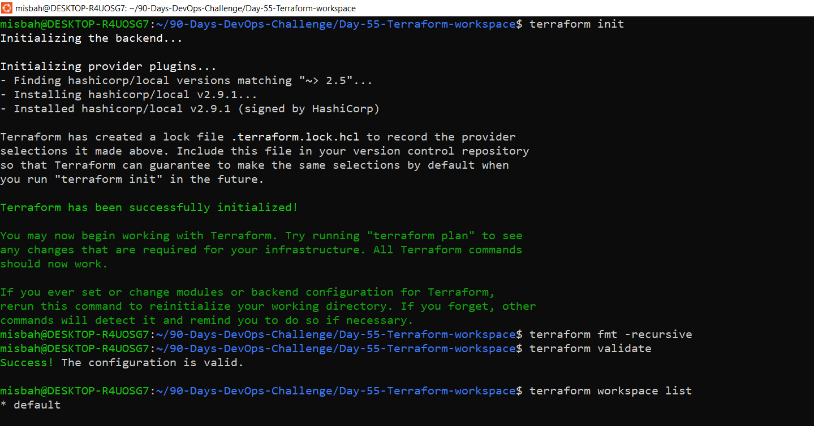
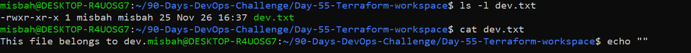
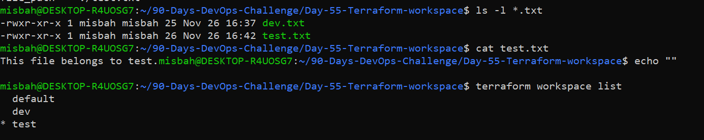
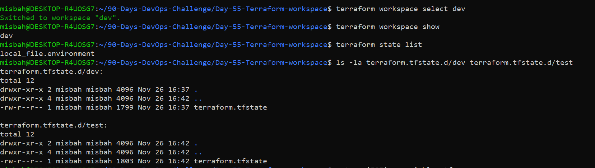
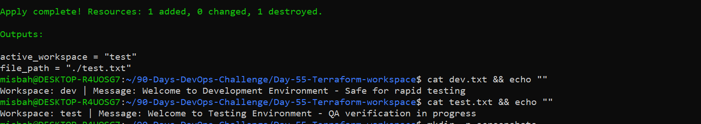
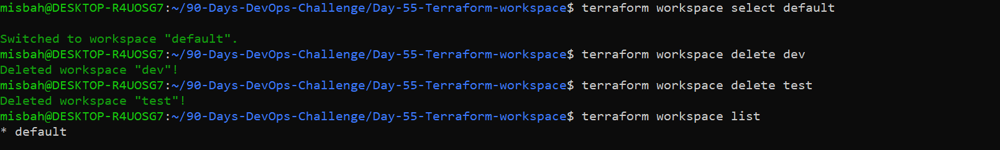

# Day 55: Terraform Workspaces & Environments

## Objective
Learn how Terraform workspaces maintain separate state instances for a single configuration, practice creating and switching between named workspaces (`dev` and `test`), and implement workspace-aware resource naming and variable injection using local files.

---

## Architecture & State Separation Diagram

    +-----------------------------------+
    |   Single Terraform Configuration  |
    |  (main.tf, variables.tf, outputs) |
    +-----------------+-----------------+
                      |
         +------------+------------+
         |                         |
         v                         v
+-------------------+     +-------------------+
| Workspace: "dev"  |     | Workspace: "test" |
|  (dev.tfvars)     |     |  (test.tfvars)    |
+---------+---------+     +---------+---------+
          |                         |
          v                         v
+-------------------+     +-------------------+
| Isolated State:   |     | Isolated State:   |
| terraform.tfstate |     | terraform.tfstate |
| .d/dev/           |     | .d/test/          |
+---------+---------+     +---------+---------+
          |                         |
          v                         v
+-------------------+     +-------------------+
| Output Resource:  |     | Output Resource:  |
|     dev.txt       |     |     test.txt      |
+-------------------+     +-------------------+

---

## Configuration Files Used

### 1. `main.tf`
    terraform {
      required_providers {
        local = {
          source  = "hashicorp/local"
          version = "~> 2.5"
        }
      }
    }

    resource "local_file" "environment" {
      filename = "${path.module}/${terraform.workspace}.txt"
      content  = "Workspace: ${terraform.workspace} | Message: ${var.env_message}"
    }

### 2. `variables.tf`
    variable "env_message" {
      description = "Environment-specific custom message"
      type        = string
      default     = "Default environment message"
    }

### 3. `outputs.tf`
    output "active_workspace" {
      value = terraform.workspace
    }

    output "file_path" {
      value = local_file.environment.filename
    }

### 4. `dev.tfvars` & `test.tfvars`
    # dev.tfvars
    env_message = "Welcome to Development Environment - Safe for rapid testing"

    # test.tfvars
    env_message = "Welcome to Testing Environment - QA verification in progress"

---

## Step-by-Step Execution & Screenshots

### Step 1: Initialize, Format & Validate
Commands executed:
- `terraform init`
- `terraform fmt -recursive`
- `terraform validate`
- `terraform workspace list`

### Step 2: Create & Apply `dev` Workspace
Commands executed:
- `terraform workspace new dev`
- `terraform workspace show`
- `terraform plan`
- `terraform apply -auto-approve`

### Step 3: Create & Apply `test` Workspace
Commands executed:
- `terraform workspace new test`
- `terraform workspace show`
- `terraform plan`
- `terraform apply -auto-approve`
- `terraform workspace list`

### Step 4: Switch Workspace & Verify State Separation
Commands executed:
- `terraform workspace select dev`
- `terraform workspace show`
- `ls -la terraform.tfstate.d/dev terraform.tfstate.d/test`

### Step 5: Environment Challenge (`.tfvars` Injection)
Commands executed:
- `terraform workspace select dev && terraform apply -var-file="dev.tfvars" -auto-approve`
- `terraform workspace select test && terraform apply -var-file="test.tfvars" -auto-approve`
- `cat dev.txt && cat test.txt`

### Step 6: Safe Cleanup & Workspace Deletion
Commands executed:
- `terraform workspace select dev && terraform destroy -var-file="dev.tfvars" -auto-approve`
- `terraform workspace select test && terraform destroy -var-file="test.tfvars" -auto-approve`
- `terraform workspace select default`
- `terraform workspace delete dev && terraform workspace delete test`
- `terraform workspace list`

---

## Submission Checklist & Key Concepts

### 1. How Workspace State is Separated
- By default, Terraform uses a workspace named `default` and stores its state in `terraform.tfstate`.
- When named workspaces (`dev`, `test`) are created, Terraform creates a `terraform.tfstate.d/` directory with a dedicated subdirectory for each workspace (`terraform.tfstate.d/dev/terraform.tfstate` and `terraform.tfstate.d/test/terraform.tfstate`).
- Switching workspaces changes which state file Terraform reads and updates, allowing the exact same `.tf` configuration to manage independent resource lifecycles without overwriting each other.

### 2. Workspaces vs. Separate Environment Directories
| Feature | Terraform Workspaces | Separate Directories (`dev/`, `prod/`) |
| :--- | :--- | :--- |
| **Code Structure** | Single shared set of `.tf` files | Separate `.tf` configurations per environment |
| **Best Use Case** | Identical infrastructure with minor variable differences | Environments that differ in architecture, versions, or scaling |
| **State Isolation** | Separate state files under the same backend | Completely separate backends and state paths |
| **Blast Radius** | Shared code changes affect all workspaces when applied | Changes are isolated to one directory at a time |

### 3. Why Workspaces Alone Are Not Enough for Production
- **No Separate Credentials or IAM Isolation:** All workspaces share the same backend configuration and authentication context; anyone with backend access can switch to `prod` and modify resources.
- **Shared Configuration Risk:** A syntax error or breaking change in `main.tf` impacts every workspace using that configuration.
- **Production Best Practice:** Production requires separate AWS accounts, distinct IAM roles, isolated remote state backends (separate S3 buckets/DynamoDB locks), and dedicated directory structures.

---

## Interview Questions & Quick Reference

1. **What is a Terraform workspace?**
   A named container for a separate state file associated with the same Terraform configuration, allowing multiple instances of the same infrastructure to coexist.

2. **What is the default workspace?**
   Every initialized Terraform configuration starts in a built-in workspace named `default`, which cannot be deleted.

3. **How do you create and switch workspaces?**
   - Create & switch: `terraform workspace new <name>`
   - Switch existing: `terraform workspace select <name>`
   - List all: `terraform workspace list`
   - Delete empty workspace: `terraform workspace delete <name>`

4. **What does `terraform.workspace` return?**
   It is a built-in interpolation expression that returns the name of the currently active workspace as a string (e.g., `"dev"` or `"test"`).

5. **Does each workspace have its own state?**
   Yes, each workspace tracks its own resources in an isolated state file.

6. **Are workspaces a complete security boundary?**
   No. They do not enforce separate credentials, RBAC permissions, or backend isolation.

7. **When would you use separate directories instead?**
   When environments have different resource architectures, require strict access controls/separate cloud accounts, or need independent Terraform provider/module versions.
