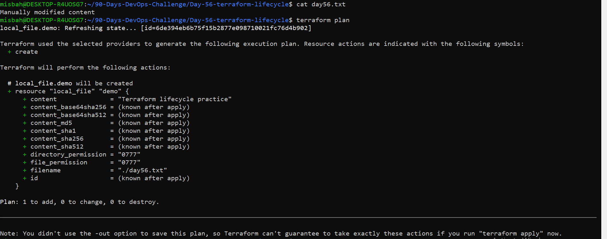
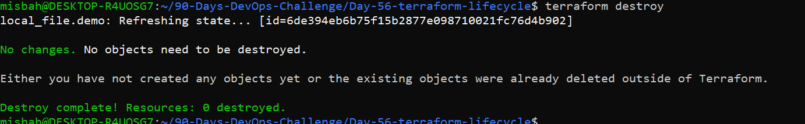
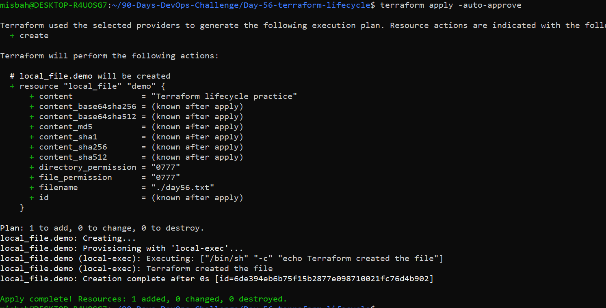

# Day 56: Terraform Lifecycle & Provisioners

## Objective
Understand how Terraform manages resource creation, updates, replacement, and deletion using `lifecycle` meta-arguments (`create_before_destroy`, `prevent_destroy`, `ignore_changes`) and explore how `local-exec` and `remote-exec` provisioners work using local resources with zero cloud cost.

---

## Project Structure
```text
Day-56-terraform-lifecycle/
├── main.tf
├── README.md
└── screenshot/
    ├── 01_experiment_A_ignore_changes_plan.png
    ├── 02_experiment_B_prevent_destroy_error.png
    └── 03_provisioner_local_exec_output.png
```

---

## Configuration (`main.tf`)
```hcl
terraform {
  required_providers {
    local = {
      source  = "hashicorp/local"
      version = "~> 2.5"
    }
  }
}

resource "local_file" "demo" {
  filename = "${path.module}/day56.txt"
  content  = "Terraform lifecycle practice"

  lifecycle {
    create_before_destroy = true
    ignore_changes        = [content]
  }

  provisioner "local-exec" {
    command = "echo Terraform created the file"
  }
}
```

---

## Practical Experiments & Outputs

### Experiment A: Testing `ignore_changes`
1. Applied the initial configuration using `terraform init` and `terraform apply -auto-approve` to create `day56.txt`.
2. Manually modified the file content outside Terraform (`echo "Manually modified content" > day56.txt`).
3. Executed `terraform plan`. Because `ignore_changes = [content]` is configured, Terraform ignored the manual drift in `content` and reported **No changes**.



---

### Experiment B: Testing `prevent_destroy`
1. Added `prevent_destroy = true` inside the `lifecycle` block of `local_file.demo`.
2. Executed `terraform destroy`. Terraform blocked deletion and returned `Error: Instance cannot be destroyed` to protect the resource from accidental removal.
3. Removed `prevent_destroy = true` afterward to allow proper lab cleanup.



---

### Experiment C: When `create_before_destroy` Helps vs. Fails
* **When it helps:** When replacing a resource that has immutable attributes (such as an EC2 instance AMI change, Launch Template, or Security Group), `create_before_destroy = true` provisions the replacement resource first before destroying the old one, minimizing service downtime.
* **When it fails:** It fails when the old and new resources cannot coexist simultaneously due to unique naming constraints, fixed IP addresses, exclusive port bindings, or single-instance locks (for example, an S3 bucket or IAM role with a hardcoded static name).

---

### Provisioner Demo (`local-exec`)
Added a `local-exec` provisioner inside `local_file.demo` and ran `terraform apply`. Terraform executed the shell command locally on the machine running Terraform right after creating `day56.txt`.



---

## Theory & Submission Checklist

### 1. Lifecycle Meta-Arguments Explained
* **`create_before_destroy`:** Reverses Terraform's default replacement order (`destroy` then `create`) by creating the new replacement resource first and deleting the old one only after the new resource is ready.
* **`prevent_destroy`:** Acts as a safety guardrail that causes Terraform to exit with an error if any plan attempts to destroy the resource. It prevents accidental deletion in Terraform runs, though it is not a replacement for backups.
* **`ignore_changes`:** Instructs Terraform to ignore updates to specific attributes (or `all`) when comparing real-world state against configuration. Useful for fields managed externally (like tags or autoscaling counts), though excessive use can hide configuration drift.

### 2. `local-exec` vs. `remote-exec`
| Feature | `local-exec` | `remote-exec` |
| :--- | :--- | :--- |
| **Execution Location** | Runs locally on the machine executing Terraform (laptop/CI runner). | Runs directly on the newly provisioned remote resource (e.g., EC2 VM). |
| **Network & Auth Needs** | Requires no SSH/WinRM credentials or remote network reachability. | Requires a reachable IP/DNS, open firewall port, and a `connection` block (SSH/WinRM). |
| **Common Use Case** | Updating local inventory files, triggering local scripts, or sending webhook notifications. | Running inline shell commands or bootstrap scripts on a remote server. |

* **Why `remote-exec` needs a reachable machine & connection details:** Because Terraform connects over the network from the runner to the target instance after creation to execute commands inside that OS, it requires valid transport protocol settings (`ssh` or `winrm`), authentication keys/passwords, and network connectivity.

### 3. Safer Alternatives to Provisioners
Provisioners are a last resort in Terraform because they break declarative state tracking, lack built-in idempotency, and make runs less predictable. Prefer:
1. **`cloud-init` / EC2 `user_data`:** Bootstraps instances natively on first boot without requiring Terraform to maintain an active SSH connection.
2. **Configuration Management Tools (Ansible, Chef, Puppet):** Provides idempotent, repeatable post-provisioning OS and application configuration.
3. **Immutable Golden Images (Packer):** Pre-bakes dependencies, packages, and configurations into AMIs/images before deployment.
4. **Native Provider Resources:** Using official Terraform provider resources (e.g., `aws_ssm_document`, `helm_release`, `kubernetes_manifest`) instead of shell scripts.

---

## Interview Questions & Answers

1. **What is the Terraform resource lifecycle?**  
   It is the sequence of states a resource goes through under Terraform management: **Create** (new resource), **Update** (in-place modification), **Replace** (destroy and recreate when an immutable attribute changes), and **Destroy** (removal).
2. **What does `create_before_destroy` do?**  
   During resource replacement, it creates the replacement object before destroying the existing one, reducing downtime when both instances can exist side by side.
3. **When is `prevent_destroy` useful?**  
   It is useful for critical stateful resources—such as production databases (`aws_db_instance`), storage buckets (`aws_s3_bucket`), or core VPCs—where accidental deletion would cause severe data loss or outage.
4. **What is the risk of `ignore_changes`?**  
   It masks configuration drift. Manual or external changes made outside Terraform will remain undocumented in HCL, making infrastructure harder to reproduce accurately from scratch.
5. **What is a provisioner?**  
   A block inside a Terraform resource used to execute scripts or commands on a local or remote machine as part of resource creation (`when = create`) or destruction (`when = destroy`).
6. **`local-exec` vs. `remote-exec`?**  
   `local-exec` runs commands on the machine running Terraform; `remote-exec` runs commands inside the remote target resource over SSH or WinRM.
7. **Why should provisioners generally be avoided?**  
   Terraform cannot model the internal state changes made by arbitrary shell scripts. If a provisioner fails mid-run, Terraform marks the resource as **tainted** (scheduled for replacement on the next apply), reducing reliability.

---

## Cleanup
Removed `prevent_destroy = true` and executed `terraform destroy -auto-approve` to remove `day56.txt` and leave a clean workspace with zero lingering resources.
