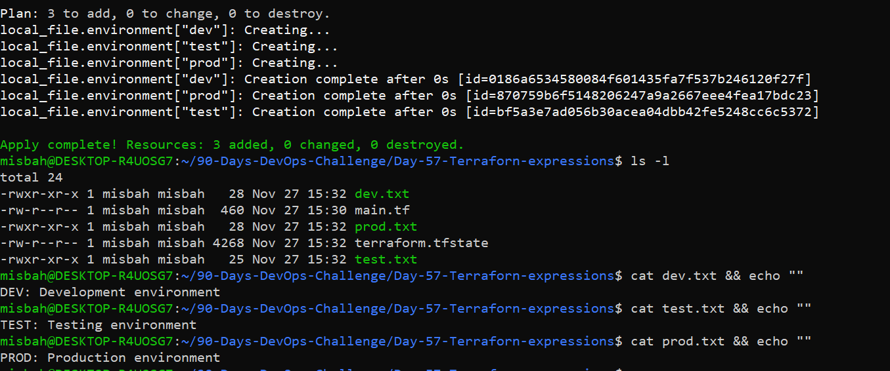
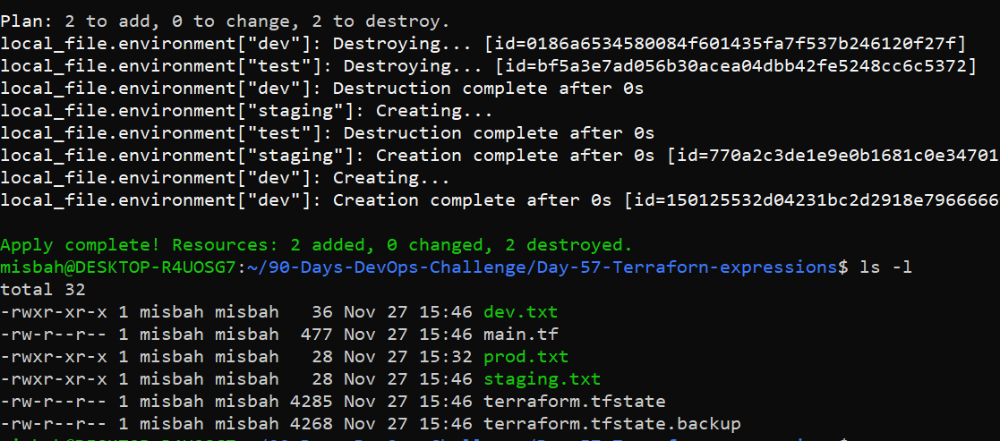
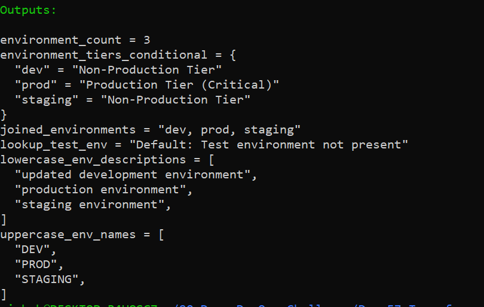
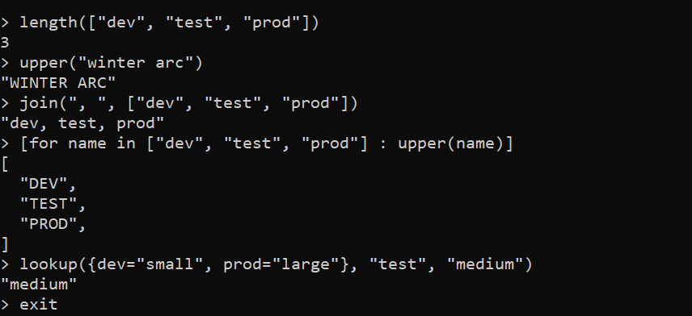

# Day 57: Terraform Functions & Expressions (Flexible Terraform Configurations)

## Objective
Practise Terraform built-in functions, expressions, conditional logic, `for` expressions, `count`, `for_each`, and `dynamic` blocks using a local-only lab with the `hashicorp/local` provider (zero AWS resources or cloud charges)[cite: 1, 2].

---

## Project Structure
```text
Day-57-Terraforn-expressions/
├── main.tf
├── outputs.tf
├── dynamic-block-example.tf.example
├── .gitignore
├── README.md
└── screenshots/
    ├── 01-apply-generated-files.png
    ├── 02-map-update-create-destroy.png
    ├── 03-terraform-outputs-expressions.png
    └── 04-terraform-console-practice.png
```

---

## 1. Practical Lab: Generating Environment Files (`for_each`)
Using `for_each` over a `map(string)` variable (`dev`, `test`, `prod`), Terraform dynamically creates local text files (`dev.txt`, `test.txt`, `prod.txt`) and formats their contents using `upper()` and string interpolation[cite: 1, 2].

### Commands Executed
```bash
terraform init
terraform fmt -recursive
terraform validate
terraform plan
terraform apply -auto-approve
```

### Generated Output Verification
* `dev.txt` -> `DEV: Development environment`[cite: 3]
* `test.txt` -> `TEST: Testing environment`[cite: 3]
* `prod.txt` -> `PROD: Production environment`[cite: 3]



---

## 2. State Behavior on Map Modification (Create, Update, Remove)
After modifying the `environments` map (`dev` description updated, `test` removed, and `staging` added), running `terraform apply` demonstrated key-based state tracking with `for_each`[cite: 2]:
* **Created:** `staging.txt` (`local_file.environment["staging"]` created)
* **Updated (Replaced):** `dev.txt` (`local_file.environment["dev"]` updated with `"UPDATED DEV: Updated Development environment"`)
* **Removed:** `test.txt` (`local_file.environment["test"]` destroyed)
* **Unchanged:** `prod.txt` (`local_file.environment["prod"]` remained untouched)



---

## 3. Terraform Expression Exercises (`outputs.tf`)
Implemented built-in functions, a conditional expression, and `for` expressions inside `outputs.tf`[cite: 1]:
* **`length()`:** Counted total active environments (`3`)[cite: 1, 5].
* **`for` expression with `upper()` & `lower()`:** Converted environment keys to uppercase (`["DEV", "PROD", "STAGING"]`) and descriptions to lowercase (`["updated development environment", "production environment", "staging environment"]`)[cite: 1, 5].
* **`join()`:** Combined environment keys into a single comma-separated string (`"dev, prod, staging"`)[cite: 1, 5].
* **Conditional Expression (`condition ? true_val : false_val`):** Classified `prod` as `"Production Tier (Critical)"` and all other environments as `"Non-Production Tier"`[cite: 1, 5].
* **`lookup()`:** Safely queried `"test"` from `var.environments` and returned the fallback default `"Default: Test environment not present"`[cite: 1, 5].



---

## 4. Terraform Console Practice
Tested expressions interactively using `terraform console`[cite: 1]:

| Expression | Output | Purpose |
| :--- | :--- | :--- |
| `length(["dev", "test", "prod"])` | `3` | Returns number of elements in a list[cite: 1] |
| `upper("winter arc")` | `"WINTER ARC"` | Converts string characters to uppercase[cite: 1] |
| `join(", ", ["dev", "test", "prod"])` | `"dev, test, prod"` | Joins list elements using a delimiter[cite: 1] |
| `[for name in ["dev", "test", "prod"] : upper(name)]` | `["DEV", "TEST", "PROD"]` | Transforms each list element into uppercase[cite: 1] |
| `lookup({dev="small", prod="large"}, "test", "medium")` | `"medium"` | Retrieves map value by key or returns default[cite: 1] |



---

## 5. Key Comparisons

### `count` vs `for_each`
| Feature | `count` | `for_each` |
| :--- | :--- | :--- |
| **Input Type** | Whole number (`number`) | Map (`map`) or Set of strings (`set(string)`) |
| **Resource Addressing** | Index-based (`resource.name[0]`, `[1]`) | Key-based (`resource.name["dev"]`, `["prod"]`) |
| **Removal Impact** | Removing an item from the middle shifts indices and recreates subsequent resources | Removing a key destroys only that specific resource without affecting others |
| **Best Use Case** | Creating identical copies of a resource | Creating distinct resources with unique configurations per key |

### `dynamic` Block vs Resource `for_each`
| Feature | `dynamic` Block | Resource `for_each` |
| :--- | :--- | :--- |
| **Scope** | Inside a single resource to generate repeated **nested blocks** (e.g., `ingress` rules)[cite: 1] | At the top level of a `resource` or `module` to create **multiple separate resources**[cite: 1] |
| **Iterator Variable** | Uses the block label name by default (e.g., `ingress.key`, `ingress.value`) | Uses `each.key` and `each.value` |
| **Use Case** | Repeated sub-blocks within one parent resource (like security group rules or tags)[cite: 1] | Multiple independent infrastructure instances (like multiple EC2s, S3 buckets, or files) |

---

## 6. Dynamic Block Reference Example (`dynamic-block-example.tf.example`)
*(Reference configuration only — no AWS resources provisioned[cite: 1, 2])*

```hcl
variable "ingress_ports" {
  type    = list(number)
  default = [22, 80, 443]
}

resource "aws_security_group" "web_sg" {
  name        = "dynamic-web-sg"
  description = "Security group with dynamic ingress rules"

  dynamic "ingress" {
    for_each = var.ingress_ports
    content {
      description = "Allow port ${ingress.value}"
      from_port   = ingress.value
      to_port     = ingress.value
      protocol    = "tcp"
      cidr_blocks = ["0.0.0.0/0"]
    }
  }
}
```

---

## 7. Interview Questions & Answers

1. **What is a Terraform expression?**
   An expression in Terraform is any construct that evaluates to a value—such as literal values, variable references, resource attributes, arithmetic/comparison operations, conditionals, or function calls[cite: 1].

2. **Name five built-in functions in Terraform.**
   `length()`, `upper()`, `lower()`, `join()`, and `lookup()` (other common functions include `split()`, `replace()`, `format()`, `file()`, `try()`, and `coalesce()`)[cite: 1].

3. **What is a conditional expression?**
   A ternary expression (`condition ? true_val : false_val`) that chooses between two values based on whether a boolean condition evaluates to true or false[cite: 1].

4. **What is a `for` expression?**
   An expression that iterates over a list, set, or map to transform or filter its elements and construct a new list (`[...]`) or map (`{...}`)[cite: 1].

5. **`count` vs `for_each`?**
   `count` creates multiple instances indexed by integers (`0, 1, 2...`), which can cause unintended recreation if items are removed from the middle of a list. `for_each` iterates over a map or set of strings and tracks instances by unique keys (`each.key`), making additions and deletions safe.

6. **What is a dynamic block?**
   A `dynamic` block dynamically generates multiple repeated nested configuration blocks inside a resource or data source by iterating over a collection (`list` or `map`)[cite: 1].

7. **Dynamic block vs resource `for_each`?**
   Resource `for_each` creates multiple separate top-level resources, whereas a `dynamic` block creates multiple nested sub-blocks inside a single resource[cite: 1].

8. **What is `terraform console` used for?**
   `terraform console` provides an interactive command-line shell to evaluate and test Terraform expressions, built-in functions, and state/variable values without modifying infrastructure[cite: 1].

---

## 8. Cleanup & Safety
* Built strictly as a local-only lab using the `local` provider (`₹0` / `$0` cloud cost)[cite: 1, 2].
* Executed `terraform destroy -auto-approve` after verification to remove all generated local files[cite: 2, 7].
* Added `.terraform/` and `*.tfstate*` to `.gitignore` so state files are never committed to GitHub[cite: 2, 7].
