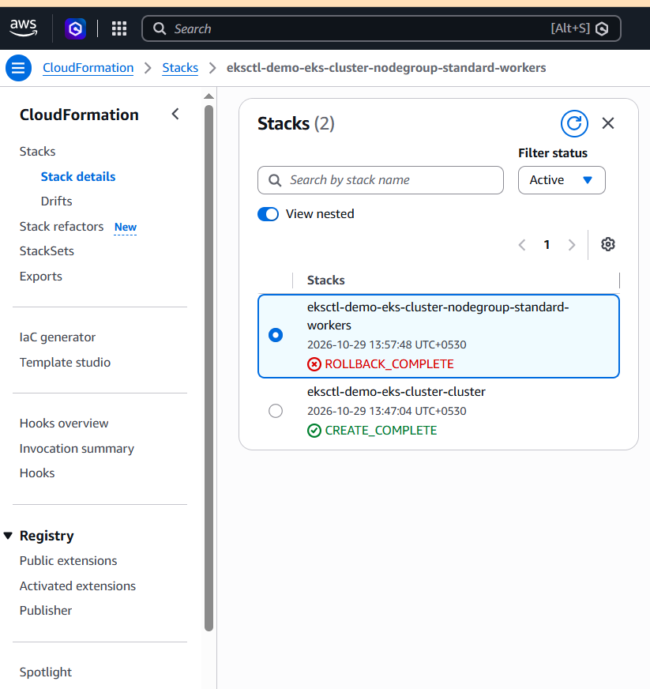
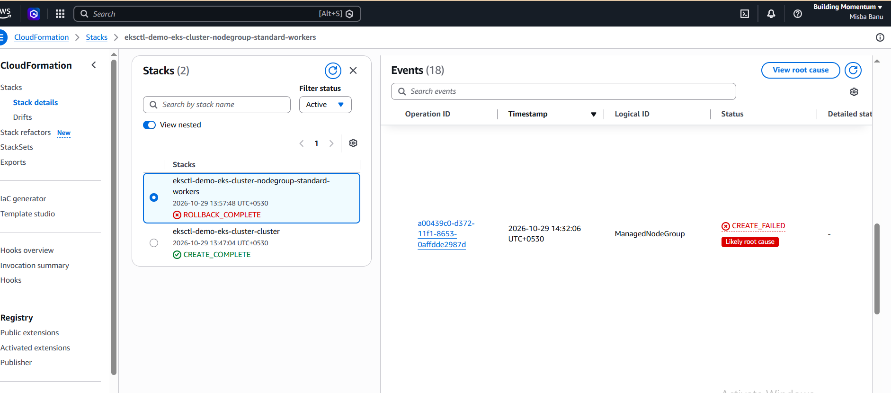
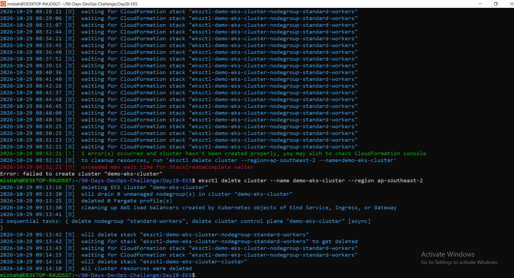
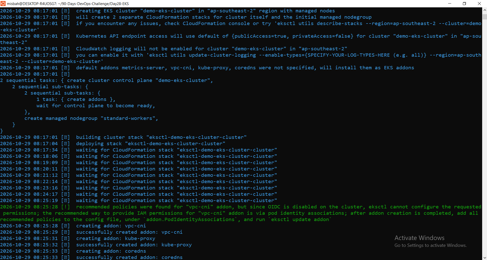

# Day 28/90: Amazon EKS (Elastic Kubernetes Service)

AWS Week, Day 6. Focus: EKS control plane, node groups, Kubernetes Deployment on AWS, troubleshooting, and cleanup.

## Overview
Amazon EKS is a managed Kubernetes service. AWS manages the control plane (API server, etcd, scheduler, controller manager) across multiple AZs. I manage the worker nodes and workloads.

## Architecture

```
You / kubectl
     |
     v
EKS Control Plane (AWS-managed, multi-AZ)
     |
     v
Managed Node Group (EC2 worker nodes)
     |
     v
Pods (nginx-demo x2)
     |
     v
Service (ClusterIP / LoadBalancer) ---> Users
```

- **Control plane:** `kube-apiserver`, `etcd`, `kube-scheduler`, `kube-controller-manager`. AWS handles patching, HA and backups.
- **Data plane:** EC2 nodes running `kubelet`, `kube-proxy` and the AWS VPC CNI (native VPC pod networking).
- **Note:** An *Active* cluster does not mean the app is reachable. Nodes, Pods, Service/LB, routes and security groups must all work.

## Tools
- **AWS CLI v2**: authentication
- **kubectl**: talk to the cluster
- **eksctl**: creates the cluster and node group via CloudFormation

## Manifest (`deployment.yaml`)
2 replicas of Nginx, exposed with a **ClusterIP** Service (no load balancer, to avoid extra cost).

```yaml
apiVersion: apps/v1
kind: Deployment
metadata:
  name: nginx-demo
spec:
  replicas: 2
  selector:
    matchLabels:
      app: nginx-demo
  template:
    metadata:
      labels:
        app: nginx-demo
    spec:
      containers:
      - name: nginx
        image: nginx:stable
        ports:
        - containerPort: 80
---
apiVersion: v1
kind: Service
metadata:
  name: nginx-demo
spec:
  type: ClusterIP
  selector:
    app: nginx-demo
  ports:
  - port: 80
    targetPort: 80
```

## Steps performed

### 1. Create cluster
```bash
eksctl create cluster --name demo-eks-cluster --region ap-southeast-2 \
  --nodegroup-name standard-workers --node-type t3.medium --nodes 2
```
- Cluster (control plane) stack: `CREATE_COMPLETE`
- Node group stack: `CREATE_FAILED` → `ROLLBACK_COMPLETE` (see troubleshooting)

### 2. Deploy (planned flow)
```bash
aws eks update-kubeconfig --region ap-southeast-2 --name demo-eks-cluster
kubectl config current-context
kubectl get nodes
kubectl apply -f deployment.yaml
kubectl get deployments
kubectl get pods -o wide
kubectl get services
```
> Because the node group failed, there were no worker nodes, so the Pods could not be scheduled. The manifest was written and validated as part of the design path.

## Troubleshooting case (real)

| Item | Detail |
|---|---|
| Symptom | Managed node group stack `eksctl-demo-eks-cluster-nodegroup-standard-workers` went to `CREATE_FAILED`, then `ROLLBACK_COMPLETE` |
| Where I looked | CloudFormation → Stack → **Events** tab → failed `ManagedNodeGroup` resource |
| Finding | Control plane and networking were healthy; only worker node provisioning failed |
| Likely cause | EC2 launch blocked: instance type not available/allowed or vCPU quota limit for `t3.medium` in `ap-southeast-2` |
| How to confirm | Read the exact status reason in the stack event; check **Service Quotas → EC2 → Running On-Demand Standard vCPUs**; check whether the account/plan only allows free-tier instance types |
| Fix options | Try another instance type (e.g. `t3.small`/`t3.micro`), another AZ/region, or request a quota increase, then recreate the node group |

## Cleanup (mandatory)
```bash
eksctl delete cluster --name demo-eks-cluster --region ap-southeast-2
```
- CloudFormation stacks reached `DELETE_COMPLETE` (Stacks: 0)
- Checked: no leftover EC2 instances, NAT gateways, Elastic IPs, load balancers or EBS volumes
- Deactivated and deleted temporary IAM access keys (`devops-admin`)
- Billing to be reviewed later (usage can show up after deletion)

> Deleting only the Deployment is not enough. EKS, nodes and load balancers keep costing money.

## Concepts

**IAM access vs IRSA**
- IAM access controls *who* (humans/CI) can access or administer the EKS cluster.
- IRSA (IAM Roles for Service Accounts) gives a *Pod* scoped AWS permissions via a Kubernetes ServiceAccount + IAM role. This follows least privilege: each workload gets only what it needs, instead of putting broad permissions on the node role.

**EBS vs EFS**
- **EBS:** block storage, attached to one node/AZ at a time. Good for databases and single-writer workloads.
- **EFS:** shared file system, many Pods/nodes across AZs. Good for shared content.

**Autoscaling**
- **Pod autoscaling (HPA):** changes the number of Pod replicas.
- **Node autoscaling (Cluster Autoscaler/Karpenter):** changes the number of nodes (compute capacity).
- They solve different problems: more Pods need room on nodes to run.

**AWS Load Balancer Controller**
Creates AWS load balancers (ALB/NLB) from Kubernetes Ingress/Service resources.

## Cost notes
- EKS control plane: about $0.10/hr (check current pricing), plus EC2 nodes, load balancers, NAT gateways, storage and public IPv4 addresses.
- Never leave lab clusters running overnight. Delete right after verification.
- CloudFormation rollback prevents a half-built node group from staying live.

## Key learnings
- `eksctl` creates separate CloudFormation stacks for the cluster and the node group.
- Always read **Stack Events** first when provisioning fails.
- Verify cleanup, not just run the delete command.

## Screenshots

### 1. Troubleshooting case


### 2. Node group error


### 3. Cleanup proof


### 4. Cluster stack CREATE_COMPLETE

